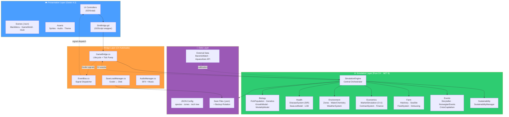

# Architecture Overview Diagram

## Layered Architecture (Simulation ↔ Presentation ↔ Bridge)



## Key Design Principles

| Principle | Implementation |
|-----------|---------------|
| **No Godot in Simulation** | `LakskongenSim` has zero Godot references — fully testable |
| **Signal-Based Decoupling** | SimulationEngine → C# events → Godot signals → UI |
| **Cohort Performance** | Fish grouped by age/genetics, not individual agents |
| **Adaptive LOD** | Disease detail scales with fish count and infection status |
| **Pure C# Testing** | xUnit tests run without Godot — fast CI pipeline |

## Communication Flow

```
GDScript UI ──read──→ SimBridge.gd ──read──→ GameBridge.cs ──read──→ SimulationEngine
                                                                          │
                                                                     AdvanceOneDay()
                                                                          │
SimulationEngine ──C# event──→ GameBridge ──Godot signal──→ EventBus ──signal──→ UI
```
