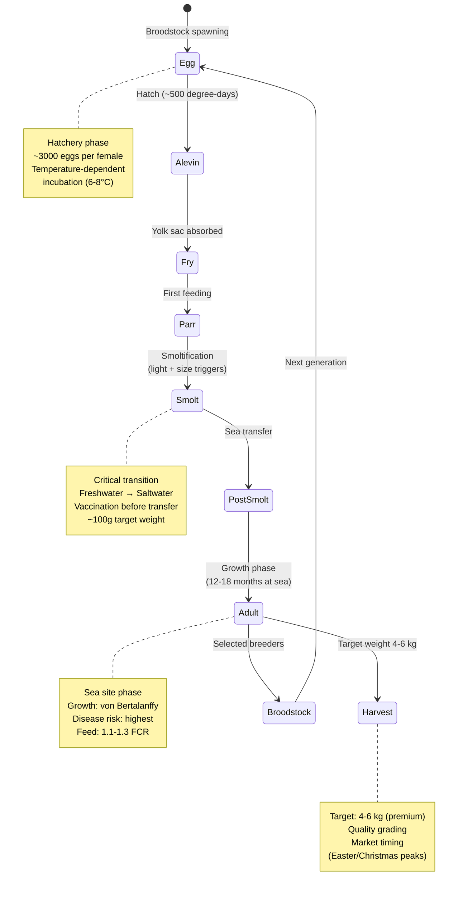
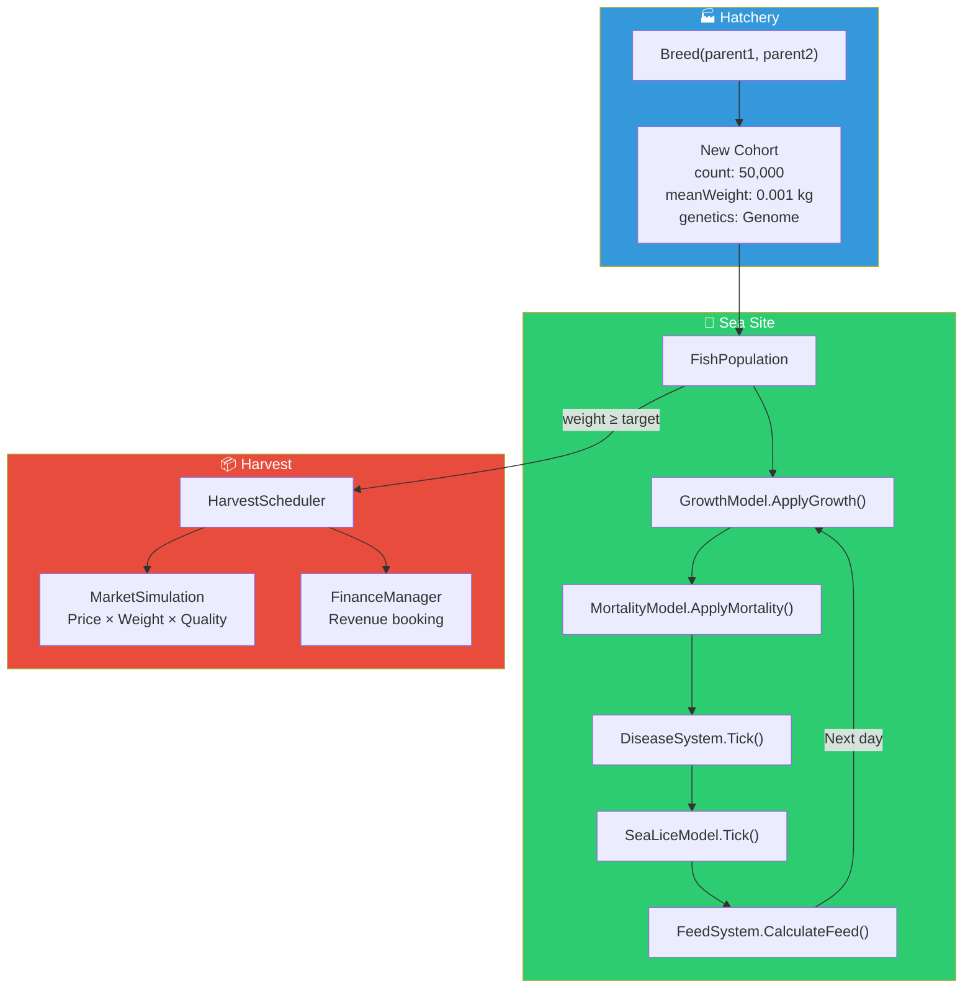

# Biology System Lifecycle

## Salmon Life Cycle: Egg → Harvest



## Cohort-Based Population Model



## Cohort Data Structure

```csharp
public class Cohort
{
    public int Count;              // Fish in this group
    public double MeanWeightKg;    // Average weight
    public double WeightStdDev;    // Weight variance
    public Genome Genetics;        // 8-trait genetic profile
    public LifeStage Stage;        // Current life stage
    public int AgeDays;            // Days since hatch
    public bool IsVaccinated;      // Vaccination status
}
```

## Growth Model (von Bertalanffy)

```
W(t) = W_inf × (1 - e^(-k × t))³

Where:
  W_inf  = asymptotic weight (genetics-dependent, ~8-12 kg)
  k      = growth rate coefficient (genetics × temperature × feed)
  t      = time in degree-days

Temperature modifier:
  If temp in [8°C, 14°C]: optimal growth (1.0×)
  Below 8°C: reduced (-5% per °C)
  Above 14°C: stress-reduced (-3% per °C)

Feed modifier:
  FCR (Feed Conversion Ratio) = feed_kg / weight_gain_kg
  Target FCR: 1.1-1.3 (efficient)
  Poor FCR: > 1.5 (wasteful)
```

## Genetics: 8 Heritable Traits

| Trait | Heritability (h²) | Impact |
|-------|-------------------|--------|
| Growth Rate | 0.30 | Faster weight gain |
| Disease Resistance | 0.15 | Lower infection rate |
| Sea Lice Resistance | 0.20 | Fewer lice attachment |
| Fillet Quality | 0.25 | Higher price premium |
| Feed Conversion | 0.20 | Lower feed costs |
| Stress Tolerance | 0.10 | Lower handling mortality |
| Late Maturation | 0.35 | Delays sexual maturity |
| Cold Tolerance | 0.15 | Better growth in cold water |

### Genetic Correlations (Trade-offs)

```
Growth Rate ←→ Feed Conversion:     +0.6  (fast growers = efficient)
Growth Rate ←→ Disease Resistance:  -0.2  (fast growers = weaker immune)
Growth Rate ←→ Fillet Quality:      -0.1  (slight negative)
Disease Res ←→ Sea Lice Resistance: +0.3  (immune co-benefits)
Stress Tol  ←→ Disease Resistance:  +0.2  (calm fish = healthier)
Late Mature ←→ Growth Rate:         -0.15 (trade-off)
```

> **Player strategy**: You can't maximize everything. Breed for growth and you sacrifice disease resistance. The best breeding programs balance traits for their specific conditions.
