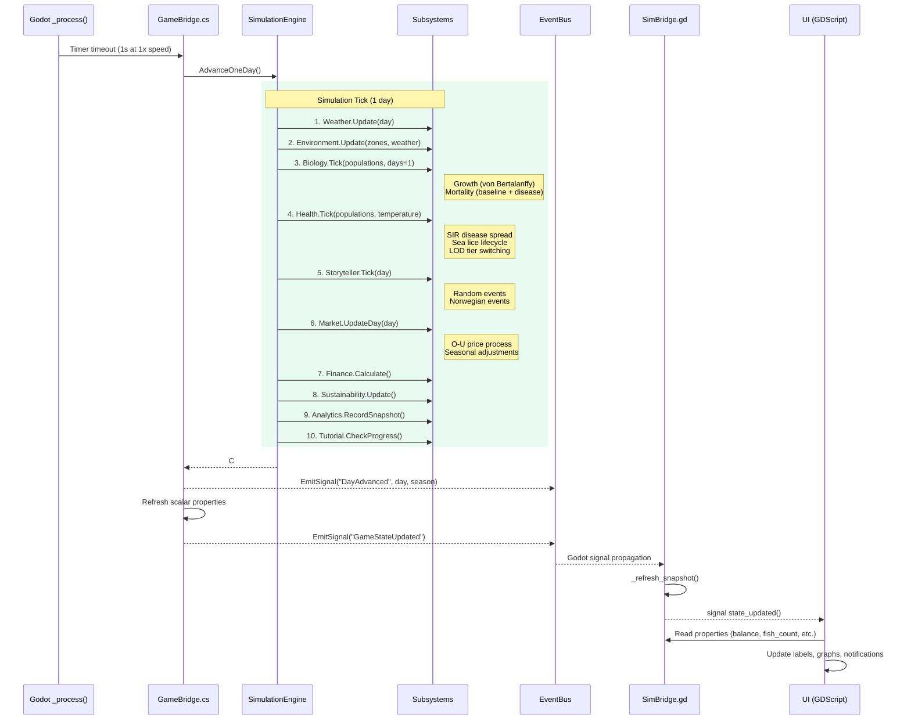
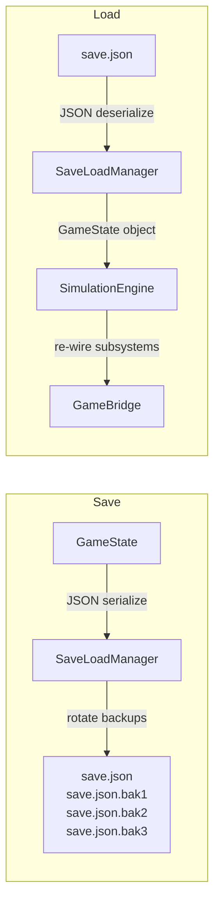

# Data Flow Diagram

## Game Loop: GameState → SimulationEngine → UI



## Save/Load Data Flow



## GameState Serialization Schema

```json
{
  "Day": 905,
  "Balance": 15000000.0,
  "Zones": [ /* Zone objects */ ],
  "SeaSites": [ /* SeaSite objects */ ],
  "Populations": [ /* FishPopulation with Cohort[] */ ],
  "Broodstock": [ /* Genome objects */ ],
  "EventLog": [ /* EventRecord[] */ ],
  "DailySnapshots": [ /* analytics per day */ ],
  "UnlockedResearchIds": ["basic_feed", "vaccination"],
  "ActiveResearchId": "laser_delousing",
  "ResearchProgress": 12,
  "ExportMarkets": ["EU", "USA", "Japan"],
  "SustainabilityScore": 75,
  "SustainabilityCertification": "ASC",
  "UnlockedAchievementIds": ["first_harvest", "millionaire"]
}
```

## Subsystem Update Order

The update order in `SimulationEngine.AdvanceOneDay()` is critical for correctness:

| Order | System | Why This Order |
|-------|--------|---------------|
| 1 | Weather | Drives temperature/conditions for all other systems |
| 2 | Environment | Water chemistry depends on weather |
| 3 | Biology (Growth) | Growth depends on temperature, oxygen, feed |
| 4 | Biology (Mortality) | Must run after growth to avoid dead fish growing |
| 5 | Health (Disease) | SIR model uses current population counts |
| 6 | Health (Sea Lice) | Temperature-dependent lifecycle |
| 7 | Events/Storyteller | Can modify any system (storms, outbreaks) |
| 8 | Market | Price updates independent of biology |
| 9 | Finance | Revenue/expense calculation after all state changes |
| 10 | Sustainability | Weekly aggregate (every 7 days) |
| 11 | Analytics | Snapshot of final daily state |
| 12 | Tutorial | Check completion conditions |
