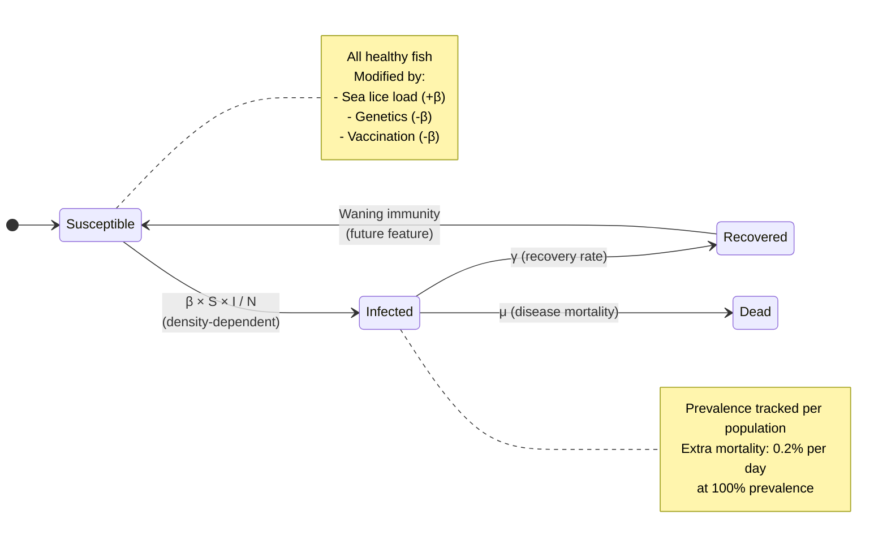
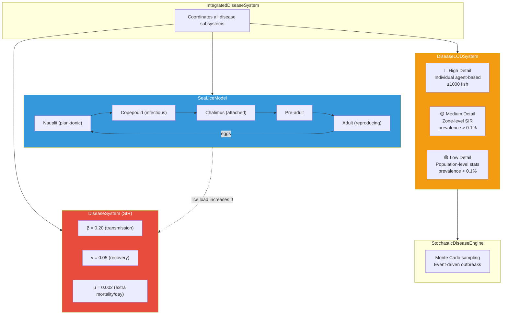
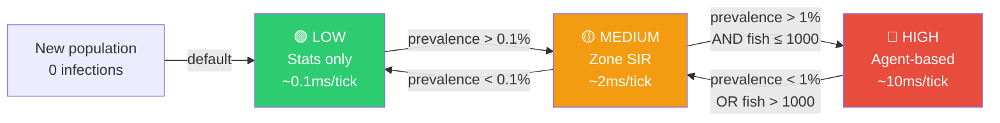

# Disease Propagation System

## SIR Model + LOD Tiers



## Disease System Architecture



## LOD Tier Switching



## SIR Parameters

| Parameter | Symbol | Default | Description |
|-----------|--------|---------|-------------|
| Transmission rate | β | 0.20 | Base daily transmission coefficient |
| Recovery rate | γ | 0.05 | Daily recovery probability |
| Disease mortality | μ | 0.002 | Extra daily mortality at 100% prevalence |
| Lice susceptibility | - | 0.02 | β multiplier per lice/fish |
| Treatment temp sensitivity | - | -0.01 | Efficacy drop per °C above 10°C |

## Diseases Modeled

| Disease | Type | Transmission | Severity |
|---------|------|-------------|----------|
| **IPN** | Viral | Vertical + horizontal | High mortality in fry |
| **ISA** | Viral | Waterborne | Catastrophic (mandatory cull) |
| **Furunculosis** | Bacterial | Direct contact | Treatable with antibiotics |
| **Sea Lice** | Parasite | Environmental drift | Chronic welfare + regulatory |

## Interaction: Sea Lice → Disease

```
High lice load (>0.5 lice/fish)
    → Skin lesions → Open wounds
    → β_effective = β × (1 + lice_count × 0.02)
    → Increased disease susceptibility
    → Treatment decision:
        Chemical (delousing bath)
        Mechanical (warm water flush)
        Biological (cleaner fish)
        Each has cost, efficacy, resistance risk
```

## Mortality Prevention: Rate Injection Pattern

To prevent double-counting disease mortality:

```
DiseaseSystem.Tick()
    ├── Calculates extra mortality rate from infection
    ├── Injects rate into MortalityModel (NOT direct fish removal)
    └── MortalityModel.ApplyMortality() applies total mortality once

This ensures:
  Total mortality = baseline_rate + disease_rate + stress_rate
  Applied ONCE per tick, not per disease subsystem
```
