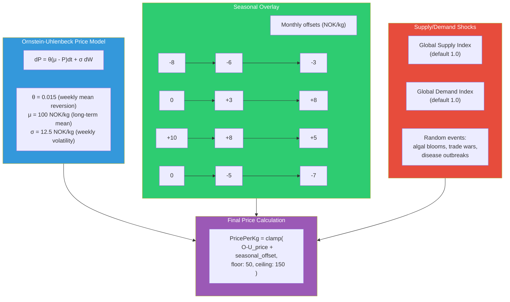
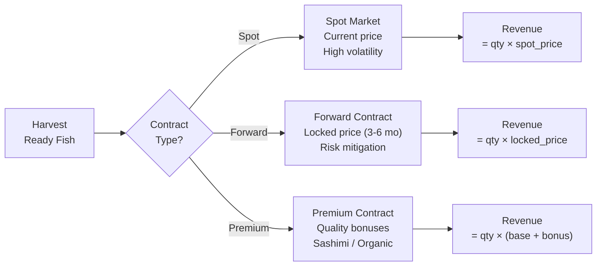

# Market Pricing System

## Ornstein-Uhlenbeck Mean-Reversion Process



## Price Dynamics Over Time

```
Price (NOK/kg)
150 ┤                                          ╭─╮
    │                                         ╭╯ ╰╮
130 ┤                              ╭─╮       ╭╯   │
    │                             ╭╯ ╰╮     ╭╯    ╰╮
110 ┤          ╭──╮              ╭╯   ╰╮   ╭╯      │
    │    ╭────╯  ╰╮    ╭──╮    ╭╯     ╰──╯        ╰╮
100 ┤───╯         ╰───╯  ╰───╯  ← long-term mean    ╰──
    │                                                    
 80 ┤  ╭╮                                               
    │ ╭╯╰╮                                              
 60 ┤╭╯  ╰╮                                             
    │╯    ╰╮                                             
 50 ┤      ╰─                                           
    ├──────┬──────┬──────┬──────┬──────┬──────┬─────→
    Jan    Mar    May    Jul    Sep    Nov    Jan
         ← winter dip →     ← summer peak →
```

## O-U Process: Mathematical Detail

### Continuous Form
```
dP(t) = θ (μ - P(t)) dt + σ dW(t)

Where:
  P(t) = price at time t
  θ    = mean reversion speed (how fast price returns to μ)
  μ    = long-term equilibrium price
  σ    = volatility (price noise amplitude)
  W(t) = Wiener process (standard Brownian motion)
```

### Discrete Implementation (Weekly Updates)
```csharp
// Every 7 simulation days:
decimal drift = MeanReversionSpeedWeekly * (LongTermMean - BasePricePerKg);
decimal noise = VolatilityWeekly * (decimal)NormalRandom(0, 1);
BasePricePerKg += drift + noise;
BasePricePerKg = Math.Clamp(BasePricePerKg, PriceFloor, PriceCeiling);

// Daily price = base + seasonal offset
int month = (day % 365) / 30;  // approximate
PricePerKg = BasePricePerKg + MonthlySeasonalOffsets[month];
```

## Calibrated Parameters

| Parameter | Value | Source |
|-----------|-------|--------|
| Initial Price | 100 NOK/kg | 2024-2026 Norwegian average |
| Long-Term Mean (μ) | 100 NOK/kg | Historical anchor |
| Price Floor | 50 NOK/kg | Realistic market minimum |
| Price Ceiling | 150 NOK/kg | Realistic market maximum |
| Weekly θ (min) | 0.01 | Annual κ ≈ 0.5 (slow reversion) |
| Weekly θ (max) | 0.02 | Annual κ ≈ 1.0 (fast reversion) |
| Weekly σ (min) | 10 NOK/kg | Low volatility regime |
| Weekly σ (max) | 15 NOK/kg | High volatility regime |

## Revenue Calculation

```
Revenue = Σ (harvested_kg × quality_grade_price)

quality_grade_price = PricePerKg
    × size_premium    (4-6 kg = 1.0×, outside = 0.8-0.9×)
    × quality_bonus   (fillet quality genetics)
    × contract_rate   (spot vs. forward vs. premium)
    × certification   (ASC organic = +10-15%)
```

## Contract System



## Historical Price Calibration

The market system can load real Norwegian salmon price data from `research/real-salmon-prices.md` to calibrate the O-U parameters at startup, ensuring simulated prices match real-world dynamics.
