# A2-01 / G1-07 evidence: hero pen and site kit against the reference

Roadmap items G1-07 (placeholder quick fixes) and A2-01 (hero pen and site
kit). Branch `wave1/art-1`. Frames are 960 px downscales in `a2_01/`.

## Reference

AKVA group, "AKVA Polarcirkel 500RS" product page,
<https://www.akvagroup.com/plastic-pens/akva-polarcirkel-500rs>, retrieved
2026-10-14 (specification table only; no reference photos are copied into
the repository). Roadmap A2-01 adds the bird-net pole, net, sinker-tube,
mooring-frame, buoy, corner-light and lice-skirt spec.

## Specification against the built model

Measured by `blender/build_pen.py` into `pen_cage_LOD0.json`; checked by
`tests/test_pen_asset.py` (5% tolerance, ranges where the spec gives one).

| Feature | Reference / spec | Model |
|---|---|---|
| Floating pipes | 500 mm HDPE, twin | 2 x 500 mm, 16-sided, 240 segments |
| Pipe centre spacing | 110 cm | 1.10 m |
| Circumference | 160-260 m (160 m class) | 160.0 m inner pipe |
| Collar outer diameter | 160/pi + 2 x 1.1 + 0.5 = 53.63 m | 54.07 m incl. mooring-collar eyes (+0.8%) |
| Brackets | every 2.7 m (spec 2.5-2.7) | 60 brackets, 2.67 m, pipe clamps + webs |
| Walkway | 1205 mm | 1.205 m, 60 panels, anti-slip normal map |
| Uprights | 160 mm, ~1.0 m | 160 mm, 0.95 m over the deck |
| Handrail | 140 mm | 140 mm with T-sleeves |
| Bird-net poles | sockets; poles 6-8 m | 20 rim poles 3.1 m + central mast 7.5 m on a float |
| Net | 20-40 m with a cone bottom | 30 m wall + 8 m cone = 38 m |
| Sinker tube | recessed suspension | 340 mm ring at -30.4 m, 16 suspension ropes |
| Feed | (site equipment) | 110 mm hose to a central rotor spreader |
| Lice skirt | 6-15 m, #C9CCC6 | 10 m variant, shown when the site has one |
| Mooring frame | 70-100 m cells | 70 m cells, frame lines at 6 m |
| Buoys | grey or orange | 1.3 m grid buoys, #6B7378 (player), #E0662A (rivals) |
| Corner lights | synchronised, #FFC23A | 4 per site, one shared lamp material, Fl Y 4 s |
| Collar colour | black HDPE #1C1E20 (D13) | albedo #1C1E20, linear luminance 0.013 |

## Budgets

| Asset | LOD0 | LOD1 | LOD2 | Limit |
|---|---|---|---|---|
| Pen (all parts, skirt included) | 51,768 | 13,036 | 1,962 | LOD0 <= 60k, LOD2 <= 2k |
| Grid buoy | 1,080 | 244 | 110 | |
| Corner light | 208 | 86 | 72 | |

LOD hand-over: 260 m and 850 m (pen), 350 m and 1200 m (buoys and lights).
At FARM zoom one site (pen, ring, label, placeholder service boat, mooring)
costs 24-27 draw calls and ~60 shadow-pass draw calls (probe:
`Viewport.get_render_info`, site shown vs hidden). The six-mesh placeholder
service boat accounts for 6 draws and ~24 shadow draws of that (A3-01).

## Frames

| Before | After |
|---|---|
| 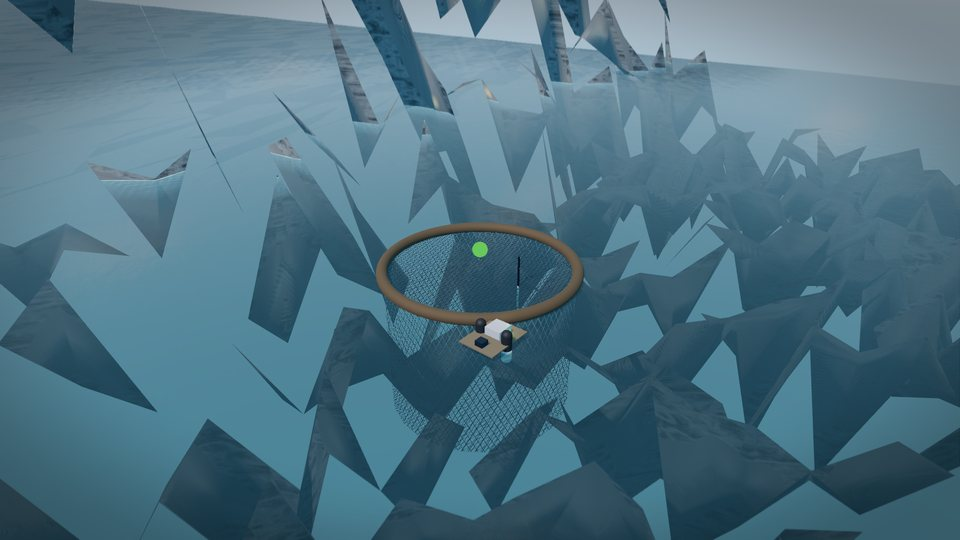 |  |
| 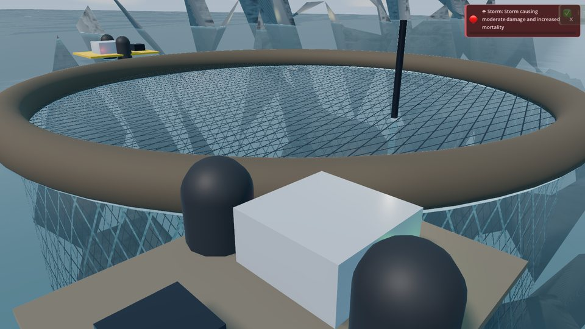 | 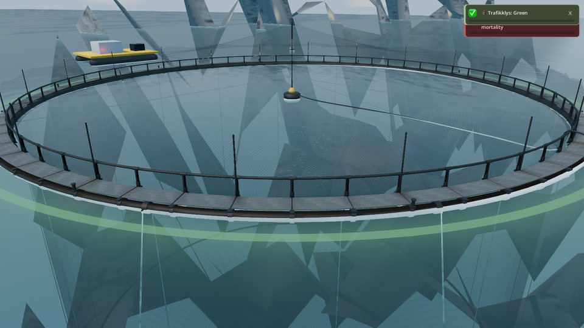 |
| 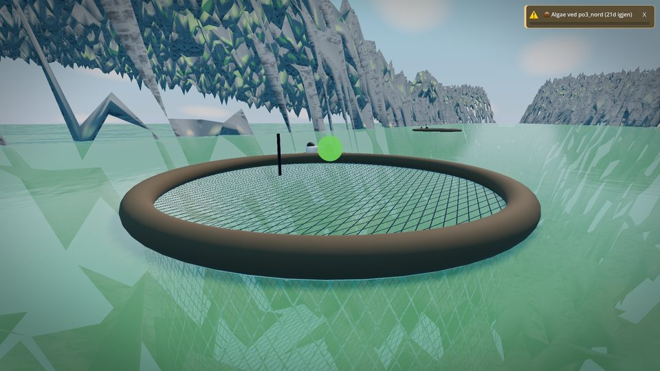 | 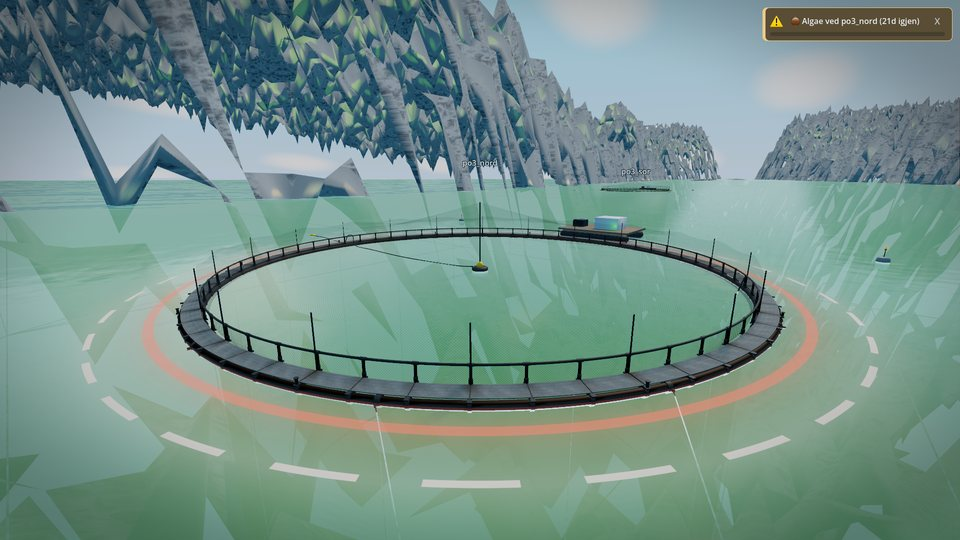 |
| 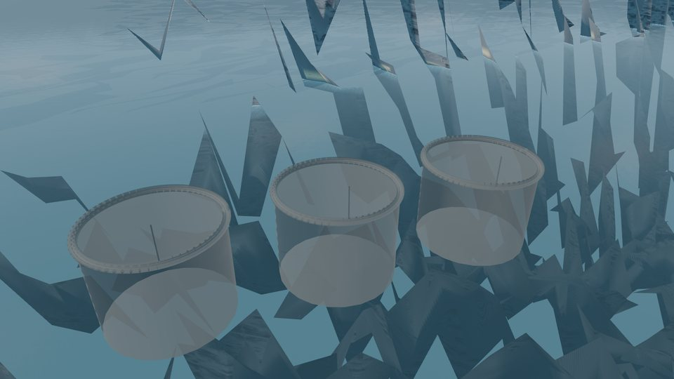 | 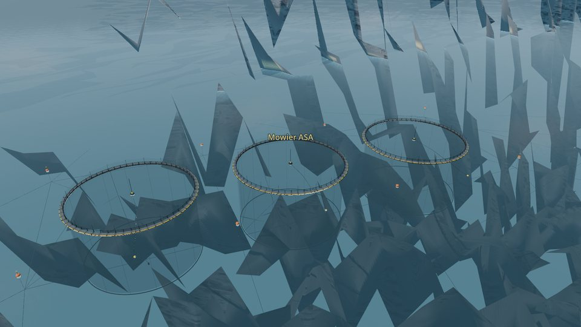 |

In game: red-zone lice ring, low waterline view, walkway, lice skirt, corner
buoy, the corner lights at night.

| | |
|---|---|
| 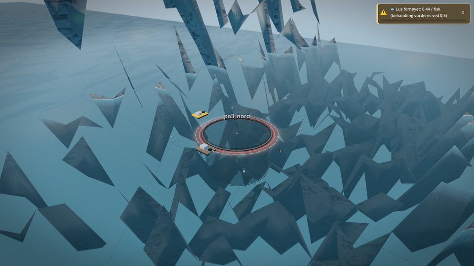 | 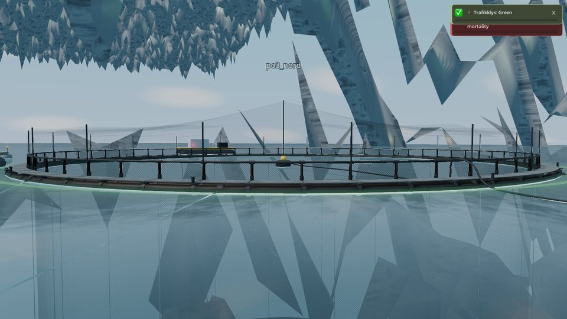 |
| 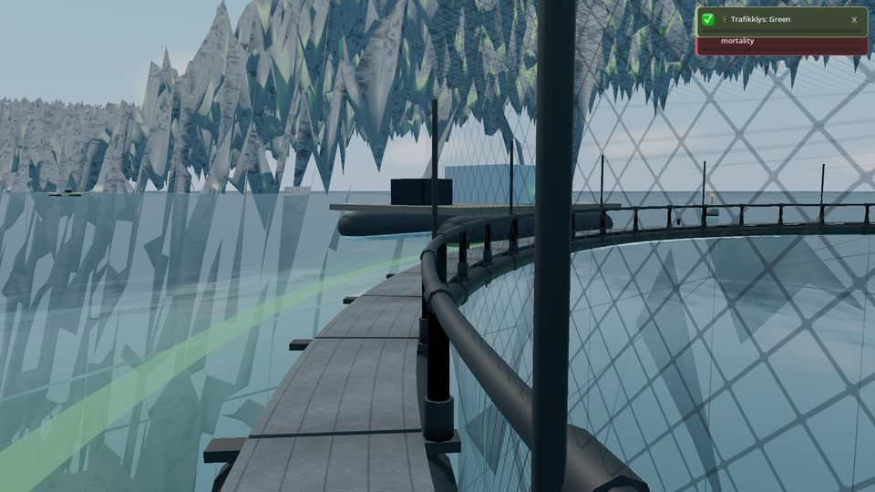 | 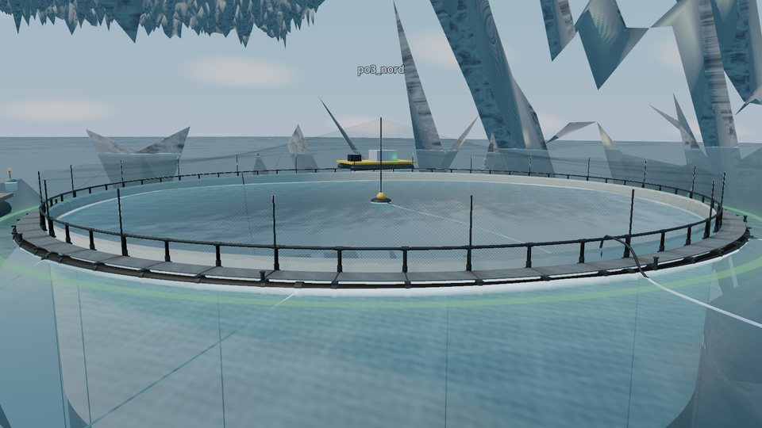 |
| 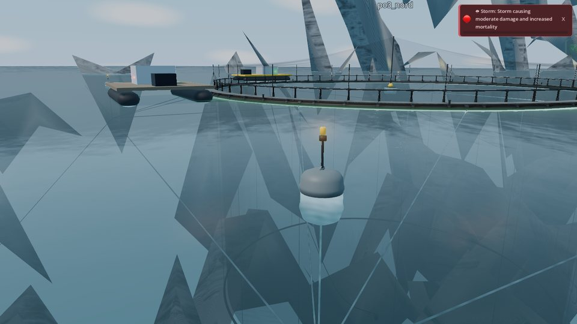 | 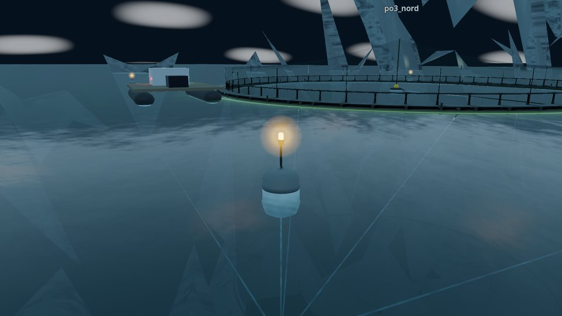 |

Asset review renders (`blender/render_asset_preview.py`, EEVEE, calm water,
22 degree sun): three-quarter hero, walkway detail, waterline, top-down, and
the lice-skirt variant.

| | |
|---|---|
| 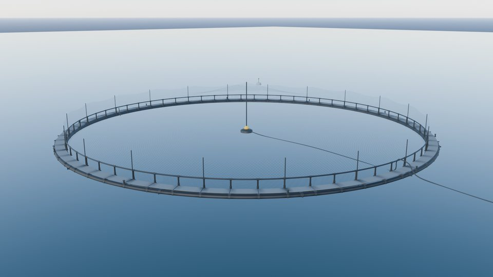 | 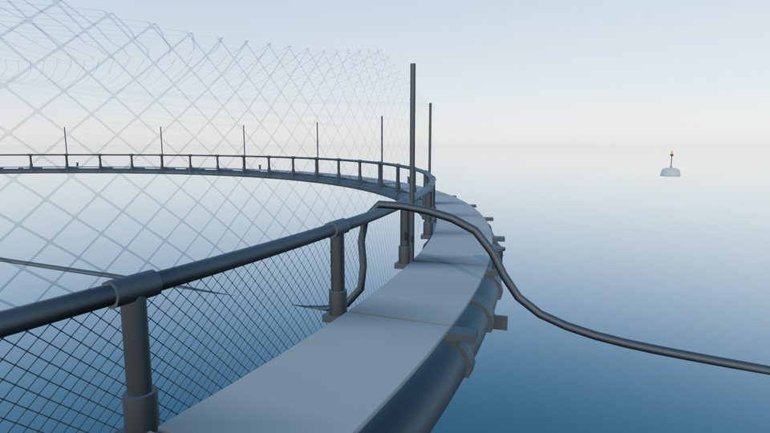 |
| 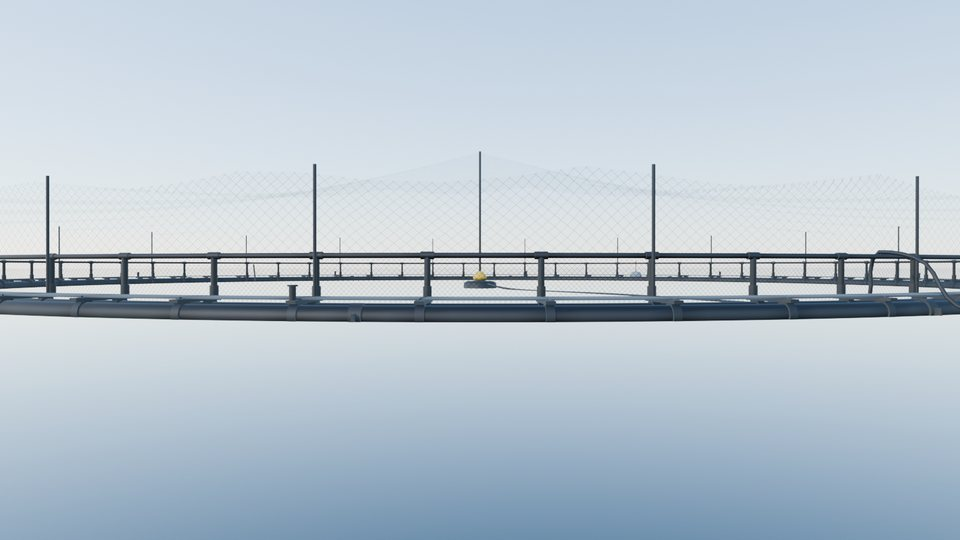 | 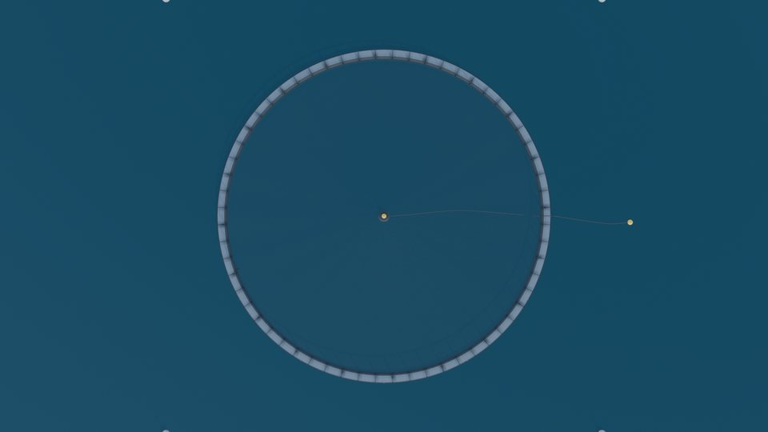 |
| 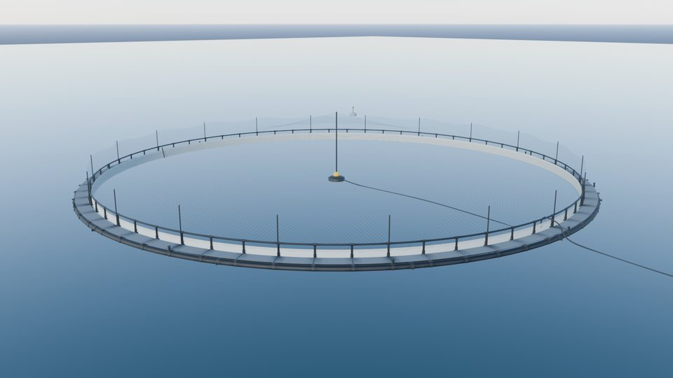 | |

## Metrics against the acceptance criteria

| Criterion | Result |
|---|---|
| G1-07.1 no net lid (11) | 0 lid faces (UI flow test); frame 11 shows the open pen |
| G1-07.2 no unshaded sphere | 0 SphereMesh in the fjord; the selection marker is a dashed ring on the water |
| G1-07.3 collar luminance < 0.1 | 0.013 (linear) and unchanged by the lice level |
| G1-07.4 health ring 08b vs 12 dE >= 20 | parameter dE76 82.8; in the frames 57.9 (green 114,162,125 vs red 215,125,113) |
| G1-07.5 rival net alpha <= 0.55 | 0.5, instance parameter, no material override |
| G1-07.6 hulls horizontal | capsules along Z, AABB z > x > y |
| A2-01.1 bbox within 5% | collar 54.07 vs 53.63 m; every spec row above in tolerance |
| A2-01.2 LOD0 <= 60k, LOD2 <= 2k | 51,768 / 1,962 |
| A2-01.3 reference doc | this file |
| A2-01.4 08b pHash d >= 16 | **not met: d = 2.** pHash works on a 32 x 32 downscale; the 0.5 m pipes are sub-pixel there and the broken terrain shards (G1-01) fill the frame. The 11 close-up moves d = 8 full frame, 26 on the pen crop. Re-measure once G1-01 and G1-03 land. |
| A2-01.5 draw calls per site | 24-27 + ~60 shadow (P0-04 has not set the budget on this branch) |

## Rebuild

```
/Applications/Blender.app/Contents/MacOS/Blender -b --factory-startup --python blender/build_pen.py -- --textures
/Applications/Blender.app/Contents/MacOS/Blender -b --factory-startup --python blender/build_site_kit.py
python3.12 .claude/skills/ecc/blender-asset-pipeline/blender_asset_pipeline.py --verify-only
```

Both scripts are deterministic: two rebuilds give identical sha256 for all
nine .glb files, and `tests/test_pen_asset.py` rebuilds two of them and
compares bytes when Blender is installed.
