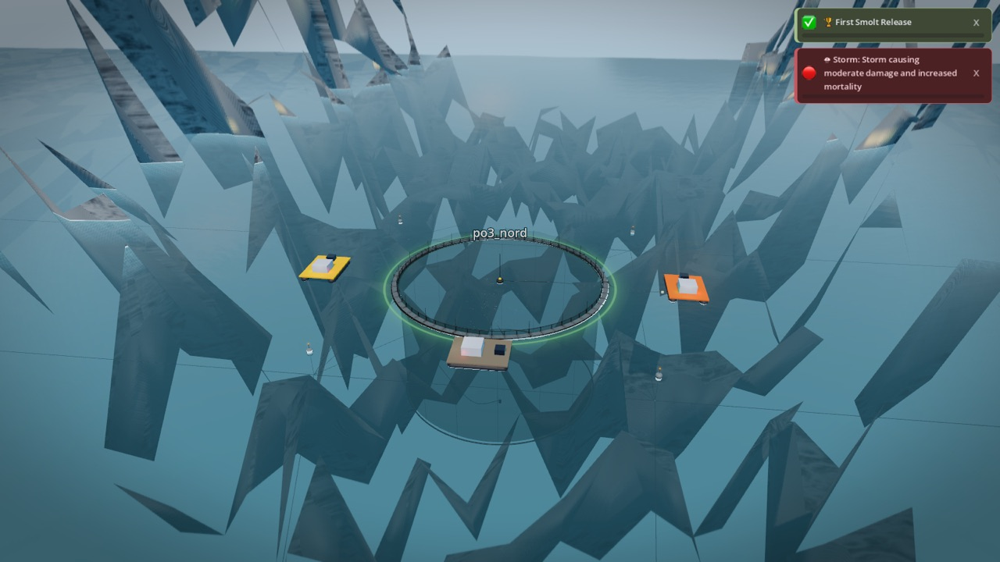
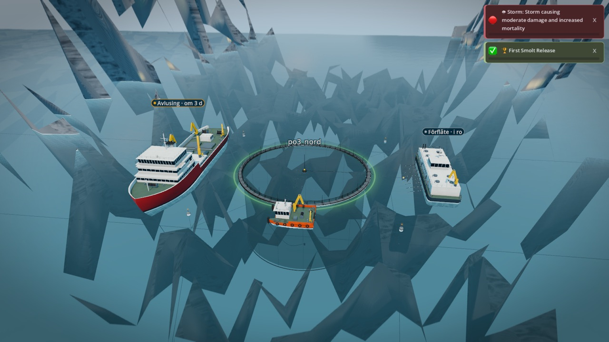
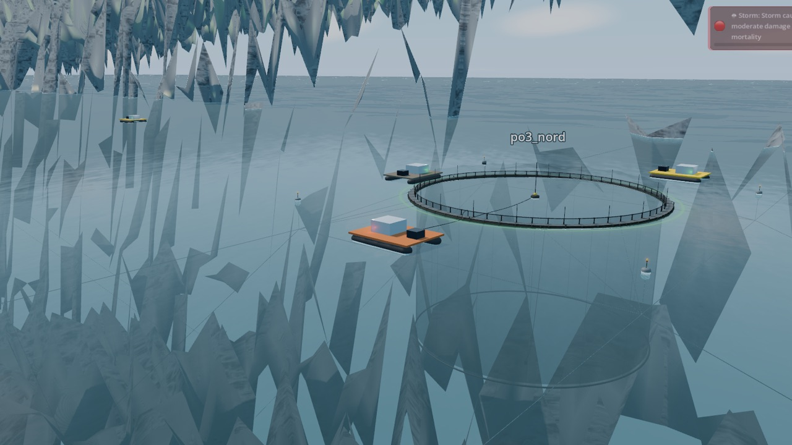
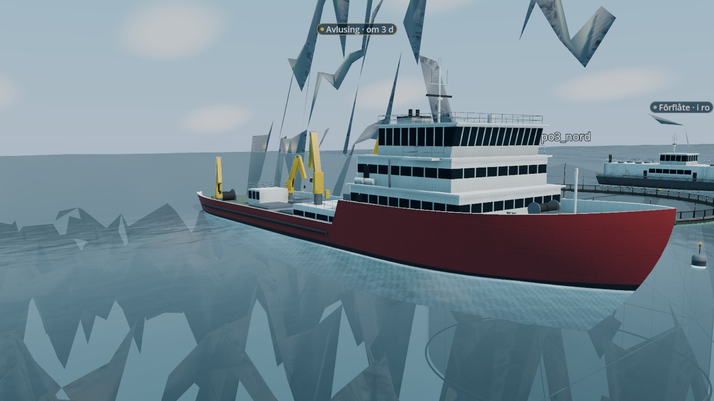

# A3-01 evidence: the aquaculture fleet

Roadmap item A3-01 (vessels: feed barge, wellboat, workboat). Branch
`wave1/art-2`. Frames are 1280 px downscales in `a3_01/`. Every model is
built headless by `blender/build_vessels.py` (geometry in
`blender/vessel_designs.py`, parts in `blender/lk_hull.py`); no third-party
geometry or textures.

## References (retrieved 2026-10-14, specification text only)

| Vessel | Reference | Spec used |
|---|---|---|
| Wellboat | Baird Maritime vessel reviews of Sølvtrans' *Ronja Queen* and *Ronja Princess* (Aas Mek AAS 3002 ST) | LOA 76.96 m, beam 17.8 m, draught 5.0 m, depth 5.9 m, two wells (3,000 m³), four Palfinger cranes, shelter deck |
| Large wellboat | Salmon Business, "Largest wellboat on Earth arrives at yard" (*Ronja Storm*) | 116 m, four wells; roadmap 116 x 23 m |
| Feed barge | Salmon Business / Fish Farming Expert on the ScaleAQ-Mowi order (SeaFarm Feeder 500) | 37 x 11.2 m, 500 t, centre control room |
| Large feed barge | AKVA group / Fish Farming Expert on the AC800 barge for Arctic Offshore Farming | 64.8 m, 13 m, exposed site, workboat ramp in the stern |
| Workboat | roadmap A3-01 | 15 x 10 m service catamaran |

Two calls the references leave open:
- The wellboat's superstructure sits **forward**, as on the modern Norwegian
  wellboats (accommodation and wheelhouse over the bow, wells amidships,
  cranes and hose reels aft). The task brief said "superstructure aft"; the
  sources describe no aft-bridge Ronja, so the model follows the type.
- The Ronja livery is red hull and white superstructure; the model uses no
  names or logos (D17).

## Specification against the built models

Measured hull dimensions from the sidecars (`<asset>_LOD0.json`), checked
by `tests/test_vessel_assets.py` (5%) and in the running game by
`UiFlowTests._test_vessel_fleet`.

| Asset | Spec | Model (moulded hull) | LOD0 / LOD1 / LOD2 tris | Ceiling |
|---|---|---|---|---|
| workboat | 15 x 10 m | 15.0 x 10.0 m, draught 1.1 m | 9,060 / 1,718 / 464 | 20k / 5k / 1k |
| feed_barge | 37 x 11 m | 37.0 x 11.2 m, draught 2.6 m | 15,108 / 1,916 / 204 | 30k / 8k / 1.5k |
| feed_barge_large | 64.8 x 13 m | 64.8 x 13.0 m, draught 4.2 m | 12,993 / 3,099 / 354 | 40k / 10k / 2k |
| wellboat | 77 x 17.8 m | 76.96 x 17.8 m, draught 4.6 m | 22,951 / 4,117 / 576 | 45k / 12k / 2k |
| wellboat_large | 116 x 23 m | 116.0 x 23.0 m, draught 6.2 m | 32,413 / 6,863 / 734 | 60k / 15k / 2.5k |
| rib | 8.5 x 3.0 m (work RIB) | 8.53 x 2.94 m over the tube, 0.72 m with the legs down | 3,865 / 1,183 / 263 | 6k / 1.5k / 400 |

The wellboat (77.0 m) is 1.42 times the pen's collar (54.1 m).

## What is on them

- **Wellboat**: lofted hull with a raked, flared bow, raised forecastle,
  bulwarks with a white capping rail, fender strake; two accommodation
  tiers, wheelhouse with forward-raked windows, bridge wings and a sun
  visor, mast with radar and lights, exhaust casing; pump house (shelter
  deck) behind the forecastle; a hatch pair per well with manifolds; four
  knuckle-boom cranes; side pipe runs; hose reels, capstans and bollards
  aft; an aft control house; rescue boat and life rafts.
- **Feed barge**: raked-end steel pontoon, silo house with stiffener
  pilasters and crew quarters amidships, control room on the roof, silo
  fill hatches with fill pipes, roof crane, exhausts, eight feed lines over
  the starboard side that float away towards the pen, tyre fenders, rails.
- **Workboat**: catamaran demihulls with V bottoms and push knees on both
  bows, bridging deck, wheelhouse with visor and mast, a 10 m and a small
  knuckle crane, capstans, winch, tyre fenders, rails.
- **RIB** (the site tender): deep-V hard hull inside an orange buoyancy
  tube with a rounded bow, centre console with windscreen, radar arch,
  jockey seats, twin outboards. It lies alongside every feed barge on the
  side away from the feed lines and is not drawn past 1.5 km.
- **Materials**: one shared shader (`vessel_paint.gdshader`) for ten
  materials in `assets/models/vessel_kit/`: box-projected UVs in metres, a
  generated 4 m weathering tile (grime, roughness, run-down streaks) plus a
  plate-seam normal map, boot-top and antifouling below the waterline on
  the hulls, Cycles AO baked into the vertex colour (big faces are split
  first so the AO reads as contact shadow, not a smear).

## In the game

- `FishPenManager` moors the workboat broadside to every pen (it replaces
  the capsule `service_boat.tscn`, now deleted with its meshes).
- `FeedBargeVisualManager` keeps a barge at every stocked site, moored on
  the hose side of the pen with its feed lines towards it. Sites stocked when
  the game starts or loads have theirs on station; a site stocked later sees
  it towed out from the depot; an emptied site sends it home. Sites licensed
  for >= 6,000 t get the 64.8 m barge.
- `WellboatVisualManager` sends the 77 m wellboat (the 116 m carrier for a
  harvest) along the other side of the pen, clear of the mooring buoys.
- **Job state is a chip, never paint** (A3-01 accept 2): `VesselChip` is a
  D13 Ink-glass pill (constant screen size, billboarded) with the job's
  signal-colour dot and text: "Avlusing · om 3 d", "Slakting · ferdig",
  "Fôrflåte · fôrer". Translation keys `UI_VESSEL_*`.
- Draw calls (probe, FARM zoom, three vessels shown vs hidden): +28 draws,
  +65 shadow-pass draws, +47k primitives. LOD hand-over per scene
  (`VesselModel.lod_switch`); LOD2 folds the small parts into five draws and
  casts no shadow.

## Frames

| Before | After |
|---|---|
|  |  |
|  |  |

- `a3_01/feed_barge_moored.jpg`, `a3_01/workboat_at_pen.jpg`: close-ups at a site.
- `a3_01/fleet_lineup_180m.jpg`, `a3_01/fleet_lineup_520m.jpg`: all five at
  LOD0 and LOD1 distance (workboat, feed barge, large barge, wellboat,
  large wellboat).
- `a3_01/wellboat_large.jpg`, `a3_01/feed_barge_large.jpg`: the large variants.
- `a3_01/blender_*.jpg`: EEVEE review renders (`blender/render_vessel_preview.py`).

The terrain shards in the game frames are the G1-01 terrain defect (another
track); the water is still the pre-G1-05 shader.
