# Evidence: the construction kit on the land campus

The F2-28 kit (crane, scaffold ring, excavator, blast mats) was merged as
assets only (`f2_28_construction_kit.md`): the spec gave no row to drawing
it, F2-20's presenter draws tanks and phase state without it, F2-22 is
logistics beats and F2-24 weather. This item draws it. `ConstructionKitVisual`
(`godot/scripts/visual/`) is a child of `LandCampusBuilder`; it reads the
engine's view of the unit (the campus's `view`: the site's project and each
lot's own) and nothing else. Frames are 1280 px JPEG downscales of 1920 x 1080
captures of the real game world by `FacilityPresenterCapture` (windowed, the
audio driver off, an isolated user dir), in `construction_kit_presenter/`.

## What it draws

| The lot's project is in... | Props | Where | Gone when |
|---|---|---|---|
| `site_works`, below 60% (the blast's share) | an excavator beside a blanket of blast mats | the middle of the blasted ground, where the camera frames the campus | the blast ends (60%) |
| `tank_rings` | a scaffold ring on each grow-out tank (none on a pre-grow tank: a Ø29.5 m ring would float 7 m off a Ø16 m one) | the tank's axis; revealed by the tank's own build progress (`INSTANCE_CUSTOM.r`, the ring is as tall as the shell) | the phase ends |
| `treatment_hall` | a tower crane per lot | 8 m behind the lot's inland end on its axis, the jib 60 deg off the axis (toward +v on even lots, -v on odd ones), so a camera looking along the lot rows sees it side-on and its tip stands over a first tank | the phase ends |

A prop shows only while its project's status is "building". The ring is struck
when `tank_rings` ends because its top lift (boards at 12 m, rail at 13 m)
stands in the height band of the tank's walkway, which the walls' top progress
(12.48 m) has not yet revealed; that arithmetic is pinned in
`tests/test_construction_kit_assets.py`. A post-smolt site gets the blast pair
and no crane (a 50 m crane would dwarf a 16 m tank), and a lot whose crane base
would stand off the pad (a short pad turned so that its quay zone and a lot fill
its depth, seen on `pad_b` with the quay along z) gets none. Props are made on
first use: a campus that was never under construction creates no node. They
stand in the kit's own LODs by visibility range (the crane's LOD2 is a mark on
the skyline at the home view; the other assets have two LODs, so nothing is
drawn beyond 2,000 m); the rings are one MultiMesh per band on their tanks'
bands, so none beyond 1,200 m. The first-sight timelapse (`replay_row`) plays
the kit through the same calls.

## Frames

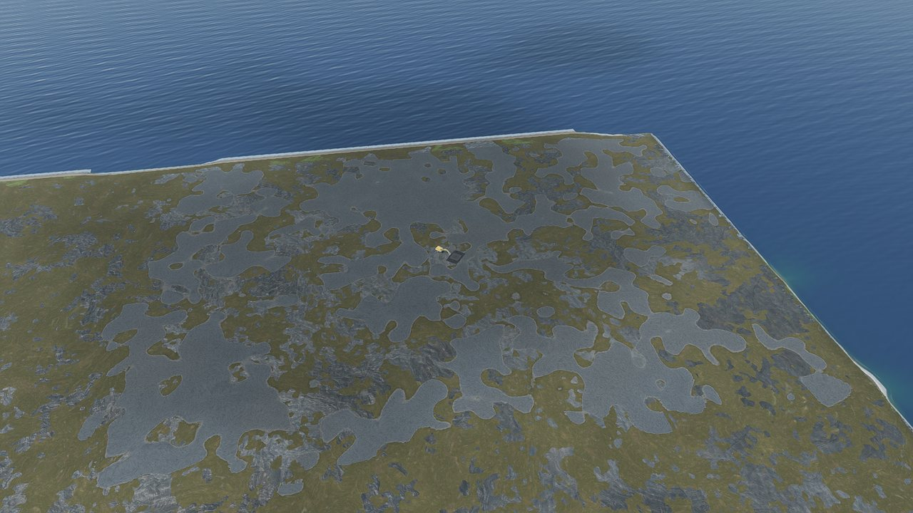

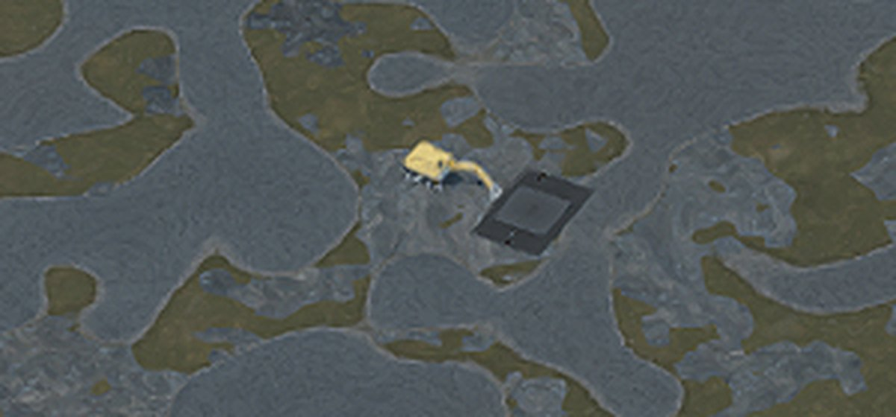

Site works at 30% (`32_land_construction_p0_site_works_blast`, the one-lot
framing: 380 m at -40 deg): the granite spreads over the heath in patches, and
in the middle of the blasted ground the excavator works beside its blanket of
mats (the crop is the same frame at 4x). Nothing else stands yet.

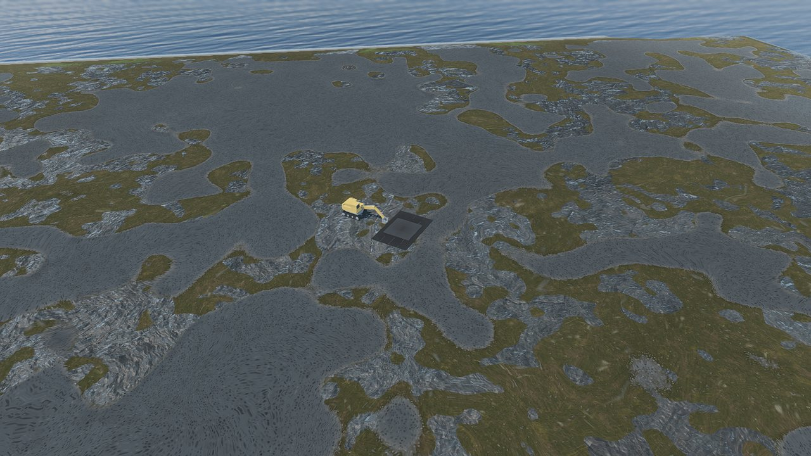

The same state at 100 m (a temporary shot, not in `shots.json`): the bucket
rests on the blanket's edge, and the second layer of mats reads as the lighter
slab on the first.

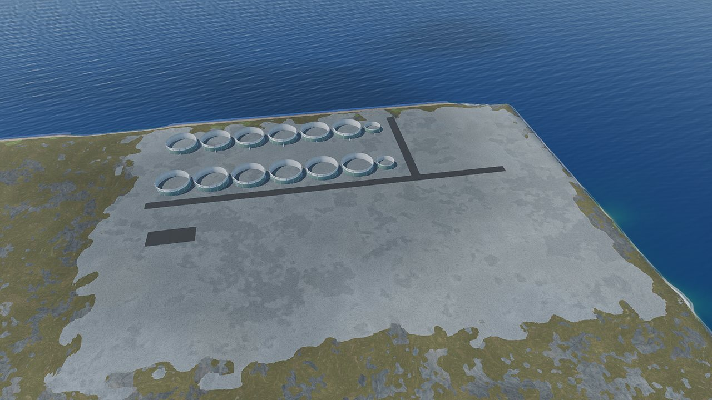

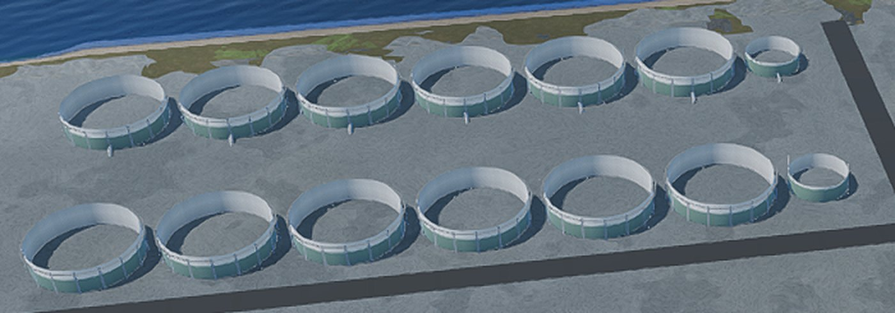

Tank rings at 50% (`..._p2_tank_rings`): the walls half up and open-topped,
each grow-out wall wearing the LOD1 scaffold cage (the crop is the same frame at
2x: pale posts and a bright top rail; the pre-grow tank closing each row wears
none).

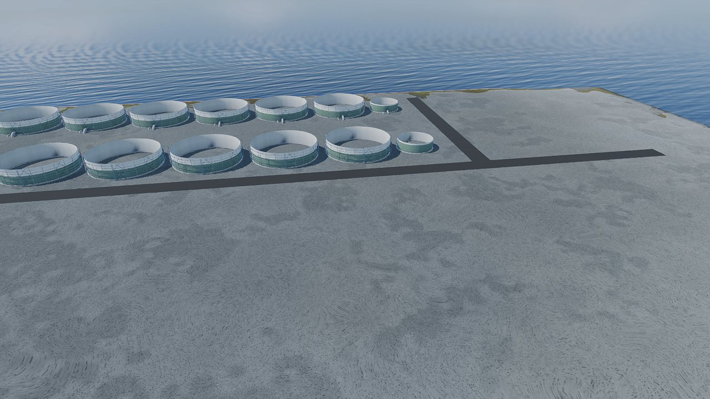

At 150 m (temporary shot) the LOD0 rings: platforms and guard rails at every
lift and X-bracing in every third bay.

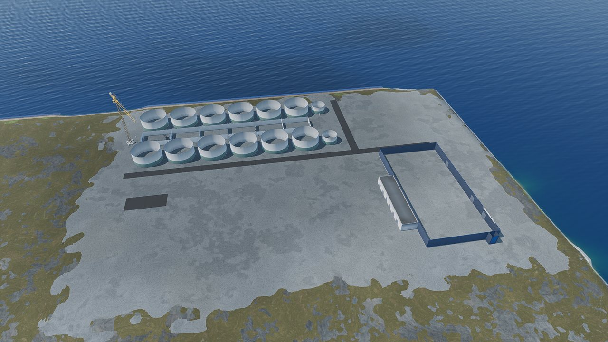

Treatment hall at 60% (`..._p3_treatment_hall`): the rings are struck, the hall
bays rise between the tank rows and the dark harvest hall at the quay side, and
a tower crane stands at the inland end of the lot with its jib over a first tank.

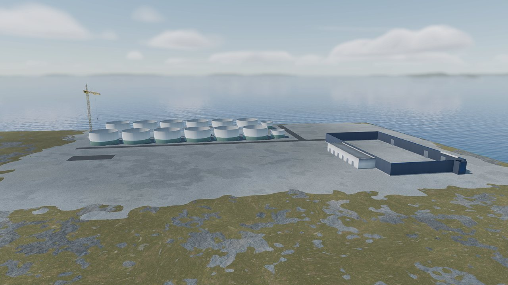

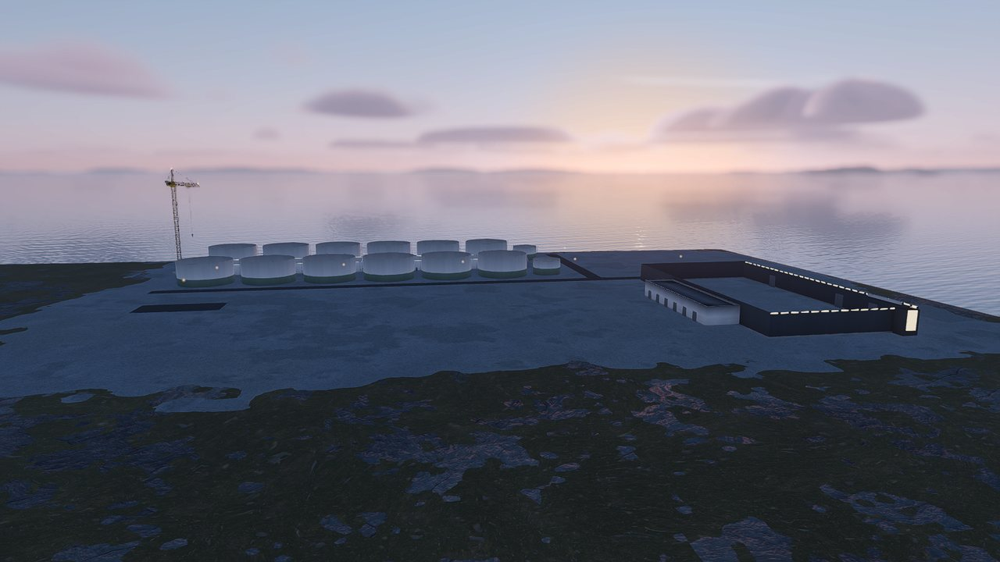

A low view of the same state (320 m, -12 deg, focus 8 m up) at noon, and at
19:20 in the dusk's season: the crane against the sky and sea, then against the
afterglow with its two lamps (cathead apex, jib tip) lit by the kit's night
emission (temporary shots).

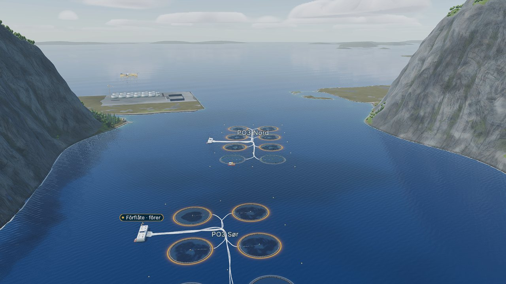

The home view with the lot in its treatment hall (temporary shot): the crane is
the small vertical mark above the campus at the left, drawn from its LOD2 (34
triangles).

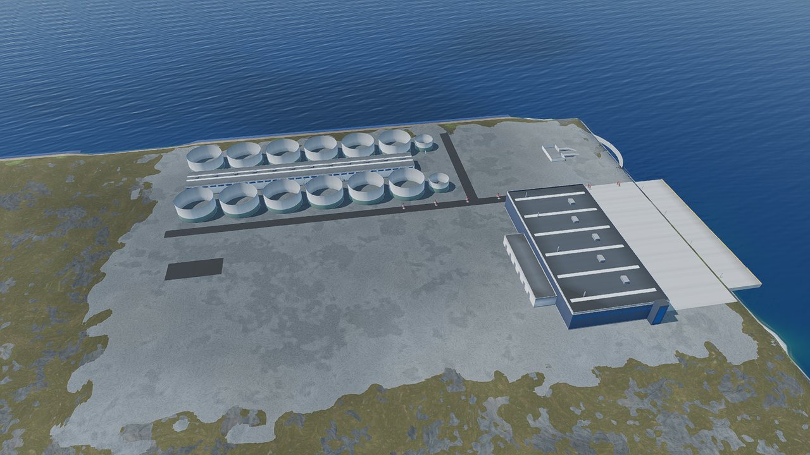

Sea works at 60% (`..._p4_sea_works`): the crane is gone and so are the rings;
the quay, the harvest hall and the pipe bridge rise.

## How it was checked

**Headless draw checks** (a throwaway script, not committed: SHIP_PLAN §3 freezes
the in-Godot check count; Godot 4.7.2, `--headless --audio-driver Dummy`): 127
checks, 0 failures. Over **44 layouts** (the three pads, each with its quay along
x and along z, every lot count the engine allows, all-HFS, all-RAS and
pilot-first sets, and 1-4 post-smolt modules) the crane's 7 m base was placed
**69 times and never stood off the pad, in a solid, on a road or in a lot's
slot**; the **9 lots that get none** are all `pad_b` with its quay along z (a 360 m
depth: the quay zone and a lot fill it, leaving 2 m behind the lot); the
blast pair stands on the pad in all 44. The three phase predicates were
tabulated (building or not, below or at 60%, ready or not). On a real two-lot
campus driven through the phases: the blast pair shows only in `site_works`
below 60%; **24 rings in `tank_rings`** (12 grow-out tanks a lot, none on a pre-grow
tank), each carrying its wall's build progress; 6 crane nodes (2 lots x 3 LODs)
in `treatment_hall`; nothing in `sea_works` or when built. With one lot built
and the other in its tank rings, rings only on the second; rings follow their
tanks' bands (none beyond 1,200 m, back with the near band). `FirstSightDirector.replay_row`
swept in 60 steps shows blast, rings, crane in order and then nothing:
`BBBBBBB....RRRRRRRRRRCCCCCCCCCC.............................`. A campus built operational creates no
prop; a post-smolt site gets no crane and the blast pair.

**Committed guards** (`tests/test_construction_kit_presenter.py`, 9 tests, and
the presenter scan in `tests/test_facility_presenter.py`, which now includes the
new script): the presenter's assets and LOD counts are the manifest's, each asset
stands in the phase the manifest's `construction_phase_sets` gives it, the blast's
share is the campus's, the ring is revealed through the grow-out tank's
shell height and only on grow-out tanks, the crane's base half-width is the
slab's (read from `tower_crane_LOD0.glb`) and fits the pad's margin, the hooks are in
the campus and the manager, the script has its Godot uid, and it never reaches
the engine. **14 scripted mutants** (a hook removed, a phase key changed, the
crane's LOD count, the base half-width, its distance behind the lot, the ring's
reveal height, the uid deleted, a SimBridge lookup added, a second blast share, rings
on pre-grow tanks, the manager's preload removed, `kit_mesh`'s directory
parameter removed, a manifest row changed) were each caught, every file restored
byte-identical.

**Gates**: `tools/run_ui_flow_tests.sh` `UI_FLOW_RESULT checks=2334 failures=0`
(the frozen count; among them "a second campus (pad_b, its seven phases) reads no
kit mesh back from the GPU (0 more)", "the land build's six phases and its
handover draw seven different states" and the layout lints over every pad);
`blender_asset_pipeline.py --verify-only` 102 passed, 0 failed (the ring's LOD1
rebuilt, its hash refreshed); the headless GDScript parse scan clean.

**The capture run** (`tools/capture_screenshots.sh --scene
res://qa/scenes/FacilityPresenterCapture.tscn -- --only 32_land_construction`, windowed, silent):
all 8 shots stand in the phase they name; the engine's 14 tanks are drawn in each
(6 whole at completion); no campus has a layout clash; the shadow rule holds;
the campus's LOD0 triangle count is 49,572 in every shot (the props are not part of
it: they are transient and stand apart from the groups); the pHash over the
campus's box puts the tank-rings state 2 bits from its twin (at most 3) and 12 bits from
the sea-works state (at least 9), as F2-20's acceptance asks. The committed
`f2_20_facilities_metrics.json` is left as that item's record: a comparison with
this run finds only pHash fields different, in every shot, including the ones
without a prop (p1, p4, p6): the hash's own run-to-run noise.

## What the first captures changed

1. **The ring's LOD1 was invisible at the one-lot framing.** At 380 m a pixel
   is a quarter of a metre, and the cage's 0.12 m standards and 0.1 m top band
   did not show at all: the first tank-rings capture had no sign of scaffold. LOD1
   is drawn from 350 m, so it was thickened (standards 0.5 m wide, a 0.6 m top
   band, the two platforms 0.3 m wider: outer Ø30.1, +2%; still 128 triangles
   against the 200 budget; LOD0 is byte-identical). The rings now read as pale
   posts and a bright rail round each wall.
2. **The blast pair stood off-centre.** Anchored at the first lot's centre it sat
   well off where the camera looks (the upper left of the frame even at 100 m);
   it now stands at the campus's focus (the middle of the blasted ground).
3. **The crane's yaw.** Along the lot's axis the jib would point straight at (or
   away from) a camera looking along the lot rows, as the capture's framing does;
   60 deg off the axis reads side-on from there and still carries the tip over a
   first tank. The in-game framing's direction depends on the pad
   (`land_framing` tries from the fjord's mouth side, then off the quay edge,
   then down the fjord), so no one yaw suits every view; the alternating sign
   gives neighbouring lots different silhouettes.

## Left

- The dust puff on each blast day (spec §6.3) is a particle effect no row owns.
- The crane's lamps glow by the kit's own night emission; `CampusLights` draws no
  camera-facing glow for them, so at the home view at night they do not read.
- The kit is static (the jib does not slew, the excavator does not dig).
- `LandCampusBuilder.gd` grows by 23 lines, 1,019 to 1,042 (SHIP_PLAN §10's "964" is out of date); its split is a queued item.
