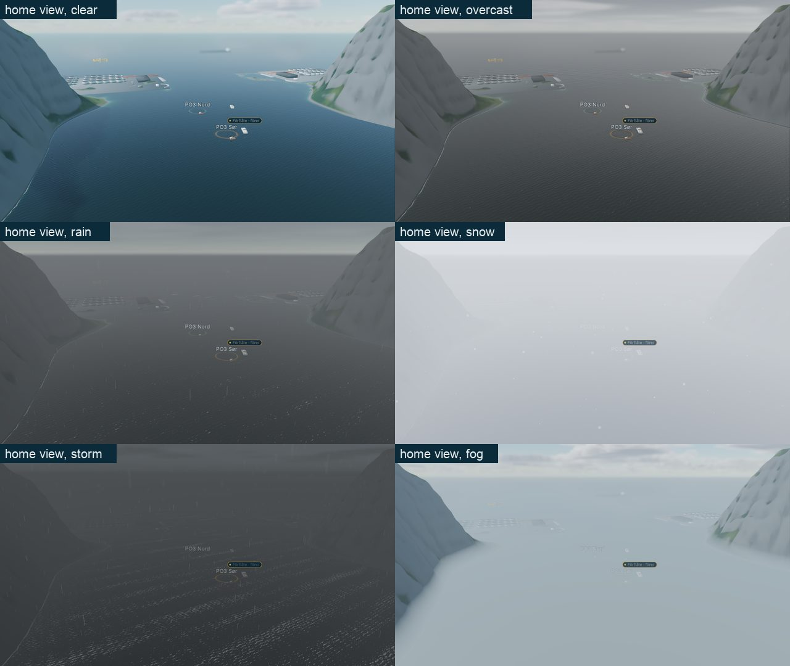
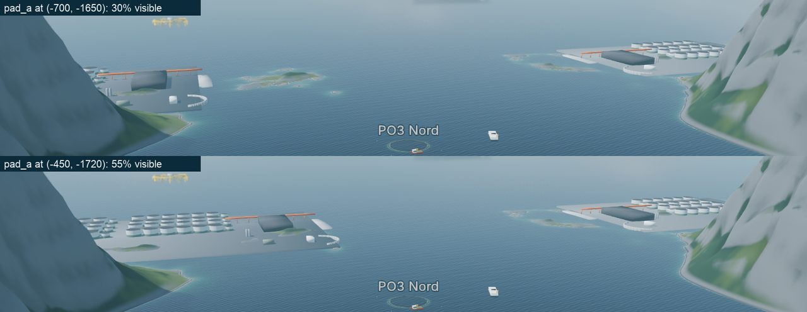
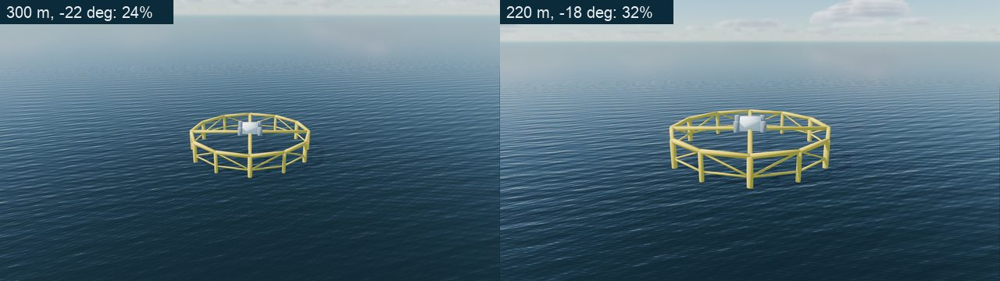
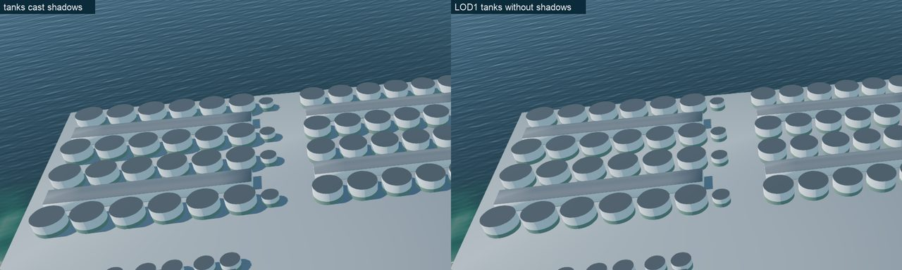

# F2-18 evidence: the gray-box read gate

Farm-types spec item F2-18 (§5.5, §7.2), branch `wave2/art-farm-1`. The gate
measures how the farm types read in the real game world **before** the land
and offshore kits spend triangles, and it confirms or changes the §4 framings
and the §5 budgets. Every number below comes from
`docs/run/evidence/f2_18_read_gate_metrics.json` (a copy of the capture's
`godot/screenshots/game/36_graybox_metrics.json`); frames are 1280 px
downscales in `f2_18/`.

## How it is measured

- **Scene.** `godot/qa/scenes/FarmTypeGrayBox.tscn` (`scripts/qa/FarmTypeGrayBox.gd`)
  boots the real `GameScene` (terrain, water, sky, weather, camera rig, the
  EnvironmentDirector), starts `po3_red_sone` with the QA seed, lets the
  vista make the first pen the home focus as in a real game, and adds
  primitives at the spec §4 plots (`scripts/qa/GrayBoxBuilder.gd`, layout in
  `scripts/qa/LandCampusLayout.gd`):
  - every pad gets its campus: Ø28 × 13 m grow-out tanks and Ø16 × 9 m
    pre-grow/post-smolt tanks (pale wall #C9CED1, lower 4 m band #5E7A6A,
    dark lid #2A3036), process-hall bays, the dark harvest hall, the orange
    pipe bridge, the quay, the intake basin and the utilities, in the §5.1
    lot layout (pad_a: 4 full lots + 4 post-smolt modules = 64 tanks;
    pad_b: 2 lots = 28 tanks; pad_delta: 4 modules = 8 tanks);
  - off_1 gets a 12-gon OF1-class ring (circumradius 55 m, alternating
    Ø3.56/Ø2.8 columns, top and mid rings, a zig-zag diagonal per bay, the
    cross gantry, topsides and silos, 25 m above the water) in #E6BE2E;
  - off_2 gets a 385 × 59.5 m Havfarm-class hull, 11 m freeboard, with its
    white aft superstructure, broadside to the home camera.
  The draw structure is F2-20's plan: one MultiMesh per tank type per plot,
  each plot's static pieces merged into one vertex-coloured mesh.
- **Shots.** `godot/qa/shots.json` (schema `godot/qa/shots.schema.json`):
  `36_graybox_home_{clear,overcast,rain,snow,storm,fog}` at the shipped home
  view (FJORD, 900 m at −17° on the first pen, focus (−116.7, 0, −1140),
  camera at (−385, 263, −322), vertical FOV 45°), `36_graybox_land_focus`
  and `36_graybox_of1_focus`, plus four variants that document the changes
  below. All at 1920 × 1080, noon, season 0.5.
- **Masks.** After each beauty frame the scene renders class masks: every
  gray-box node unshaded in a class colour, the camera on its own plain
  environment (no light, fog, tonemap or DOF) and every visual except the
  terrain and the water hidden, so a class pixel is exactly the geometry's
  visible cover. Class colours are the seven pure colours over two passes,
  so an anti-aliased edge between two classes never reads as a third. The
  same passes with the terrain hidden give the unoccluded cover; their ratio
  is the **visible fraction**. Sizes from the masks are accurate to about
  1 px (half-covered edge pixels are not counted); projected sizes come from
  the camera and the geometry and ignore occlusion.
- **Contrast.** Per target: mean ΔE76 (CIE Lab) of its pixels against the
  mean of a surround ring (the bbox grown 30%), and that ΔE relative to the
  clear frame ("kept"). Transmittance is `EnvironmentDirector.transmittance(d)`
  (Koschmieder distance fog). The capture runs with
  `tools/capture_screenshots.sh --scene res://qa/scenes/FarmTypeGrayBox.tscn`.



## Acceptance

| # | Criterion | Measured | Result |
|---|---|---|---|
| 1 | Home view, 6 weathers: pixel width and height of a tank, the campus and OF1, depression angles, fog transmittance per plot | Tables below, all six states, every plot | Recorded |
| 2a | Land framing (520 m, −40°): lid ellipse ≥ 40 px tall | 66 × 40 px (mask), 67.4 × 41.4 px (projection) | Pass |
| 2b | OF1 framing: ring fills 25–45% of the frame width | 618 px = 32.2% at the framing set here (220 m, −18°); 462 px = 24.1% at revision 2's 300 m, −22° | Pass after the change below |
| 3 | Read rule per distance band, chip rule, §5 budgets confirmed or changed before F2-25/F2-26 | Sections below | Done |

### Home view, clear (distances from the camera)

| Target | Distance | Depression | Mask w × h (px) | Projected w × h | Visible | ΔE vs surround |
|---|---|---|---|---|---|---|
| pad_a campus (moved, see below) | 1,423 m | 10.5° | 519 × 66 | 723 × 108 | 55% | 12.6 |
| pad_a nearest grow-out tank | 1,433 m | 9.9° | wall 28 × 14, lid 27 × 4 | 29 × 17, lid 28 × 4.9 | — | — |
| pad_b campus | 1,759 m | 8.5° | 321 × 68 | 467 × 68 | 90% | 14.2 |
| pad_b nearest grow-out tank | 1,710 m | 8.3° | wall 25 × 11, lid 19 × 2 | 26 × 15, lid 25 × 3.7 | — | — |
| OF1 at off_1 | 2,443 m | 6.2° | 69 × 18 (382 px) | 69 × 22 | 100% | 22.2 |
| Havfarm at off_2 | 3,327 m | 4.5° | 153 × 17 (1,109 px) | 153 × 10 | 100% | 6.0 |
| pad_delta | 1,832 m | — | behind the camera | — | — | — |

The spec's §5.5 estimates hold: a Ø28 tank at 1.4–1.8 km is a 25–28 px pale
stub with a 2–4 px lid line, so the campus reads as rows of stubs carried by
the dark hall and the orange bridge, never as a grid of circles; OF1 is a
69 × 18 px yellow sliver (ΔE 22 against the sea, the strongest read on the
frame); the Havfarm hull is a 153 px dark bar with ΔE 6, softened by the far
depth of field (it starts at 1.8 × the focus distance, 1,620 m, and the
offshore plots lie at 2.4–3.3 km).

### Weather: transmittance and the contrast that is left

| State (visibility) | pad_a T / kept | pad_b T / kept | OF1 T / kept | Havfarm T / kept | Chip by T < 0.4 |
|---|---|---|---|---|---|
| clear (60 km) | 0.91 / 1.00 | 0.89 / 1.00 | 0.85 / 1.00 | 0.81 / 1.00 | none |
| overcast (20 km) | 0.76 / 0.72 | 0.71 / 0.70 | 0.62 / 0.76 | 0.52 / 0.60 | none |
| rain (4.5 km) | 0.29 / 0.22 | 0.22 / 0.21 | 0.12 / 0.14 | 0.06 / 0.09 | all |
| snow (2.5 km) | 0.11 / 0.06 | 0.06 / 0.04 | 0.02 / 0.02 | 0.01 / 0.05 | all |
| storm (2 km) | 0.06 / 0.08 | 0.03 / 0.05 | 0.01 / 0.02 | 0.00 / 0.05 | all |
| sea fog (0.4 km in the layer) | 0.69 / 0.27 | 0.63 / 0.19 | 0.53 / 0.23 | 0.42 / 0.25 | **none** |

Where the fog is the distance fog the contrast kept tracks T (rain: OF1
0.12 against 0.14), which validates the Koschmieder chip rule. In sea fog it
does not: the distance transmittance stays at 0.42–0.69 while only 19–27% of
the contrast survives, because the sea-fog layer is height fog that
`transmittance()` leaves out. Rule 2 as written would show no chip in the
one weather that hides every farm type.

## Decisions (recorded in RUN_LOG §7, amended in the spec)

1. **pad_a moves from (−700, −1650) to (−450, −1720).** At revision 2's
   centre the western headland hides 70% of the hero campus at the home view
   (visible fraction 0.295; only the harvest hall, the bridge and the quay
   show, and the nearest tank is fully hidden). Shifting it 230 m east
   (`36_graybox_home_clear_pad_a_east`) raises that to 0.49; shifting it
   250 m east and 70 m seaward raises it to 0.55 with the tank rows in view
   (13,215 campus pixels against 5,699), and the two campuses now flank the
   mouth. The pad keeps its size, lots and fairway quay (quay face ~85 m from
   the fairway edge); its far edge stays 70 m inside the 4 km heightfield.
   At the land framing it also clears the hill that hid 10% of the old pad
   (visible 0.98 against 0.90). F2-03 (`site_plots.json`) and F2-19 (pad
   carving) take the new centre.

   

2. **The OF1 framing becomes 220 m at −18° (was 300 m at −22°).** At
   300 m the camera's FOV is 47.8° (the distance table), not the 45° the
   estimate assumed, so the ring filled 24.1%, under the 25–45% band; and
   −22° put the horizon 4.4% from the top, breaking the horizon rule (10–25%)
   §4 itself sets for the offshore framings. At 220 m and −18° the ring fills
   32.2% and the horizon sits 14.1% from the top.

   

3. **Chip rule (§5.5 rule 2): the chip shows when the transmittance is
   below 0.4 or the sea-fog layer is up (`sea_fog ≥ 0.5`) and the unit lies
   beyond the layer's visibility.** Until the director's `transmittance()`
   folds in the height-fog term, F2-20/F2-24 implement the second clause from
   `WeatherController.get_sea_fog()`; the measured contrast kept in fog
   (0.19–0.27) is below what rain leaves on the land plots (0.21–0.22), where
   the chip already shows.

4. **Tanks cast shadows in the LOD1 band (was "LOD1 and beyond cast no
   shadow").** At the land framing all 64 tanks stand 465–692 m from the camera, in the
   LOD1 band (350–1,200 m), so the spec's rule would draw the hero view with
   no tank shadows; without them the tanks float like stickers
   (`36_graybox_land_focus_no_tank_shadows`). The gray box, every tank
   casting, adds 8 shadow draw calls for all three land plots. LOD2 still
   casts none, and buildings follow the original rule.

   

## Read rule per distance band

| Band (camera distance) | Tanks | Buildings and units | What reads | Chip |
|---|---|---|---|---|
| < 350 m (tanks) / < 500 m (units) | LOD0 | LOD0 | Walkway stanchions, ladders, lid panel seams, feeder detail; the one-lot framing (380 m) shows its nearest tanks here | No |
| 350–1,200 m / 500–2,000 m | LOD1, **casts shadows** | LOD1 | The land framing (520 m, −40°): tank 67 px across, lid ellipse 40 px, walkway 3 px, handrail 2–3 px. LOD1 must carry the L1 look by itself: dark lid at the full shell diameter, the walkway outside the shell, the handrail as a continuous band, the feeder, the wall band | No |
| > 1,200 m / > 2,000 m | LOD2 | LOD2 | The home view (1.4–1.8 km for the campuses, 2.4–3.3 km offshore): pale 25–28 px stubs with a 2–4 px dark lid line, the dark hall, the orange bridge; OF1 as a 69 × 18 px yellow sliver | When T < 0.4 or in sea fog (rule above) |

Kit consequence for F2-25: the lid stays dark and full-diameter (the
walkway is cantilevered outside the shell), because the 40 px lid ellipse at
the land framing has no margin; a walkway on the lid would shrink it to
~37 px.

## §5 budgets

| Budget (§5.5 rule 5, §5.1, §5.2) | Measured on the gray box / the layout | Verdict |
|---|---|---|
| Full 4-lot campus ≤ 20 opaque + ≤ 16 shadow draws | The instanced plan adds 8 opaque + 7 shadow draws for all three land plots at the home view and 4 + 8 at the land framing (`perf`). The kit adds LOD bands: ≤ 6 tank MultiMeshes (2 types × 3 bands) + ≤ 5 merged static chunks per campus ≈ 11 opaque, ≤ 11 shadow | Confirmed |
| OF1 + vessel ≤ 8 opaque + ≤ 6 shadow | The OF1 ring and the Havfarm hull add 2 opaque, 0 shadow at the home view (beyond the 1.6 km shadow distance) | Confirmed |
| Campus ≤ 250 k LOD0 triangles inside 600 m | At the land framing the campus pieces within 600 m sum to 97.7 k at LOD0 budgets; drawn with the LOD bands the whole campus is 55.6 k | Confirmed |
| Tank 2,400 / 600 / 96, feeder 220 / 60 | LOD1 carries the land framing (above): 600 triangles for a 67 px tank with walkway, rail band, lid and feeder; LOD2 (96) is a 25 px stub | Confirmed |
| OF1 60 k / 12 k / 1.5 k | 1.5 k at the home view for a 69 × 18 px sliver; 60 k at the OF1 framing (618 px) | Confirmed |
| Added p95 ≤ 1.5 ms at FJORD | Not measurable here: the shared machine's frame time swung 39–45 ms between identical A/B blocks at the home view (15–63 ms over the whole capture) (the `frame_ms_samples` in the metrics). F2-20 measures it against the P0-04 baseline | Deferred to F2-20 |

LOD distances stay as §5.5 rule 4 has them (tanks 350/1,200 m, units
500/2,000 m); the change is decision 4 (LOD1 tanks cast shadows).

## Reproduce

```
dotnet build godot/LakskongenGame.csproj --nologo
bash tools/capture_screenshots.sh --scene res://qa/scenes/FarmTypeGrayBox.tscn
cp godot/screenshots/game/36_graybox_metrics.json docs/run/evidence/f2_18_read_gate_metrics.json
python3.12 -m pytest tests/test_farm_type_graybox.py -q
```

The capture prints `GRAYBOX_RESULT shots=12`. `UiFlowTests._test_farm_type_graybox`
checks the layout and the gray box headless.
