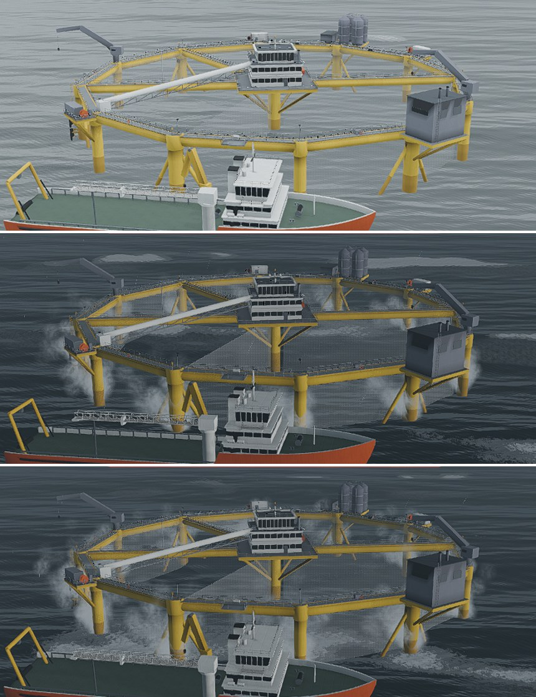
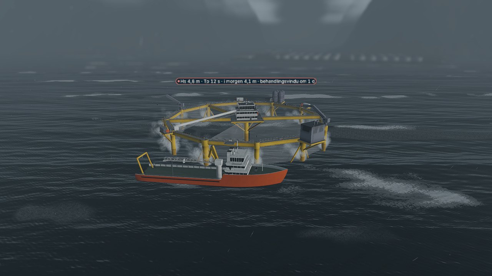
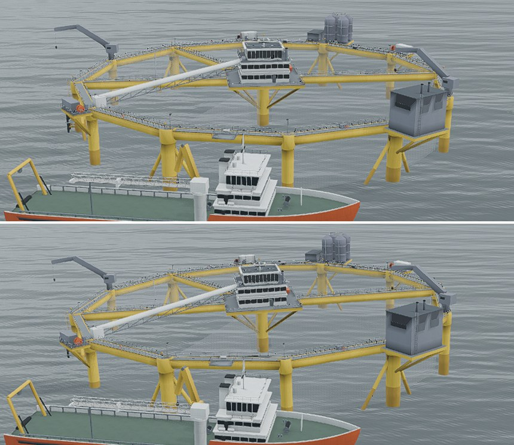
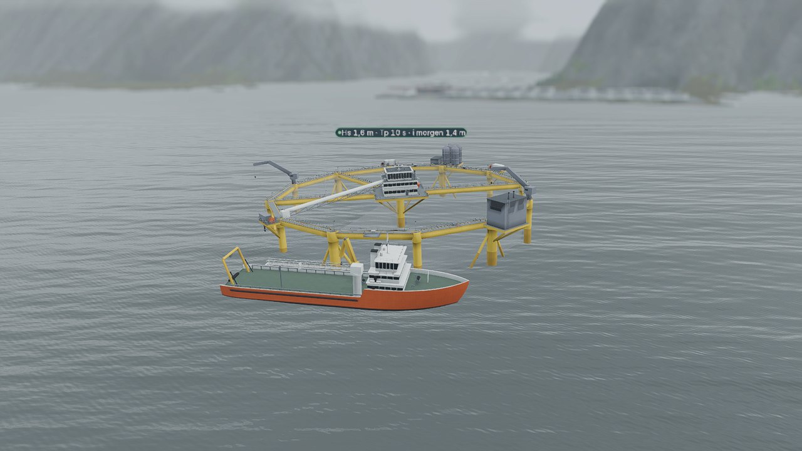
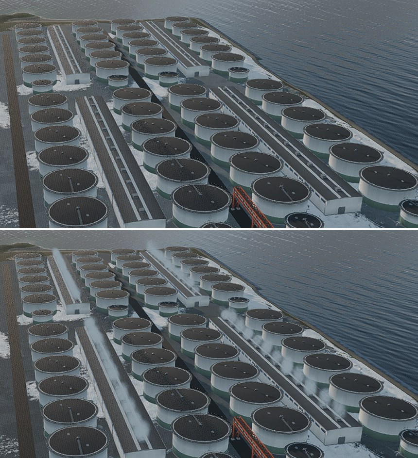
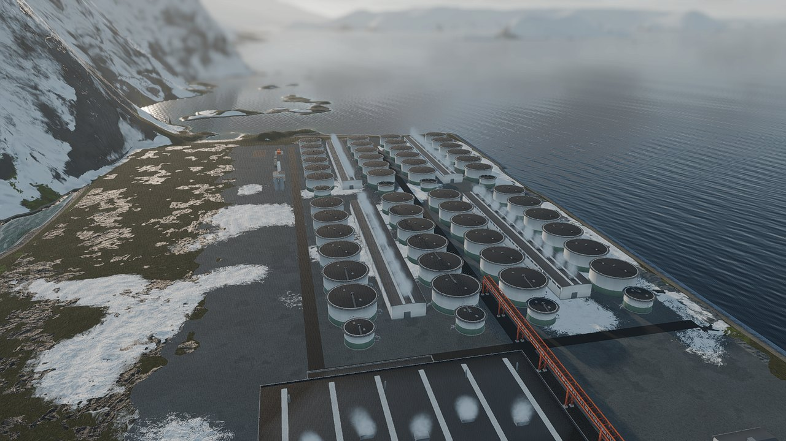
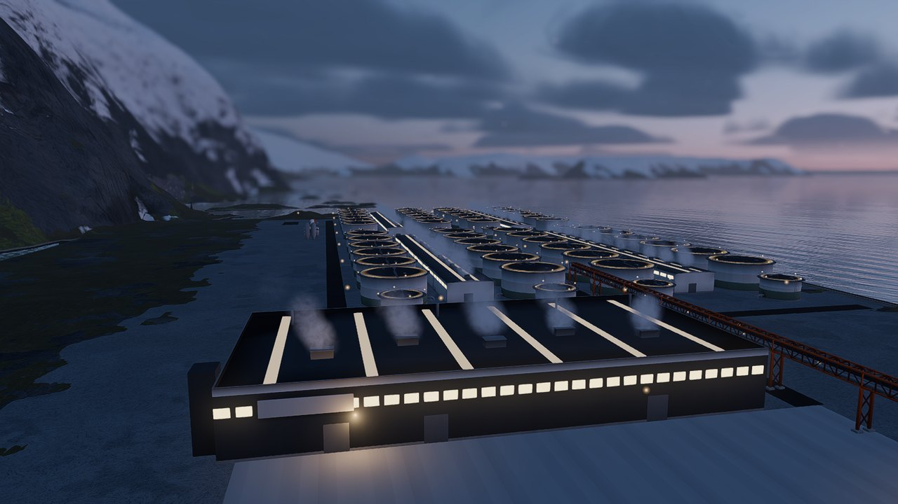

# Evidence: weather drama and incident poses (F2-24)

F2-24 (farm-types spec §7.2; §4 "Weather drama", §5.4 Animation): the OF1-class
unit throws spray at its columns above Hs 3 m, lists by at most 3 degrees while
a tilt incident is open at it, and the land campus's roof vents steam below
-2 degC air. Frames are 1920 x 1080 captures of the real game world by
`ShowcaseCapture` (windowed, the audio driver off, an isolated user dir), shown
as 1280 px JPEGs and 860 px crops of the same frames, in `f2_24_weather_drama/`;
the numbers are the `47_*` shots of `f2_23_showcase_metrics.json`
(`tools/capture_screenshots.sh --scene res://qa/scenes/ShowcaseCapture.tscn
-- --only 47_`).

## What draws what

| | Reads | Rule (`FacilityDrama`) | Drawn by |
|---|---|---|---|
| Spray | the engine's sea at the unit's plot (`get_sea_state_forecast`, today's Hs) | none at or under Hs 3 m, 0.15 of its share just over, full from 6 m; the drops leave a column faster in a heavier sea | `UnitSpray`: one emitter in the unit's model with a point at each of the 12 columns' waterline |
| List | the engine's open incident at the unit (`get_offshore_handling_state`: `active_incident_kind`) | 2.6 degrees (at most 3) while it is a `Tilt`, eased in and out at 0.6 deg/s, none for any other incident | `OffshoreUnitVisual`: the model's roll, on top of its heave |
| Steam | the presentation weather's air and wind | none at or over -2 degC, 0.30 of its share just under, full from -14 degC | `RoofSteam`: one emitter in the campus with a point at each roof vent of every hall that stands whole |

Nothing here writes the sim. The rules are one pure class; the nodes are fed by
`FarmFacilityVisualManager` (the sea and the incident at its half-second sea
refresh, the weather at its own half second).

## 1. Spray appears only above Hs 3 m

Where the points are: 12 at the design's circumradius (55 m, vertex k at
TAU * k / 12 in Blender x/y, Godot x/-z). Against the built OF1 mesh, all 936
vertices of its `Columns` node within 3 m of the waterline (and off the axis)
stand within 2.2 m of one of the points, 72 to each (`tests/test_facility_drama.py`).

The sea of each shot is staged as the F2-23 storm shot's is (the open sea and
the unit's chip read the same Hs). "Changed" is the share of pixels, in the air
over the twelve columns (6 m round each, up to 14 m), whose CIE L* differs by 6
or more between the shot and the frame a few draws later with the spray cleared
and held off; the sea's own motion between the two frames is the floor, 3.5%.

| Shot | Hs | Spray level | Emitting | Changed with it held off |
|---|---|---|---|---|
| `47_of1_calm_no_spray` | 2.4 m | 0 | no | 3.5% |
| `47_of1_storm_spray` | 4.8 m | 0.70 | yes | 25.3% |
| `47_of1_gale_full_spray` | 6.8 m | 1.00 | yes | 28.3% |

From the top: 2.4 m, 4.8 m, 6.8 m, the same crop of the same framing (pHash
distance 20 between the calm and the storm frame, 16 between the storm and the
gale).

## 2. Nav-light phases are equal across units at night

They were since F2-26 and are now pinned: `offshore_kit.gdshader` flashes the
lanterns on `fract(TIME * nav_flash_hz)` with `nav_flash_hz` 1.0, `TIME` is global
and the nav branch reads nothing per instance, so every unit's lanterns flash
together (`tests/test_facility_drama.py::test_the_nav_lanterns_flash_in_step_at_one_hertz`).

## 3. A tilt shows a list of at most 3 degrees until resolved

The engine's `OffshoreIncidentKind.Tilt` (a ballast deviation the crew did not
catch in time) is the incident; the handling state names it for as long as it is
open (`ActiveIncidentKind` is the kind's name, "Tilt", and "" once it is closed).
The roll in the frame, the mast top and the deck at both ends of the unit's beam
on screen, read in the same frame so the wave under the unit is the same:

| Shot | Roll | Mast top | Deck slope across the beam |
|---|---|---|---|
| `47_of1_upright_calm` | -0.01 deg | (961, 390) | -15 px |
| `47_of1_tilt_list` | 2.61 deg | (954, 390) | -43 px |

The mast shifts 7 px and the deck's slope grows by 28 px across the beam (pHash
distance 4 between the two frames, the same sea and sky). Top: upright, bottom:
listed.

## 4. Vent steam only below -2 degC air

The vents are the roof units of the halls as the Blender design puts them (a
process hall bay's two, at x = -7.5 and 7.5 and 11.2 m up; the harvest hall's
five, every 20 m from x = -40 and 15.8 m up), and `tests/test_facility_drama.py`
holds them to the built glbs: each is a roof box top of the design's size at that
place. A vent steams once its hall stands whole (the campus's `built_groups`),
as `CampusLights`' lamps do. "Changed" is the share of pixels in the campus's
box (grown up by a third, for the plumes over the roofs) that differ between the
shot and the frame a few draws later with the steam cleared and held off.

| Shot | Air | Steam level | Vents steaming | Changed with it held off |
|---|---|---|---|---|
| `47_campus_mild_no_steam` | +4.0 degC | 0 | 0 of 53 | 0.19% |
| `47_campus_frost_steam` | -9.0 degC | 0.74 | 53 of 53 | 1.93% |
| `47_campus_frost_dusk` | -9.0 degC | 0.74 | 53 of 53 | 3.43% |

53 vents are the 4 lots' 24 bays twice, and the harvest hall's five. Top: the
mild morning, bottom: the frost (pHash distance 6); then the blue hour at
-9 degC, the lit harvest hall's five roof units each under a plume.

## 5. No yellow marker, 20 delta E off the hull

`tools/lint_markers.py` reads every colour a world-anchored marker over a unit
carries (the sea chip's status colours, its pill and text, the chip shader's
defaults, the unit card's ring) and fails a colour under 20 delta E (CIE76) from
the hull's #E6BE2E or one that reads as a yellow fill. It passes; the closest is
the chip's warning amber at 28.0 delta E, and the lint is shown to fail a
yellow marker (`test_the_colour_lint_fails_a_yellow_marker`). F2-21's chip test
(`tests/test_camera_bookmarks.py`) stays as it was.

## Checks

- **Headless, on the real nodes:** `godot/tests/FacilityDramaChecks.gd`, 31 checks
  (`godot --headless --audio-driver Dummy --path godot -s res://tests/FacilityDramaChecks.gd`
  prints `FACILITY_DRAMA_RESULT checks=31 failures=0`): the rules at their edges (none at
  2.9 and 3.0 m, spray from 3.1 m; no steam at -1.9 and -2.0 degC, steam from -2.1); an OF1
  unit's spray as its sea changes (it stops when the sea falls back, a forecast the engine
  could not make asks for none, the wind carries the drops); the list easing over 4.3 s to
  2.6 degrees, never past 3, none for a net tear, the unit righting itself once the
  incident is resolved; a campus of a full lot, a pilot lot and a RAS hall with 57 vents,
  steaming as their halls stand and the air changes. It is not part of the UI flow suite
  (its check count is frozen, SHIP_PLAN §3); `tests/test_facility_drama.py` runs it where
  Godot is installed.
- **pytest:** `tests/test_facility_drama.py` (13): the thresholds against the spec's own
  words and the engine's names, the spray points against the built OF1 columns, the vents
  against the Blender design and the built hall glbs, the nav lanterns' shared TIME, the
  wiring of the presenters, the particles out of the planar mirror and far views, the
  marker lint passing and failing a yellow marker, and the headless checks above.
  `tests/test_facility_presenter.py` gains the pure-read pin of the one new read and lists
  its name among the presenter's approved reads, as F2-21's sea read was added.
- **xUnit:** `OffshoreHandlingViewTests` (2): 1,000 polls of the handling view, at day 40 and
  at day 440 of a unit, move no stream and change no save; a unit with no incident names none.
  Scripted mutant: the view made to write a field of the unit, the first test fails (the save
  differs) and the engine file is restored byte-identical. No `src/LakskongenSim` change.
- **Mutants:** 14 scripted mutants of the F2-24 code, each caught, each file restored byte-identical:

| Mutant | Caught by |
|---|---|
| M01 spray starts at 2.5 m, not 3 m | the thresholds pin |
| M02 spray at exactly 3.0 m | the headless checks |
| M03 the list passes 3 degrees | the thresholds pin |
| M04 any incident lists the unit | the rules pin (the engine's name) |
| M05 the list never eases back | the unit's wiring pin |
| M06 steam from 0 degC | the thresholds pin |
| M07 a vent steams before its hall stands | the campus's wiring pin |
| M08 the bay's vents stand 1.2 m too low | the vents against the design and the glb |
| M09 the spray points mirrored | the points against the built columns |
| M10 the unit's sea no longer feeds its spray | the unit's wiring pin |
| M11 the list is not applied to the model | the unit's wiring pin |
| M12 the spray is drawn in the planar mirror | the particles pin |
| M13 the steam ignores the weather's air | the campus's wiring pin |
| M14 the open incident is never read | the unit's wiring pin |

(The runs stop at the first failure, so the pin that comes first in the file is the one
named. M05, M07, M10 and M11 break behaviour the headless checks hold as well; M13 and M14 are
in the manager, which they do not exercise, and only the wiring pins hold.)

## Gates

All on the final tree (`gfx/weather-drama`; `origin/main` `89bfc92` had not moved):

| Gate | Result |
|---|---|
| `bash tools/run_ui_flow_tests.sh` | `UI_FLOW_RESULT checks=2334 failures=0`: the frozen count, `MIN_CHECKS` unchanged (SHIP_PLAN §3) |
| `python3 -m pytest tests/ -q` | 1040 passed, 1 skipped (1026 before: +13 here, +1 in the presenter scan) |
| `dotnet test --filter OffshoreHandlingViewTests` | 2 passed |
| `bash tools/validate_scenes.sh` | SCENE VALIDATION: PASSED |
| headless GDScript parse scan (`godot --headless --editor --quit-after 3`) | clean: 0 parse or script errors |
| `python3 tools/lint_markers.py` | MARKER LINT: PASSED |

No `src/LakskongenSim` change, so the golden traces and the whole dotnet suite were not run
(SHIP_PLAN §3 item 3); no asset changed, so the asset verifier was not either.

One thing went wrong on the way and is worth the record: a first version of the headless
checks was written to `godot/tests/WeatherDramaChecks.gd`, a file that already exists (the sky's
checks of G3-05, called from the UI flow suite), and overwrote it. Scene validation caught it
at once (`UiFlowTests` could not resolve the class); the file was restored from `origin/main`
(`git diff origin/main -- godot/tests/WeatherDramaChecks.gd` is empty) and the rules and the
checks were renamed `FacilityDrama` and `FacilityDramaChecks` so the two cannot be mistaken
for one another.
