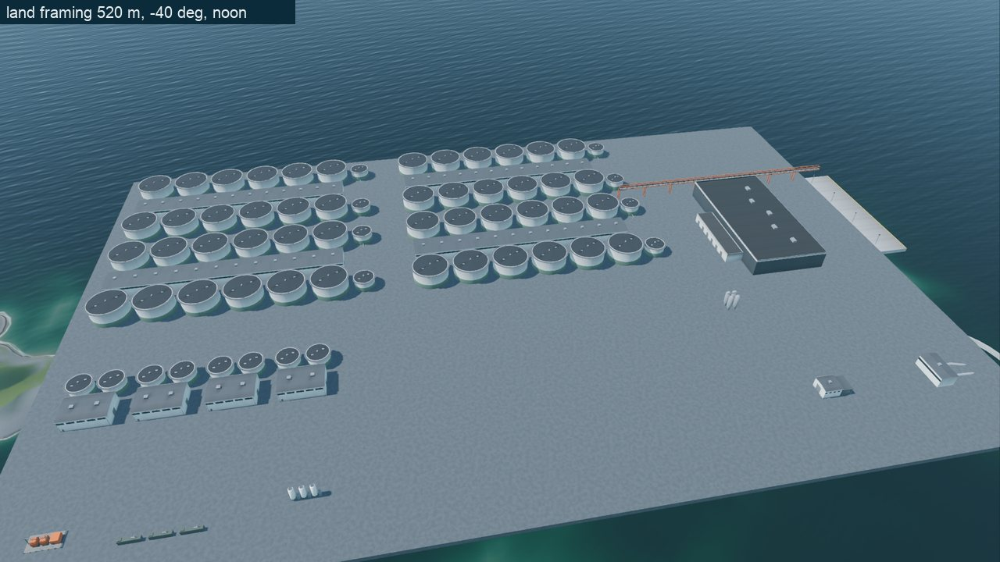
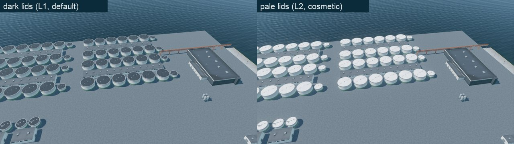
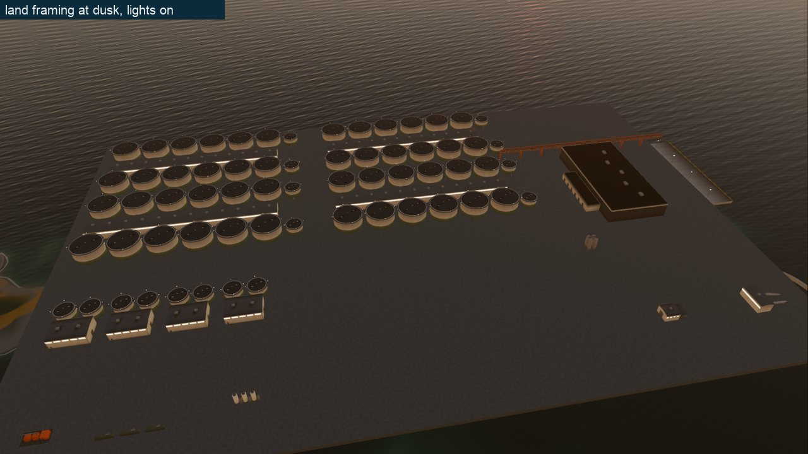
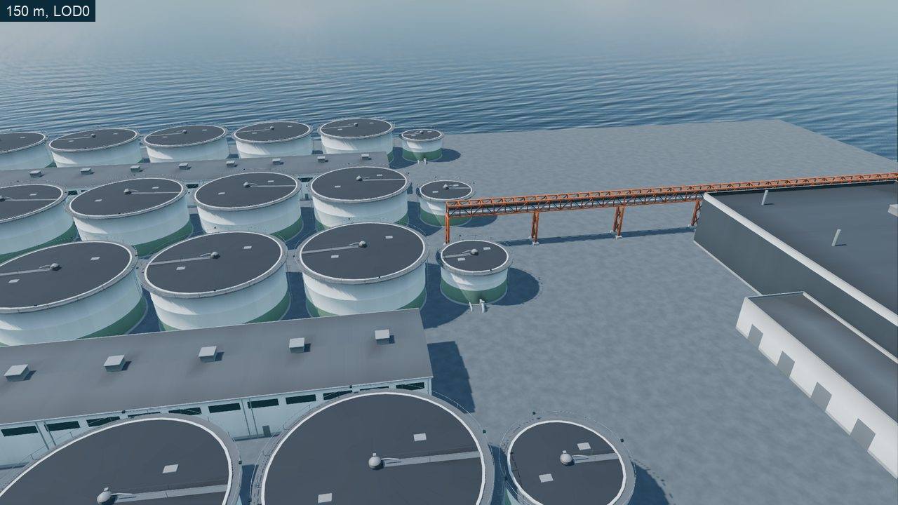
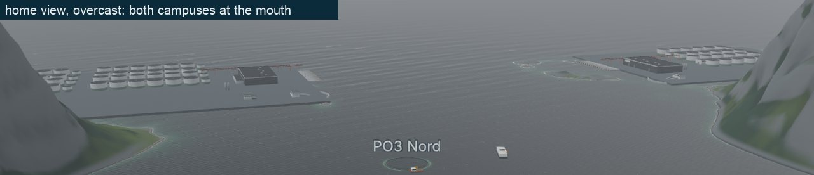
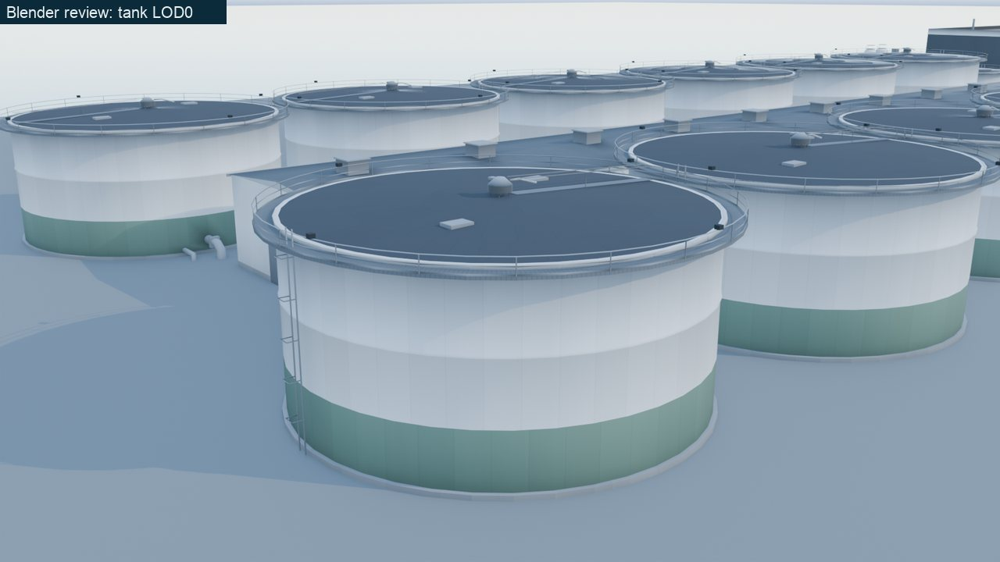
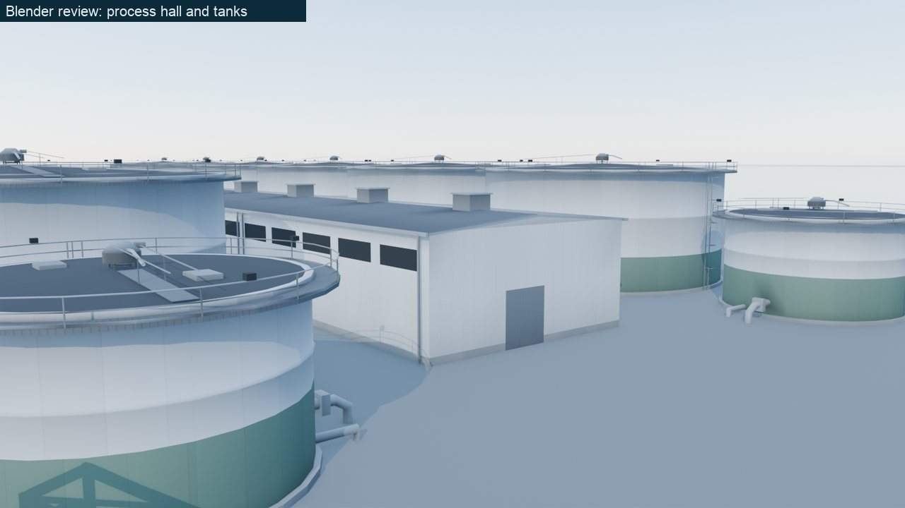
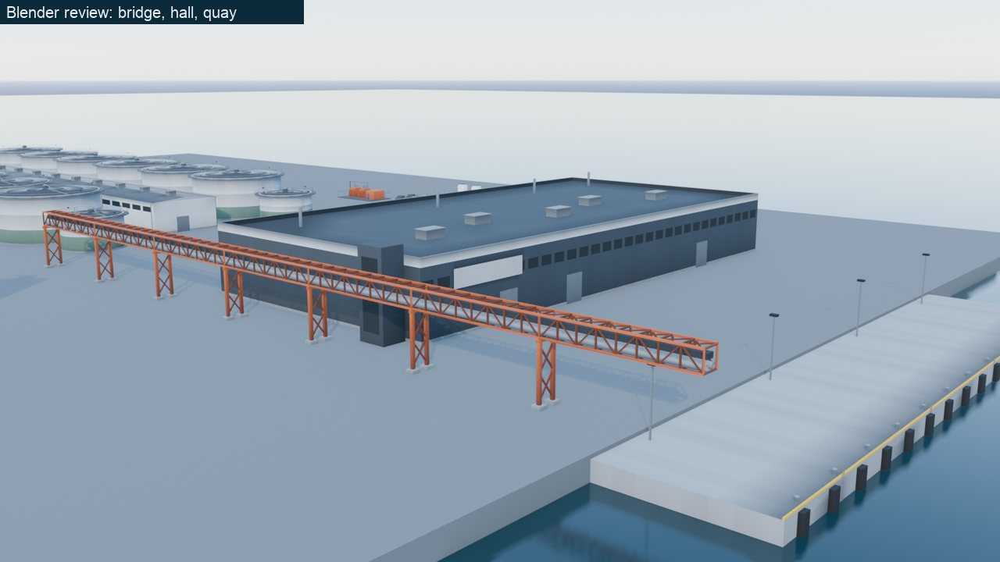
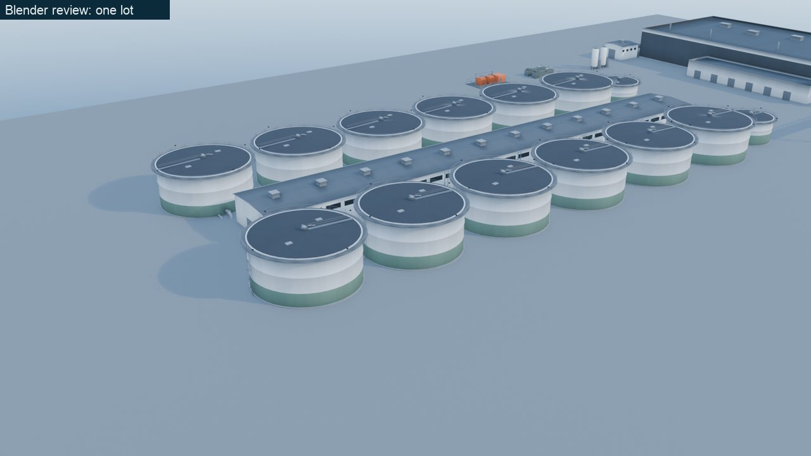

# F2-25 evidence: the land kit

Farm-types spec item F2-25 (§5.1, §7.3), branch `wave2/art-farm-1`. The
land-based campus kit: 14 assets, 41 LODs, one material, built headless and
byte-reproducibly from code, previewed on the real game world at the spec's
land framing by day and at dusk. Frames are 1280 px downscales in `f2_25/`;
the preview's numbers are `f2_25_land_kit_metrics.json` (a copy of the
capture's `godot/screenshots/game/39_landkit_metrics.json`). The owner's two
land references (L1, L2) exist only as written descriptions
(`OWNER_REFERENCE_BRIEF.md`, outside the repo), so the side-by-sides below
set each frame against those descriptions; no reference image is committed.

## What was built

| Piece | Where |
|---|---|
| Build script (CLI, atlas, AO bake, join, export, sidecars, budgets) | `blender/build_land_base.py` |
| Asset geometry, one function per asset and LOD | `blender/land_designs.py` |
| Parts and building blocks (sheds, flat-roofed blocks, rails, ring decks, wall grids) | `blender/land_parts.py` |
| Shared mesh helpers appended (strip UVs, planar grids, breaks) | `blender/lk_meshkit.py` (append only: the pen, vessel and site kits rebuild unchanged) |
| Review renders (QA, writes outside the repo) | `blender/render_land_preview.py` |
| 41 LODs + sidecars + import settings | `godot/assets/models/land_kit/` |
| The kit material, its shader and the trim atlas | `godot/assets/models/facility_kit/LK_FacilityKit.tres`, `godot/shaders/facility_kit.gdshader`, `godot/assets/models/facility_kit/textures/facility_atlas.png` |
| Godot preview on the game world | `godot/qa/scenes/LandKitPreview.tscn`, `godot/scripts/qa/LandKitPreview.gd` (on `QaWorldCapture.gd`, shared with the F2-18 gray box), shots `39_landkit_*` in `godot/qa/shots.json` |
| Manifest entries | `blender/asset_manifest.json` (14 entries, type `land_kit`) |
| Tests | `tests/test_land_kit_assets.py`, `UiFlowTests._test_land_kit_imports` |

**One material per kit, one surface per LOD.** Every LOD is one node named
by the asset id with one `LK_FacilityKit` surface, so F2-20 can draw a
whole campus with one MultiMesh per tank type and LOD band. The spec's part
names (`Wall`, `Band`, `Lid`, `Walkway`, `Feeder`, ...) live on as strips of
a trim atlas: 32 horizontal strips of 32 px in a 1024 px PNG, U repeating
every 16 m along each surface, V on the strip's centre row. A strip carries
its swatch and a surface pattern along U only (2 m tank panels, 1 m cladding
seams, 0.5 m standing seams, corrugation, grating); its alpha is the
roughness, or 1.0 where it glows at night (windows, lid work-lights).
Because a strip is constant down its 32 rows, every mip level down to
32 x 32 keeps each strip on its own texels, and the shader stops the mip
level there: strips never bleed. The shader addresses parts by strip: the
pale cosmetic lid (#EDEFEF, ref L2) is the row under the dark lid, the band
can fall back to the wall, the pipe bridge's legs stretch from their 10 m
reference to the terrain, the feeder's rotor spins; with
`use_instance_custom` a MultiMesh drives them per instance (F2-20).
Cycles bakes ambient occlusion into the vertex colour against a ground plane
(walls darken where they meet the pad and under the walkway; LOD2 is white).

## Acceptance

| # | Criterion | Measured | Result |
|---|---|---|---|
| 1 | Every §5.1 asset within 5% of spec | All 14 at LOD0 and LOD1 (table below); worst: river intake length 30.4 (+1.3%), span 25.24 (+1.0%), sludge station 20.2 (+1.0%), substation height 5.95 (-0.9%) | Pass |
| 2 | LOD0/1/2 triangles within budget; the build stops over `TRI_LIMITS` | Table below; `TRI_LIMITS` equal the spec rows (tested against the spec text); `--tri-limit-scale 0.5` makes the build exit with "over its 30 budget" | Pass |
| 3 | A rebuild reproduces byte-identical files | Two full builds: 82 of 82 `.glb`/`.json` files and the atlas identical (`cmp`), and the test rebuilds three LODs plus the atlas and compares SHA-256 | Pass |
| 4 | One `LK_FacilityKit` surface per LOD; swatch report matches §5.1 | glTF of all 41 LODs: 1 mesh, 1 primitive, 1 material `LK_FacilityKit`, node = asset id; every spec swatch is a strip whose median texel is within dE76 3 of it (e.g. lid #2A3036 exact, wall #C8CDD0 for #C9CED1) | Pass |
| 5 | Preview at the land framing: lid ellipse >= 40 px; dark lids vs pale walls dL >= 30 | 520 m at -40 deg, noon: lid 64 x 40 px, lid L* 38.4 vs wall 69.2, dL 30.8 (`39_landkit_day`); dusk (`39_landkit_dusk`, sun 0.2 deg): lid 64 x 40 px, dL 30.7; one-lot framing 380 m: lid 84 x 48 px, dL 31.7 | Pass, thin margin (see below) |
| 6 | Evidence doc with reference side-by-sides (refs not committed) | This file | Done |

| Asset | Spec (m) | Measured LOD0 (m) | Triangles LOD0 / LOD1 / LOD2 | Budget |
|---|---|---|---|---|
| tank_growout | Ø28 x 13 | Ø28.0 x 13.0 | 2,144 / 500 / 72 | 2,400 / 600 / 96 |
| tank_pregrow | Ø16 x 9 | Ø16.0 x 9.0 | 1,556 / 348 / 62 | 1,600 / 400 / 64 |
| tank_feeder | Ø1.6 x 1.2 | Ø1.6 x 1.2 | 174 / 50 / (in tank) | 220 / 60 / - |
| process_hall_bay | 30 x 20 x 10 | 30.0 x 20.0 x 9.98 | 680 / 98 / 12 | 900 / 160 / 12 |
| harvest_hall | 120 x 60 x 15 | 120.0 x 60.0 x 15.0 | 2,984 / 434 / 20 | 3,000 / 450 / 24 |
| pipe_bridge_span | 25 span, 3.5 x 3.5, legs 6-14 | 25.24, 3.5 x 3.5, legs 10 (stretched by the shader) | 618 / 174 / 22 | 1,800 / 320 / 24 |
| quay | 120 x 25, deck +3.0 | 120.0 x 25.0, deck +3.0 | 1,118 / 342 / 10 | 2,500 / 400 / 30 |
| intake_basin | arc R 45, 140 deg, 2 m wall, top +3.0; pump house 22 x 12 x 9 | R 45.0, 140.0 deg, 2.0 m, +3.0; 22.0 x 12.0 x 8.98 | 1,650 / 192 / 36 | 2,200 / 380 / 40 |
| river_intake | 30 x 8 x 5 | 30.4 x 8.0 x 5.0 | 490 / 96 / 12 | 600 / 120 / 12 |
| lox_tank | Ø3.2 x 10.5 | Ø3.2 x 10.5 | 404 / 88 / 12 | 640 / 120 / 12 |
| genset_container | 12.19 x 2.44 x 2.90 | 12.19 x 2.44 x 2.90 | 110 / 22 / 10 | 320 / 60 / 12 |
| substation | 18 x 10 x 6 | 18.07 x 10.07 x 5.95 | 664 / 100 / 10 | 1,500 / 220 / 12 |
| feed_silo_land | 4 x Ø4 x 14 | 4 x Ø4.0 x 14.0 | 884 / 152 / 10 | 900 / 160 / 12 |
| sludge_station | 20 x 12 x 8 | 20.2 x 12.0 x 8.0 | 386 / 112 / 10 | 800 / 150 / 12 |

The kit campus on all three land plots (pad_a's four lots and post-smolt
modules, pad_b's two lots, the delta's modules) adds **11 opaque and 10
shadow draw calls** at the land framing (`39_landkit_day` perf A/B), under
the budget of 20 + 16 for one full campus, and draws 49.5 k triangles there.

**Thin margins.** The lid ellipse (40 px) and dL (30.8) pass with little to
spare: the lid keeps the full shell diameter (the walkway is cantilevered
outside it, as F2-18 required) and the lid's roughness is 0.9 so the sky's
specular does not lift it. F2-20 must not shrink the lid, raise its
roughness/specular, or put the lid work-lights on by day.

## Against the references



| Owner reference (description) | In the kit | Frame |
|---|---|---|
| L1: ~70 round tanks in two sizes, large grow-out and smaller post-smolt | pad_a: 48 Ø28 m grow-out + 16 Ø16 m pre-grow/post-smolt = 64 (spec: 64-70); pad_b 28; delta 8 | `landkit_day`, `landkit_lot` |
| L1: pale grey walls with dark covered lids, set in rows | #C9CED1 shell with 2 m panel joints and a ring stiffener; #2A3036 insulated lid with ringed panel joints, two hatches, the rotor feeder on a footbridge; rows of six, 4 m apart | `blender_tank_close`, `landkit_close` |
| L1: long low white/grey service buildings with roof vents | 30 m process-hall bays end to end between the rows: pale sandwich cladding, a dark-glass window ribbon, roller doors, two roof vents per bay, gutters and downpipes | `blender_hall_end`, `landkit_lot` |
| L1: a large dark-grey harvest/processing hall | 120 x 60 x 15 m, #3A4046 cladding and roof under a pale fascia, loading doors to the quay, a blank logo panel (no names, D17), office stair tower, pale dispatch annex with six docks, roof plant | `blender_bridge_quay`, `landkit_day` |
| L1/L2: an orange steel truss bridge on legs carrying pipes/conveyor from a concrete quay with a wellboat berth | 25 m orange truss spans with two Ø0.9 m pipes, a covered conveyor and a walkway, leg frames on footings every span; 120 x 25 m quay at +3.0 m with black fenders, bollards, ladders, deck lights and a yellow edge kerb | `blender_bridge_quay`, `landkit_close` |
| L1: a curved intake/outfall basin at the shoreline | 140 deg concrete arc, R 45 m, with a railing, the pump house behind it and two Ø2 m intake pipes running out to depth | `landkit_day` (south-east corner) |
| L1: parking, a road, a small orange substation | Orange transformer yard with busbar gantry and fence; gensets, LOX tanks, silos, sludge station. Roads and parking are terrain (F2-19) and layout (F2-20) work | `landkit_day` |
| L2: ~12 big tanks with banded walls (grey over green/white) and flat white lids | The 4 m #5E7A6A band on every tank; the pale lid is a per-instance swatch (`lid_variant`, INSTANCE_CUSTOM.g) | `landkit_lids_dark_pale` |
| L2: blasted granite pad, calm sea | Placeholder granite slab (F2-19 carves the real pad); the preview presses the terrain under the pads so hills leave a cut face | all |
| L2: dusk, the "wow" mood | Sun 0.2 deg, the window ribbons and lid work-lights lit (`night_light` 0.8); the pink-violet sky itself is the sky model's (G1-04/G3-05) | `landkit_dusk` |









At the shipped home view the two campuses read as landmarks flanking the
mouth (pad_a where F2-18 moved it): pale stubs in rows, the dark harvest
halls and the orange bridges, the tanks at LOD2 (28 x 14 px, a 4 px lid).

Blender review frames of the LOD0 geometry (EEVEE, AgX, the atlas and the
baked AO roughly as the Godot shader draws them):






## Reproduce

```
/Applications/Blender.app/Contents/MacOS/Blender -b --factory-startup \
    --python blender/build_land_base.py -- --textures          # 41 LODs + atlas
env GODOT_MCP_TOKEN_PATH=$(mktemp -d)/t godot-mono --headless --path godot --import
bash tools/capture_screenshots.sh --scene res://qa/scenes/LandKitPreview.tscn
cp godot/screenshots/game/39_landkit_metrics.json docs/run/evidence/f2_25_land_kit_metrics.json
/Applications/Blender.app/Contents/MacOS/Blender -b --factory-startup \
    --python blender/render_land_preview.py -- --out /tmp/landkit
python3.12 -m pytest tests/test_land_kit_assets.py -q
```

The preview prints `LANDKIT_RESULT shots=6`.

## Left for later items

- F2-20 wires the kit into the game (`LandCampusBuilder`, the
  INSTANCE_CUSTOM build progress, lid swatch, leg length and rotor phase,
  LOD bands and shadows per F2-18, night lights on the presentation clock).
- F2-19 carves the pads, paints the blasted granite and lays the roads and
  parking that L1 shows; the preview's slab and terrain press stand in.
- The harvest hall's LOD1 has no window cells (its 450-triangle budget);
  at dusk its windows light only inside 500 m.
- The dusk sky is the sky model's: L2's pink-violet afterglow needs a
  G1-04/G3-05 mood, not facility art.
