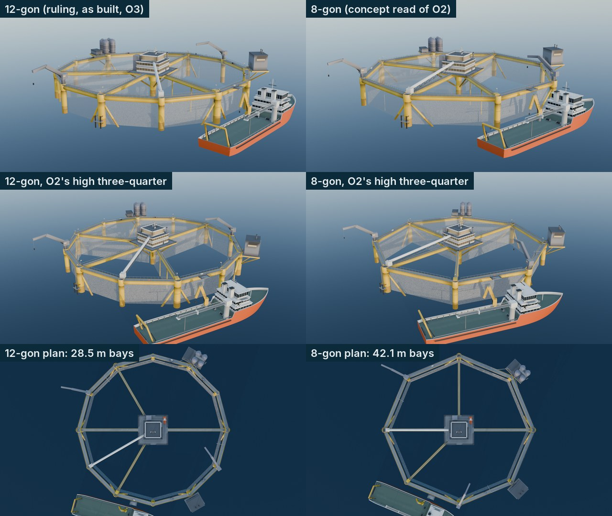
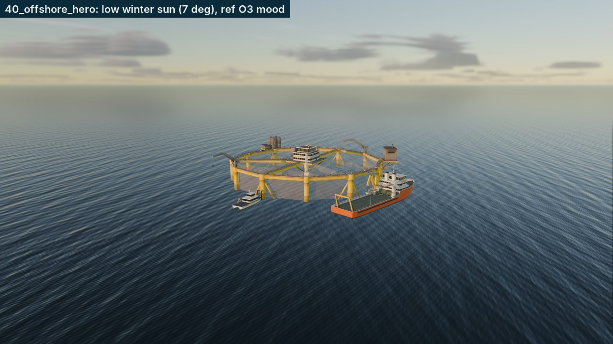
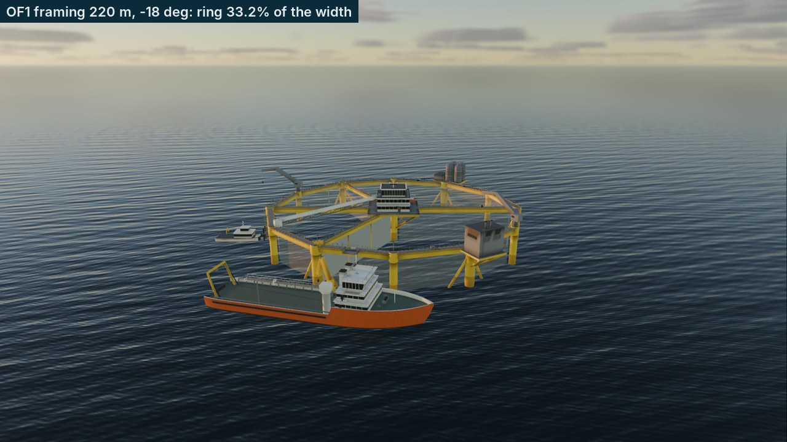
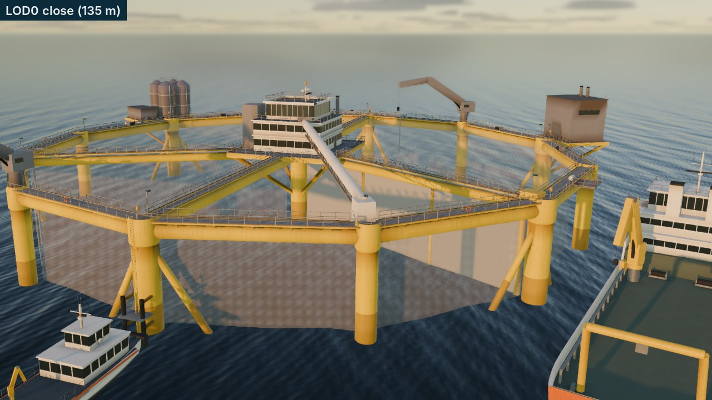
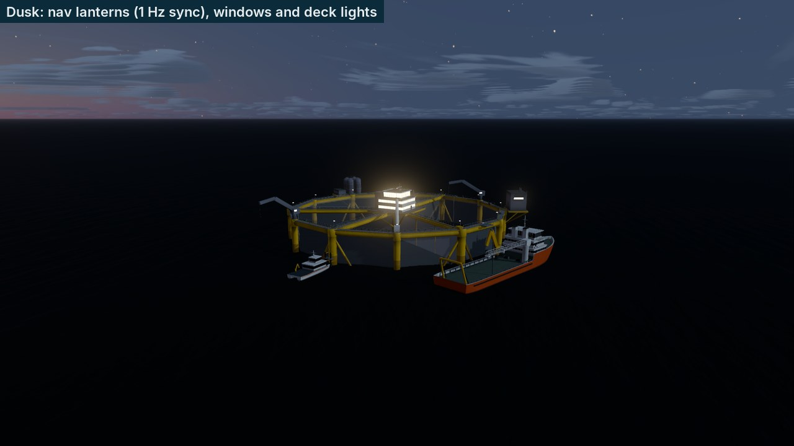
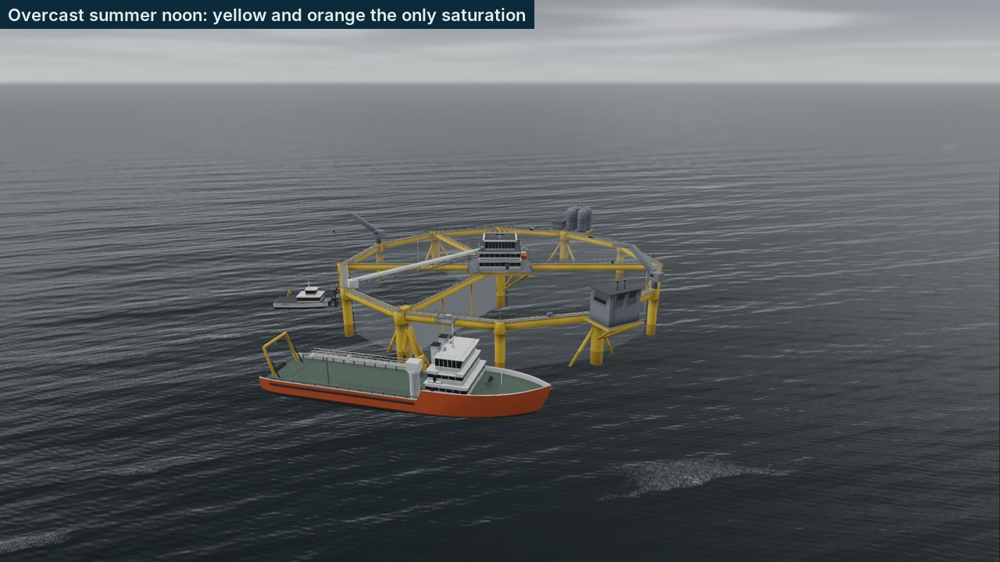
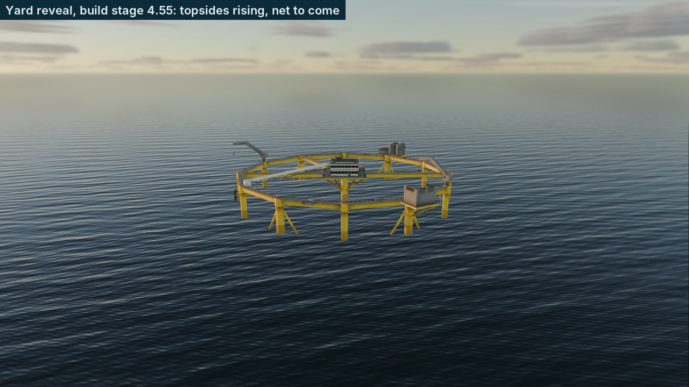
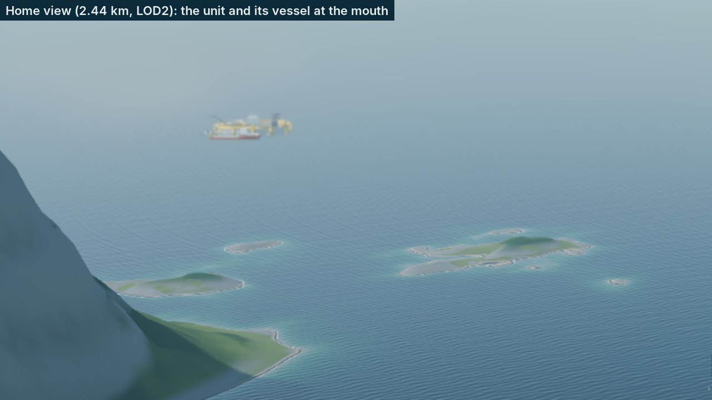

# F2-26 evidence: the OF1-class semi-submersible unit

Farm-types spec item F2-26 (§5.2, §7.3), branch `wave2/art-farm-2`. The
OF1-class unit is built headless and byte-reproducibly from code in Blender,
previewed on the real game sea at plot `off_1` (spec §4) with the F2-27 fleet
alongside, in ref O3's low winter sun, at the spec's OF1 framing, close up,
at dusk with the nav lanterns, on an overcast day, mid-build in the yard
reveal and at the shipped home view. Frames are 1280 px downscales or crops in
`f2_26/`; the preview's numbers are `f2_26_of1_metrics.json` (a copy of the
capture's `godot/screenshots/game/40_offshore_metrics.json`). The owner's
offshore references O1 (diagram), O2 (render) and O3 (photo) stay outside
the repo; the comparisons below are written against them and no reference
image is committed.

## The owner's polygon ruling, and the 12-gon against the 8-gon

The ruling (RUN_LOG §7, roadmap §9a): a **12-gon**, circumradius 55 m, large
columns on cone-ended pontoon feet alternating with slimmer columns, as on
the built structure in O3; O2's eight sides are a concept simplification.
`build_offshore.py --sides 8` builds the 8-gon with the same members,
topsides and fleet for this comparison only (it is never committed; a test
fails if an `*8gon*` file appears under `godot/`).



| | 12-gon (built) | 8-gon (concept) | Against the references |
|---|---|---|---|
| Bay width | 28.5 m (derived from [O:R6]'s 341.6 m circumference) | 42.1 m | O3 shows five to six faces on the near half and one diagonal per bay at roughly 45-55 deg: the 12-gon's bays give that rhythm; the 8-gon's 42 m bays stretch the zig-zag flat |
| Columns | 12: six Ø3.56 on cone feet, six Ø2.8 | 8: four on feet, four plain | O3: alternate columns end in cone feet at the waterline; O2 shows eight equal columns |
| Silhouette at the OF1 framing | Reads round, like O3's ring | Reads as a clear octagon, like O2 | The read gate (F2-18) measured the 12-gon gray box; the 8-gon would not change the ring's 33% share of the frame |
| Topsides | Identical in both | Identical | O2's white block, grey silos and cranes; O3's white tube from the block to the ring |

The 12-gon stands. O2 still informs the topsides: the white
accommodation/control block on the centre platform, the grey feed silos on
a deck cantilevered at the ring, the grey service house, the cranes, the
cross gantry with its walkway, the net hanging below the waterline.

## What was built

| Piece | Where |
|---|---|
| Build script (CLI, AO bake, net split, group UVs, empties, export, sidecars, budgets, `--sides 8` evidence variant) | `blender/build_offshore.py` |
| Geometry, one function per assembly, and the unit's layout | `blender/offshore_designs.py` |
| The trim-atlas code, now shared by the land kit (its atlas and LODs rebuild byte-identical) | `blender/lk_trim_atlas.py` |
| Review renders (QA, writes outside the repo; 12-gon vs 8-gon, studio views) | `blender/render_offshore_preview.py` |
| LOD0/1/2 + sidecars + import settings, the scene | `godot/assets/models/offshore/of1_class_*`, `of1_class.tscn` |
| Scene script (LOD chain, shadows, yard reveal, bulkhead, crane slew, beacon, gangway landing) | `godot/scripts/visual/OffshoreUnitModel.gd` |
| Kit material, net material, atlas, shader | `godot/assets/models/facility_kit/LK_OffshoreKit.tres`, `LK_OffshoreNet.tres`, `textures/offshore_atlas.png`, `godot/shaders/offshore_kit.gdshader` |
| Godot preview on the game world | `godot/qa/scenes/OffshorePreview.tscn`, `godot/scripts/qa/OffshorePreview.gd` (on `QaWorldCapture.gd`), shots `40_offshore_*` in `godot/qa/shots.json` (schema gained `fleet`, `tug`, `lineup`, `measure`, `nav_lights`, `build_stage`) |
| Manifest | `blender/asset_manifest.json` (`of1_class`, type `offshore_unit`), `godot/assets/asset_manifest.json` |
| Tests | `tests/test_offshore_assets.py` (38), `UiFlowTests._test_offshore_unit_and_fleet` (12 checks, shared with F2-27) |

**Layout** (Blender Z up, z = 0 the design waterline, origin on the unit's
axis): pontoon feet and the centre pontoon bottom out at **-43.0** (the
operating draft [O:R6]); the bottom ring (Ø2.05) and twelve bottom radial
beams (Ø1.75) at -35.0; the mid ring (Ø1.0) at -10.5; the top ring (Ø2.29),
the cross gantry (Ø2.05) and the top spoke at +14.0; the walkways and the
centre platform at +15.4; the control block's roof at +25.2 and the silo
tops at +25.4 (structural height **68.4 m**); the mast and the Beacon at
+28.2. One Ø1.0 diagonal per bay zig-zags through the mid ring with its apex
at the top of each large column and the bottom of each slim one, as in O3.
About 15 m of frame stand above the water with the pale EcoNet inside it,
so from the game camera the unit reads like O2 (frame, net, topsides) while
the hidden 43 m of structure is there for the yard view and the tilt pose.
The splash zone (#B8902A) is painted from 2.5 m under to 4 m over the
waterline on every member that crosses it; heave carries it with the unit.

**Topsides and outfitting**: the white control/accommodation block
(14 x 14 m, two storeys with window bands, a 10 x 10 m control room set back
on top with tall windows, a stair tower, roof gear, an exhaust, the mast
with radar, AIS/broadband domes, antennas and the Beacon); four Ø4 x 10 m
silos with a catwalk and the feed blower house on a deck cantilevered at
vertex 2, with feed pipes along the ring to two zones; a grey power house
with exhausts on a deck cantilevered at vertex 10; two knuckle cranes
reaching 18.6 m on column tops (each its own node, origin on the slew axis);
the white harvest chute from the block to the ring (ref O3's tube) on a
light truss; walkways with galvanised grating and yellow kick plates,
1.1 m handrails with posts, knee rails and toe boards round the ring, the
gantry, the spoke and the platform; net-lifting winches; deck lights;
lifebuoys and life rafts; the rescue boat on its davit; a boat landing
(ladder, fender posts, landing platform) at the large column on vertex 6
and a walk-to-work landing apron at bay 8-9 (marker node `W2WLanding`);
six nav lanterns on the large columns and the Beacon lantern.

**Material.** One kit material for every solid face (spec §5 "one material
per kit"): `LK_OffshoreKit` reads a 1024 px trim atlas of 15 strips (the
land kit's scheme: U along the surface every 16 m, V the strip's centre,
alpha = roughness or 1.0 where it glows), so a strip is the part's colour
and surface. The shader adds what a flat swatch cannot: the vessel kit's
weathering tile projected in model space (grime on every paint, rust runs
on the hull steel only), a wet, darker, glossier band round the waterline,
windows that are dark glass by day and lit at night, and nav lanterns that
flash in sync at 1 Hz (one global clock, Kystverket synchronised yellow
[O:R58]). The net and the sliding bulkhead's net use `LK_OffshoreNet`
(`pen_net_shader`, alpha-to-coverage, base #A8ADB0): at the framing it is a
pale veil that warms in low sun through the light, as the spec asks.

**Build groups.** Every vertex carries its yard group in the second UV set
(TEXCOORD_1.x): 0 Pontoons, 1 Columns, 2 Rings, 3 Bracing, 4 Topsides, 5 Net.
`set_build_stage(s)` (0..6) sets an instance uniform: groups below `floor(s)`
stand complete, the current one rises through its own height band, later
ones are not drawn, and the net and the sliding bulkhead appear with the
last stage. The same data serves the F2-31 yard picture-in-picture and the
First Sight timelapse at every LOD.

## Acceptance

| # | Criterion | Measured | Result |
|---|---|---|---|
| 1 | Owner's polygon ruling recorded in RUN_LOG §7 with the 12-gon vs 8-gon side-by-side against O2/O3; geometry follows it (12-gon, circumradius 55 ± 2.75 m) | Ruling row (2026-10-14) plus the F2-26 row; side-by-side above; sidecars: `sides` 12, `columns` 12, circumradius 55.0 m at LOD0, LOD1 and LOD2 (column centroids) | Pass |
| 2 | Height 68 ± 3.4 m, waterline at the 43 m draft | Structural height 68.4 m (feet to the silo tops; control block roof 68.2 m); draft 43.0 m (the waterline is model y = 0); mast and Beacon to +28.8 m (air draught) | Pass |
| 3 | Column diameters 3.56 and 2.8 ± 5% | 3.56 / 2.80 at every LOD; centre column 3.56; also rings 2.29 / 2.05 / 1.0, diagonals 1.0, gantry 2.05 exact at LOD0; silos 4.0 x 10.0; control block 14.0 x 14.0 x 9.8; crane reach 18.6 m | Pass |
| 4 | Triangles <= 60 k / 12 k / 1.5 k | 46,638 / 5,478 / 1,198; the build stops over `TRI_LIMITS` (equal to the spec row, tested against the spec text) | Pass |
| 5 | Fixed node names, including `Beacon` | LOD0: Hull, Columns, Bracing, Topsides, Net, Bulkhead, Cranes (CraneA, CraneB), NavLights, Beacon (+ W2WLanding); LOD1/LOD2: Hull, Net | Pass |
| 6 | Part groups for the yard picture-in-picture and the timelapse | Six groups in TEXCOORD_1 at every LOD (LOD2 has no pontoons: it keeps only what stands above z = -3 m); `40_offshore_yard` at stage 4.55 | Pass |

Also measured: the OF1 framing (220 m at -18 deg, `40_offshore_framing`)
puts the ring at **33.2%** of the frame width (spec §4: 25-45%); the hero
shot's sun stands at 7.2 deg (season 0.08, 13:24).

**Draw calls** (A/B, `perf` shots):

| View | Unit alone | Unit + service vessel | Unit + vessel + crew boat |
|---|---|---|---|
| Home view, 2.44 km (LOD2) | 2 opaque, 0 shadow | **7 opaque, 0 shadow** (budget §5.5: <= 8 + <= 6) | 12, 0 |
| OF1 framing, 220 m (LOD0) | 10 opaque, 11 shadow | 19, 25 | 27, 29 |

The §5.5 budget is met where it is set (the home view, against the P0-04
baseline). At the OF1 framing every LOD0 node is a draw (the spec's node
API: Hull, Columns, Bracing, Topsides, Net, Bulkhead with its net surface,
CraneA, CraneB, NavLights) and shadow casters draw once per cascade; LOD0
is only used inside 500 m, i.e. in the focus views. F2-20 owns the
instancing pass and can merge LOD0 nodes for units that are not being
animated if the focus view ever needs it.

## Frames

**Hero, ref O3's mood** (`40_offshore_hero`): low winter sun from the left,
the safety-yellow 12-gon on dark blue open water, the orange service vessel
broadside alongside, the crew boat on the boat landing. Against O3: the same
reading of a big yellow frame with a pale net, a white block and a white
tube on top, an orange vessel for scale and nothing else saturated. O3's
photo shows the structure higher out of the water than the operating
draft the spec fixes, and snowy hills on the horizon (G2-01's far field).



**The OF1 framing** (spec §4, 220 m at -18 deg):



**Close, LOD0**: the splash zone on the columns, the zig-zag bracing and
collars, grating walkways with yellow kick plates and handrails, the control
block, cranes, the chute, the cantilevered silo and power decks, the net
veil above the water. Against O2: the same detail density (walkways and
rails on every member, grey service houses, silos, cranes, the white block),
in a cooler palette.



**Dusk** (sun -6.9 deg, `nav_lights` 1, `night_light` 0.8): the lanterns on
the large columns and the mast flash together; window bands and deck lights
are lit at a quieter emission than the land kit's (0.9 vs 2.4: the block's
three window bands would otherwise bloom into one white box).



**Overcast summer noon**: spec pillar 7, the yellow hull and the orange
vessel are the only saturation.



**Yard reveal** (build stage 4.55): pontoons, columns, rings and bracing
complete, the topsides rising through their band, the net to come.



**Home view** (2.44 km, LOD2, 2x crop): a yellow sliver with its vessel at
the fjord mouth, as spec §5.5 rule 1 expects (the status chip below fog
transmittance 0.4 is F2-21's).



## Reproduce

```bash
# build (deterministic; a second build into a temp dir is byte-identical)
/Applications/Blender.app/Contents/MacOS/Blender -b --factory-startup \
    --python blender/build_offshore.py -- --textures
# evidence-only 8-gon, review renders (outside the repo)
Blender -b --factory-startup --python blender/build_offshore.py -- --sides 8 --lod LOD0 --out /tmp/x
Blender -b --factory-startup --python blender/render_offshore_preview.py -- --out /tmp/x --vessel offshore_service
# preview on the game world
tools/capture_screenshots.sh --scene res://qa/scenes/OffshorePreview.tscn
```
