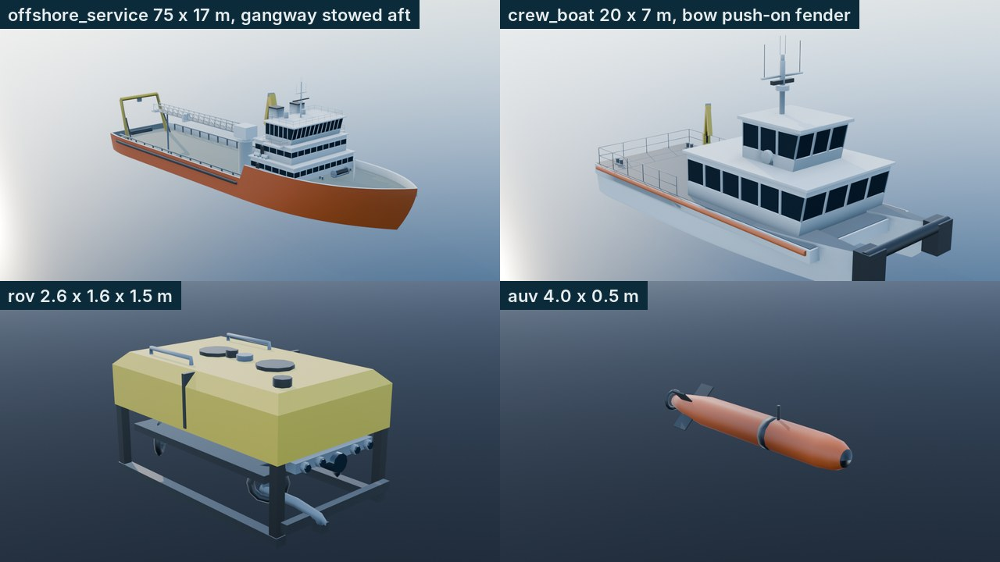
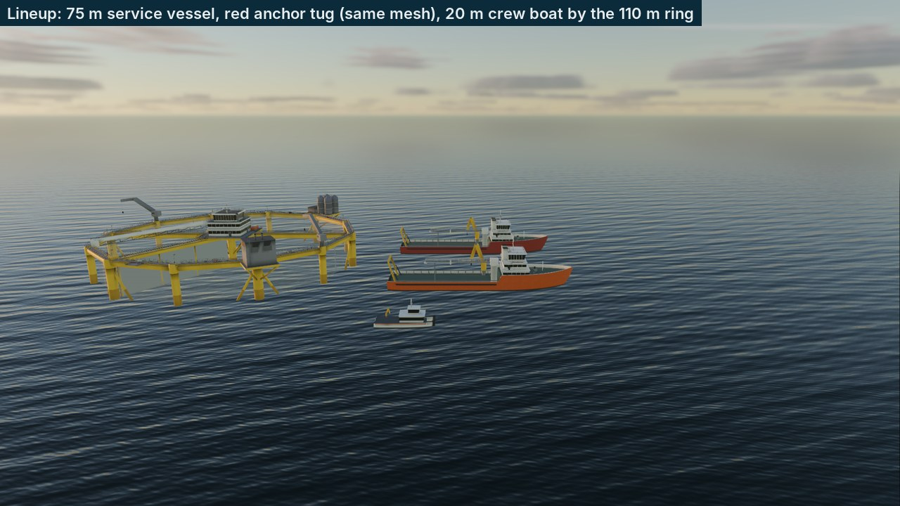
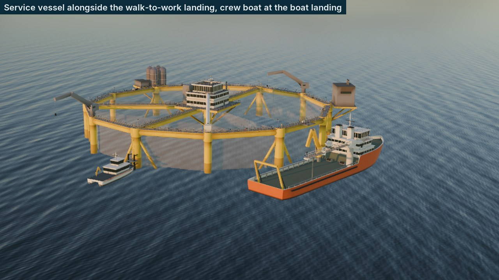

# F2-27 evidence: the offshore fleet

Farm-types spec item F2-27 (§5.2, §7.3), branch `wave2/art-farm-2`. The
offshore fleet joins the A3-01 vessel pipeline (`blender/vessel_designs.py`,
`blender/build_vessels.py`, the vessel kit materials and `VesselModel.gd`):
a DP offshore service vessel with a walk-to-work gangway, a crew transfer
catamaran, a work-class ROV and an AUV, plus the anchor tug as a swatch
variant of the service vessel. Previewed with the F2-26 unit on the game
sea (`godot/qa/scenes/OffshorePreview.tscn`, shots `40_offshore_hero` and
`40_offshore_lineup`; numbers in `f2_26_of1_metrics.json`) and in Blender
studio renders (`blender/render_offshore_preview.py --studio`, outside the
repo). The owner's references O1 (diagram: DP service vessels, an ROV, AUVs)
and O3 (photo: an orange-hulled service vessel alongside, a fast boat with
a wake) are not committed.

## What was built

| Asset | What | Size (measured) | Triangles LOD0 / LOD1 / LOD2 (budget) |
|---|---|---|---|
| `offshore_service` | DP service vessel: orange hull #C9531F with the vessel kit's black boot-top, white superstructure forward (two accommodation tiers, a bridge with a raked front, bridge wings and a radar mast), twin exhausts, a motion-compensated walk-to-work gangway (tower, slewing head, 26 m telescopic box truss stowed aft on a rest; node `Gangway`), the cargo deck with cargo rails and tugger winches, a knuckle crane to port, a stern A-frame, windlass, life rafts, rescue boat | 75.0 x 17.0 m (spec 75 x 17, artist est.) | 19,377 / 3,697 / 620 (30,000 / 6,000 / 800) |
| `anchor_tug` | `offshore_service.tscn` with the Hull surface of every LOD overridden by the vessel kit's red hull (`vessel_hull_red_material.tres`) | the service vessel's | none of its own |
| `crew_boat` | Crew transfer catamaran: white demihulls (#E9ECEA, new `LK_VHullWhite` with the boot-top), dark slate deck (#34424B), orange rubbing strakes, the bow push-on fender for the boat landing, a passenger cabin with big windows and the wheelhouse on top, a small crane, rails, twin waterjets | 20.0 x 7.0 m (spec 20 x 7) | 7,186 / 1,288 / 292 (8,000 / 1,500 / 300) |
| `rov` | Work-class ROV: yellow syntactic foam (#E6BE2E, new `LK_VSubseaYellow`, no waterline) in two blocks over a dark frame on skids, four vectored thrusters in nozzles, two vertical thrusters, camera and light bar, bumper, folded manipulator, grab rails, lifting point, sonar head | 2.60 x 1.60 x 1.49 m (spec 2.6 x 1.6 x 1.5) | 1,094 / 152 (1,200 / 300) |
| `auv` | AUV: orange torpedo (#C9531F, new `LK_VSubseaOrange`) with a dark nose cap and sensor band, X fins, ducted propeller, antenna | 3.88 x 0.50 m body (spec 4.0 x Ø0.5) | 432 / 120 (600 / 150) |

The subsea props have two LODs (spec §5.2 lists two budgets) and their
scenes stop drawing at 250 m; `build_vessels.py` gained per-asset part
materials and folds (`ASSET_PARTS`, `ASSET_ALIASES`) and assets with fewer
LODs (`lods_for`). The existing fleet rebuilds byte-identical (workboat, RIB
and the wellboat LOD1 checked: `.glb` and sidecars unchanged).

**The gangway node.** `VesselModel.gd` (being reworked by the wave-2
integration fixer) is unchanged: the gangway is a separate part only at
LOD0, and `offshore_service.tscn` gives the inherited `Gangway` node the
LOD0 visibility range (ends at `lod_switch.x`, 300 m); LOD1 and LOD2 fold
it into the superstructure. The node's origin is the tower's slewing axis
(sidecar `pivots.Gangway`, (5.7, 2.5, -5.0) m: starboard, deck level, just
aft of the house), so F2-22 slews it by turning the node and luffs it to the
unit's `W2WLanding` marker; telescoping the boom is F2-22's (the stowed
length is 26 m).

**The anchor tug.** `anchor_tug.tscn` inherits `offshore_service.tscn` and
overrides `surface_material_override/0` on `Hull`, `LOD1/Hull` and
`LOD2/Hull` (the LOD instances are marked editable); it references no mesh
and no `.glb`. Loaded in Godot, every Hull surface reads `LK_VHullRed`.



## Acceptance

| # | Criterion | Measured | Result |
|---|---|---|---|
| 1 | Service vessel 75 x 17 m and crew boat 20 x 7 m ± 5% | 75.0 x 17.0 and 20.0 x 7.0 at every LOD (moulded hull) | Pass |
| 2 | The anchor tug is a swatch variant with zero new meshes | A scene of material overrides on the service vessel; no `anchor_tug*.glb`; every Hull surface red (UI-flow check) | Pass |
| 3 | Triangle budgets met | Table above; `TRI_LIMITS` and the manifest equal spec §5.2 (tested against the spec text); the pipeline verifier passes all 10 new LODs | Pass |
| 4 | The service vessel is visibly shorter than OF1's diameter, and the gangway node exists | 75.0 m against the ring's 110 m (68%); `Gangway` in the LOD0 glTF and the scene; see the lineup | Pass |



**Alongside** (`40_offshore_hero`): the service vessel lies alongside the
walk-to-work landing with its hull side 6 m off the ring, the crew boat
pushes its bow fender onto the boat landing's fender posts. Against O3: the
orange hull with a white house reads the same at the same scale against the
yellow ring. Wakes and the bob on the waves are G2-03/F2-22's.



## Reproduce

```bash
for a in offshore_service crew_boat rov auv; do
  /Applications/Blender.app/Contents/MacOS/Blender -b --factory-startup \
      --python blender/build_vessels.py -- --asset $a
done
Blender -b --factory-startup --python blender/render_offshore_preview.py -- --out /tmp/x --studio --vessel rov
```
