# F2-28 evidence: the construction kit

Farm-types spec item F2-28 (§5.3, §6.3, §7.3), branch `art/construction-kit`.
Four construction assets (a tower crane, a scaffold ring, an excavator and
blast mats), 9 LODs, on the land kit's one material, built headless and
byte-reproducibly from code, plus the asset set of every §6.3 construction
phase as data (`construction_phase_sets` in the manifest, cross-checked
against the spec text and the engine's phase keys). Frames are 1280 px JPEG
downscales in `f2_28/`: Blender review renders of the committed GLBs (EEVEE,
AgX, the trim atlas and the baked AO roughly as `facility_kit.gdshader` draws
them) beside the land kit's tanks and hall at the F2-25 scale. The kit is not
drawn in the game yet, and no spec row assigns that: F2-20's presenter
(`LandCampusBuilder`) draws tanks and phase state without it, F2-22 is
logistics beats and F2-24 weather. So there is no Godot capture here, only
the import checks below. The owner's
reference brief has no photograph of construction equipment; what it fixes
is the palette rule (saturation is reserved for equipment, so the temporary
yellow of a building site is spec §5.3's #E6BE2E), and the frames are set
against that.

*Update 2026-10-21: the kit is drawn in the game since, by `ConstructionKitVisual` (`construction_kit_presenter.md`), and the scaffold ring's LOD1 was thickened there (outer Ø30.1, still 128 triangles). This record stays as the merge's: its numbers and "not drawn yet" are F2-28's own.*

## What was built

| Piece | Where |
|---|---|
| Build script (CLI, atlas, AO bake, join, export, sidecars, budgets) | `blender/build_construction_kit.py` |
| Asset geometry, one function per asset and LOD | `blender/construction_designs.py` |
| One atlas strip appended: `crane_yellow` #E6BE2E, row 27 | `blender/build_land_base.py` `STRIPS`; `godot/assets/models/facility_kit/textures/facility_atlas.png` (only row 27 changed; the land kit's rows and the shader's `ROW_*` constants keep their indices) |
| Review renders (QA, write outside the repo) | `blender/render_construction_preview.py` |
| 9 LODs + sidecars + import settings | `godot/assets/models/construction_kit/` |
| Manifest: 4 entries (type `construction_kit`) and `construction_phase_sets` | `blender/asset_manifest.json`; the verified hashes in `godot/assets/asset_manifest.json` |
| Tests | `tests/test_construction_kit_assets.py` (53) |

**One material, one surface per LOD.** The kit shares the land kit's
`LK_FacilityKit` material and trim atlas, so the presenter can instance the
scaffold ring beside a tank MultiMesh with the same shader: `INSTANCE_CUSTOM.r` build
progress discards fragments above progress x `build_height_m` (13 m), which
is the ring's height too. The spec's part names (`Mast`, `Jib`, `Standards`,
`Tracks`, ...) live on as named parts in each sidecar (triangles and strip per
part) and as strips of the atlas. Cycles bakes ambient occlusion against a
ground plane into the vertex colour (LOD2 is white). The new yellow is a flat
strip at roughness 0.5.

| Asset | What is modelled (LOD0) |
|---|---|
| `tower_crane` | A 1.7 m square lattice mast (1.92 m over the chords: four chords, a ring and zig-zag diagonals at each of 20 bays) on a concrete base with four ballast blocks; slewing unit; an operator cab with glass and a machinery house on the counter-jib; a 50 m jib of three chords with 20 bays of diagonals and cross frames, a trolley, hoist rope and hook; a 17 m counter-jib with four concrete counterweights; a four-legged cathead up to 60 m with four pendants to the jib and counter-jib; two warm-white lamps (cathead apex and jib tip, the `lamp` strip, emissive at night). LOD1 keeps the four chords, three long diagonal bays (no rings), six jib bays, a prism counter-jib with one block and a single-pole cathead; LOD2 is a 34-triangle silhouette |
| `scaffold_ring` | 24 standards at R 14.70 and six lifts (2 to 12 m) of grating boards (R 14.48 to 14.75), a guard rail 1 m above each lift (the top one at 13 m), X-braces on every third bay in three tiers, a ladder on the seaward side. LOD1: 16 ribbon standards, two lifts and the top rail |
| `excavator` | Tracked undercarriage (ribbed shoes, sprocket, idler and rollers), house with counterweight, a cab with glass, boom, stick and an open bucket with teeth resting on the ground in a digging pose, three hydraulic cylinders, exhaust. LOD1 drops the shoe ribs, the wheels, the exhaust and the bucket's scoop (a block), and the bucket cylinder |
| `blast_mats` | A 12 x 8 m blanket: 18 rubber mats (3 x 2 m, 0.12 m thick; half mats at the ends of every other row) in a running bond, a second layer of six 2 x 3 m mats crossing it, steel lashings along the row seams. LOD1: four long slabs and one crossing block |

## Acceptance

Criteria 1 to 4 are the F2-28 row of the spec; 5 and 6 are what the row's
neighbours (F2-25, the asset pipeline) have always required of an asset PR.

| # | Criterion | Measured | Result |
|---|---|---|---|
| 1 | Tower crane 50 m mast and jib, +-5% (47.5 to 52.5 m) | Mast 50.04 m (LOD0), 50.007 (LOD1), 50.0 (LOD2); jib 50.042 / 50.016 / 50.0, measured from the mast axis; counter-jib 17.07 m; cathead top 60.0 m. The other three assets are inside their spec numbers too (table below) | Pass |
| 2 | The scaffold ring (Ø29.5 m) fits `tank_growout` | Outer Ø29.541 m (+0.14%), 13.0 m tall, as tall as the shell. The platform polygon's inscribed radius is 14.356 m against the committed tank's plinth reach of 14.300 m (read from the plinth's own vertices in `tank_growout_LOD0.glb`): 5.6 cm clear all round, and the nearest ring vertex to the axis is 14.48 m. LOD1 has no plinth: shell R 14.0, ring inscribed R 14.202. At the 32 m pitch the ring's outer radius 14.77 plus the neighbour's walkway reach (14.0 + 1.3) is 30.07 m, under 32 | Pass |
| 3 | Triangle budgets met | Table below; the build stops over `TRI_LIMITS` ("tower_crane LOD1 has N triangles, over its 300 budget"), the manifest pins each LOD at what was built (`tri_budget`) under the spec ceiling (`tri_max`), and the asset verifier enforces both | Pass |
| 4 | Every land and offshore construction phase in §6.3 has its asset set (manifest cross-check test) | 7 land and 7 offshore rows, read from the spec text, each with its set in `construction_phase_sets`; every engine key (`LandConstructionPhases.cs`, `OffshoreProfiles.cs`: 6 land, 6 offshore) is drawn by a spec row; every asset a row names exists in the manifest, except `mooring_line_kit`, listed as `pending` (F2-29); none of the four assets is an orphan (see below) | Pass |
| 5 | One `LK_FacilityKit` surface per LOD; swatches match §5.3 | glTF of all 9 LODs: 1 mesh, 1 primitive, 1 material; the spec swatches are strips whose median texel is within dE76 3 of the spec hex (mast and jib #E6BE2E, `House` #E6BE2E, `Tracks` and `Mats` #1C1E20, `Standards` #8A9096). Imported by Godot 4.7.2 (headless, silent) and instantiated, all 9 LODs are one `MeshInstance3D` with one surface on `LK_FacilityKit.tres`, the triangles read back from the imported mesh are inside the budgets, and the AABBs equal the sidecars' sizes (a throwaway script: SHIP_PLAN §3 freezes the UI-check count, so the committed guard is the static import-settings test) | Pass |
| 6 | A rebuild reproduces byte-identical files | A second full build into a scratch directory: 18 of 18 `.glb` / `.json` files and the atlas identical (`cmp`). The test rebuilds five LODs plus the atlas and compares SHA-256 | Pass |

| Asset | Spec (m) | Measured LOD0 / LOD1 (m) | Triangles LOD0 / LOD1 / LOD2 | Spec budget |
|---|---|---|---|---|
| `tower_crane` | mast 50, jib 50 | 50.04 / 50.007, 50.042 / 50.016 | 1,620 / 274 / 34 | 2,500 / 300 / 40 |
| `scaffold_ring` | Ø29.5 x 13 | Ø29.541 x 13.0 / Ø29.5 x 13.0 | 1,000 / 128 / - | 1,500 / 200 |
| `excavator` | 10 x 3.5 x 3.5 | 10.0 x 3.5 x 3.5 / 10.0 x 3.4 x 3.5 | 662 / 130 / - | 2,000 / 300 |
| `blast_mats` | decal stack (no size in the spec) | 12.0 x 8.0, 0.24 high (two layers) | 264 / 50 / - | 2,000 / 300 |

The spec gives the excavator and the blast mats one row (2,000 / 300); each
asset gets that budget. The crane has three LODs and the other assets two
because that is what the spec's §5.3 table budgets; the build refuses a LOD
the spec has no budget for. The mats have no dimensions in the spec ("mats as
a decal stack"): 12 x 8 m and 0.12 m a layer are an artist estimate, recorded
in the manifest as such.

GLB sizes: crane 140,692 / 24,908 / 4,320 bytes, scaffold 76,296 / 9,928,
excavator 49,640 / 12,548, mats 24,024 / 5,616: 347,972 bytes for the kit.

## Construction phases (criterion 4)

`construction_phase_sets` has one entry per spec phase row, keyed by the
row's first cell, with the engine phase keys that draw it, the manifest
assets it shows, what is still `pending`, and a note.

| Phase (§6.3) | Engine key | The kit's assets |
|---|---|---|
| Land: Blast pad | `site_works` | `blast_mats`, `excavator` |
| Land: Foundations | `site_works` | the land tanks' own plinths (no asset of this kit) |
| Land: Tank rings rise | `tank_rings` | `scaffold_ring` on each rising tank |
| Land: Treatment hall | `treatment_hall` | `tower_crane` beside the hall bays |
| Offshore: Tow to the plot | `tow` | three anchor tugs: `anchor_tug.tscn` (F2-27, `offshore_service` with a red hull; spec §5.2), no new geometry |
| Offshore: Mooring | `mooring` | tugs, and `mooring_line_kit` as `pending` (F2-29) |

The other rows (intake and outfall, commissioning, first smolt, yard
contract, hull, voyage, commissioning, first stocking) show assets that
already exist (quay, pipe bridge, tanks, `of1_class`, crew boat, wellboat).
The sets are the contract for whoever draws the kit in the presenter; the
manifest is build-side data and the game does not load it.

**Strike the ring when `tank_rings` ends.** The ring's top lift (boards at
12 m, rail at 13 m) stands in the height band of the tank's walkway (grating
from 12.57 m, reaching R 15.3), so the two must never show together. They
do not, in the presenter as it is: when `tank_rings` ends the walls stand at
`WALLS_TOP_PROGRESS` 0.96 = 12.48 m, and the shader reveals nothing higher.
`test_the_ring_is_struck_before_the_walkway_shows` pins that arithmetic (it
fails if the walls' top moves above the walkway, or the walkway moves down)
and the manifest note says it.

## Frames

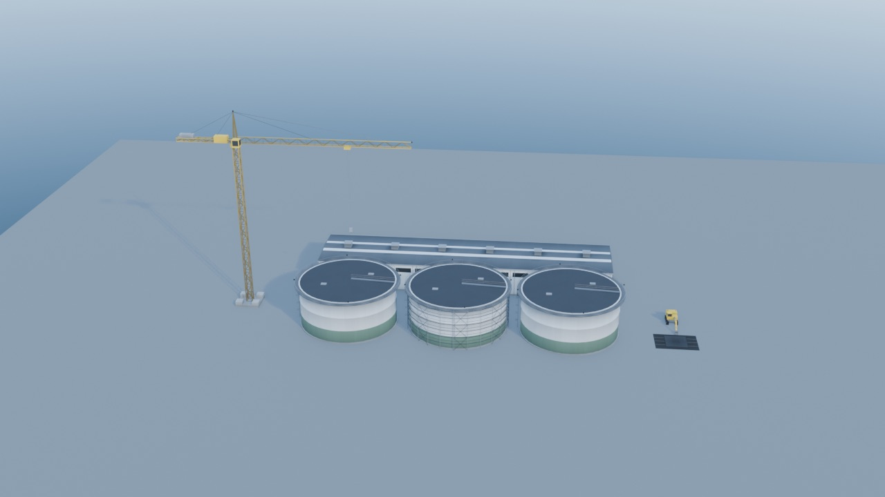

A building site at the F2-25 land scale: three Ø28 m grow-out tanks 32 m
apart, the middle one in its scaffold ring, the crane at the end of the row
with its jib over the first tank, a process hall behind, the excavator on its
mats. The crane is the one tall yellow line on the pad.

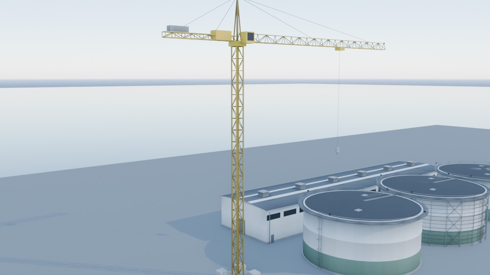

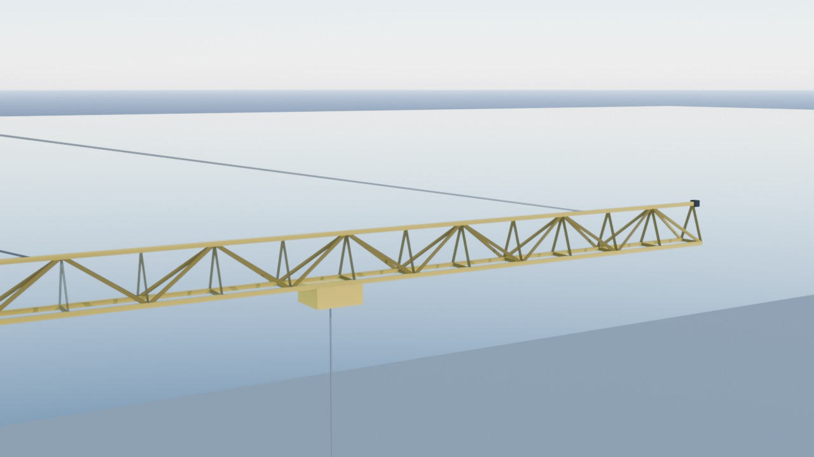

The crane: lattice mast on its base, slewing unit, cab, the triangulated jib
with trolley and hook line, counter-jib with ballast, cathead and pendants.

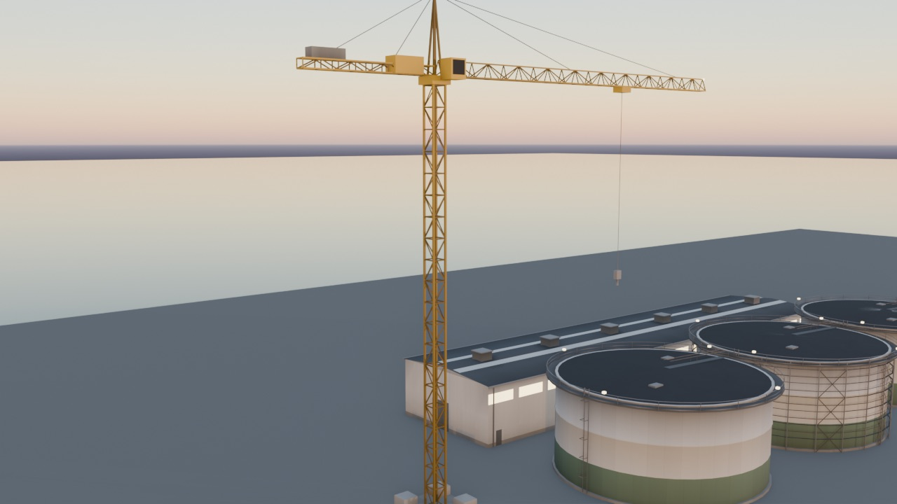

At dusk the yellow stays the warm accent of the pad, and the crane's two
lamps (cathead apex, jib tip) glow with the land kit's lid lights.

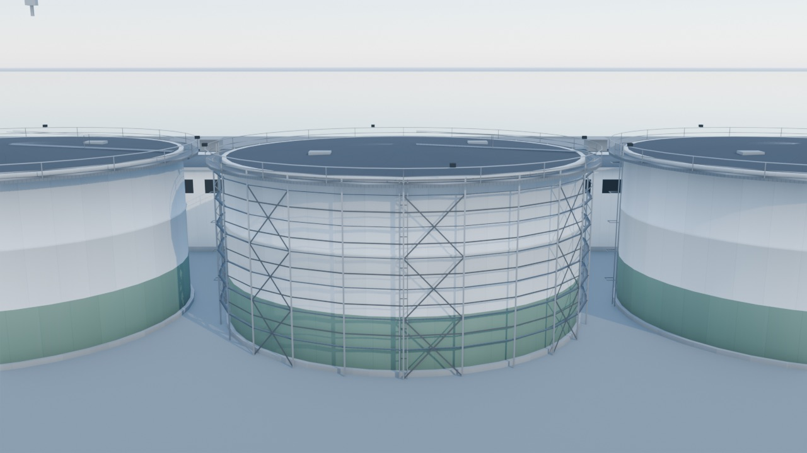

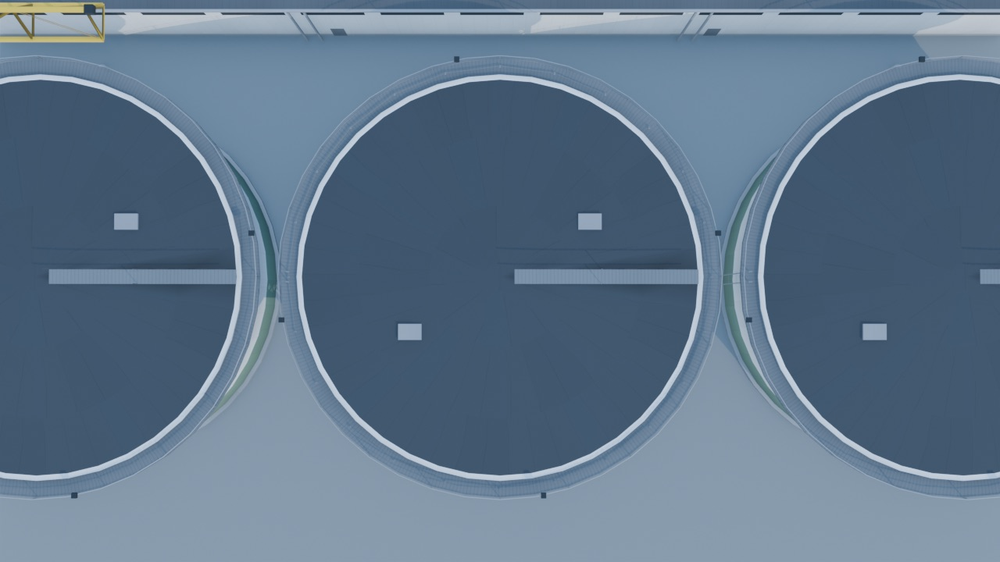

The ring on a grow-out tank: standards, lifts of boards with guard rails,
X-braces and the ladder, standing clear of the shell. From straight above the
ring is not visible: it stays inside the tank's own walkway reach, so a ringed
tank keeps its 32 m pitch footprint.

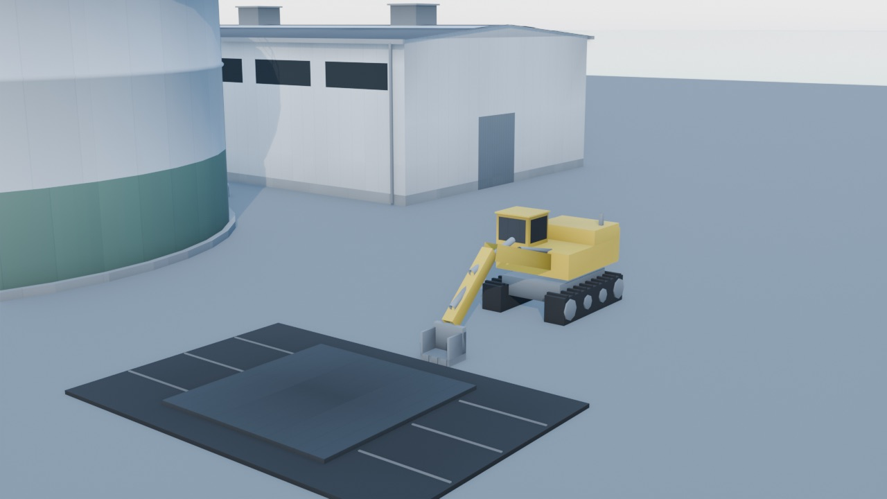

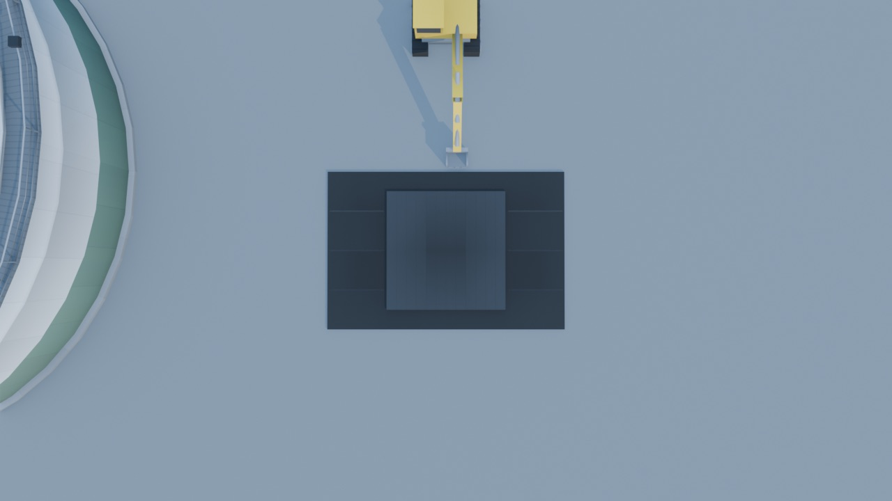

The excavator at work, bucket open on the ground at the edge of the blanket,
and the mats from above: the ground layer, the crossing layer and the
lashings along the seams. The second layer is the seamed rubber strip
(`conveyor`, #2E3236) rather than the flat #1C1E20 of the ground layer, so the
two layers read apart from above; only the ground layer is the spec swatch.

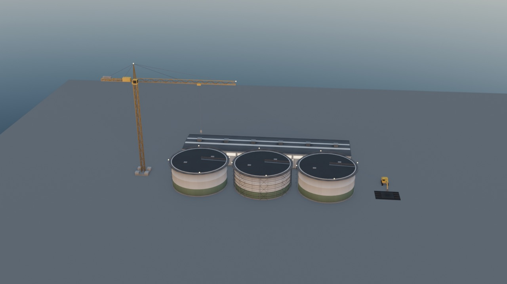

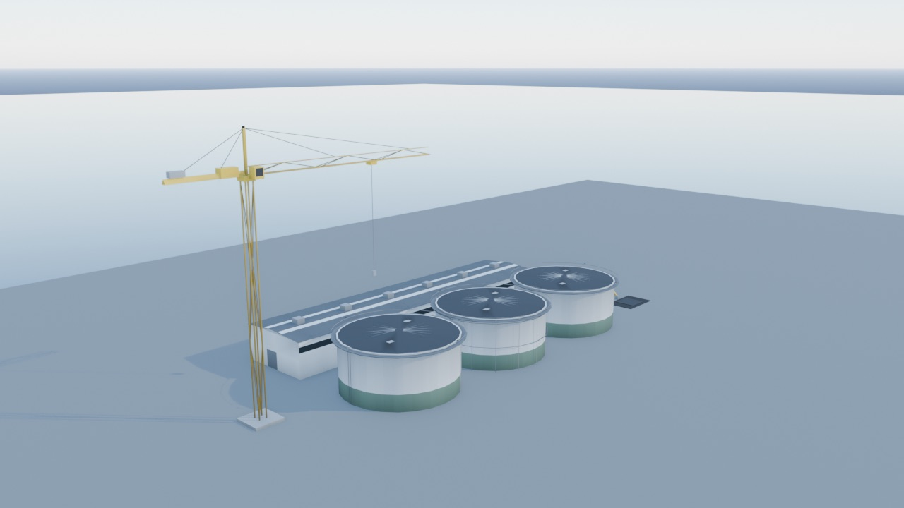

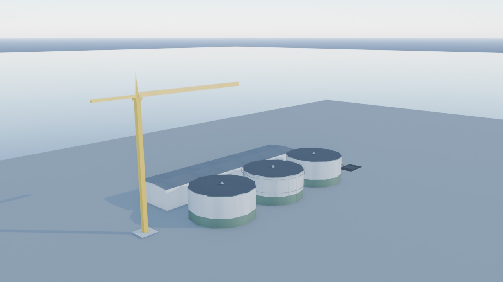

LOD1 (crane 274, scaffold 128, excavator 130, mats 50 triangles; the tanks
and hall are the land kit's LOD1) keeps every shape: the crane its mast, jib,
cab and rigging; the ring a see-through cage. At LOD2 only the crane has one:
34 triangles of mast, jib, counter-jib and cathead; the scaffold, excavator
and mats stay at LOD1. Seen obliquely, the LOD1 mast's three long diagonals
cross and read as braided rather than latticed: acceptable at the distance
where LOD1 is drawn, and noted for the presenter's LOD distance bands.

## Checks that fail without the code

Each is a scripted mutant of the committed inputs, run through the tests it
should break, with every file restored byte-identical afterwards (the kit
directory and the sources compare equal to a backup).

| Mutant | Caught by |
|---|---|
| Crane spec mast 50 -> 40 m in the manifest | manifest dimensions |
| `scaffold_ring` removed from "Tank rings rise" | the spec words name their assets |
| The "Mooring" row deleted | every spec phase has its asset set |
| An engine phase misspelt in "Treatment hall" | every engine key is drawn |
| An existing asset left in `pending` | every spec phase has its asset set |
| A phase asset that does not exist | every spec phase has its asset set |
| Crane LOD1 budget 300 -> 250 in the build script | every spec row is built with its budget |
| `crane_yellow` moved before `skylight` in the atlas | the strip is appended |
| Excavator LOD1 import with generated LODs | the import uses the kit material |
| Scaffold `R_IN` 14.48 -> 14.20, rebuilt | the ring fits `tank_growout` |
| Crane mast 50 -> 40 m, rebuilt | dimensions and the 50 m crane |
| Crane base sunk 0.5 m, rebuilt | nothing sinks into the ground |
| `WALLS_TOP_PROGRESS` 0.96 -> 0.99 | the ring is struck before the walkway shows |
| `WALLS_TOP_PROGRESS` renamed | the same test, with "moved or renamed?" |

## Reproduce

```
/Applications/Blender.app/Contents/MacOS/Blender -b --factory-startup \
    --python blender/build_construction_kit.py -- --textures        # 9 LODs + atlas
python3.12 .claude/skills/ecc/blender-asset-pipeline/blender_asset_pipeline.py --verify-only
env GODOT_MCP_TOKEN_PATH=$(mktemp -d)/t godot-mono --headless --audio-driver Dummy --path godot --import
/Applications/Blender.app/Contents/MacOS/Blender -b --factory-startup \
    --python blender/render_construction_preview.py -- --out /tmp/construction
python3.12 -m pytest tests/test_construction_kit_assets.py -q
```

`--verify-only` rewrites `godot/assets/asset_manifest.json` (the verified
hashes). The review script also takes `--lod LOD1`, `--dusk` and `--shots`.

## Left for later items

- **Drawing the kit** is unassigned in the spec (see the top): a presenter
  task for `LandCampusBuilder` and the offshore yard. The crane at the hall's
  end for `treatment_hall`; the ring on each rising tank for `tank_rings`,
  struck when the phase ends (see above); the excavator and mats for the
  blast share of `site_works` (`BLAST_SHARE` 0.6). The dust puff on each blast
  day (§6.3) is a particle effect no row owns either.
- The kit is static: one mesh per LOD, so no slewing jib, trolley or digging
  arm. The parts are built separately in `construction_designs.py` and joined
  at export, so a split-part export is a build-script option if a presenter
  wants motion.
- F2-29 delivers `mooring_line_kit`, the one asset the phase sets list as
  `pending`.
- The mats' size and the excavator-and-mats budget split are interpretations
  of a spec row that gives neither; both are recorded above and in the
  manifest.
