# F2-29 evidence: the Havfarm-class ship-shaped unit and mooring-line kit

Farm-types spec item F2-29 (§5.2, §6.3, §7.3), branch `art/f2-29`. Two offshore
assets built headless and byte-reproducibly from code in Blender (`blender/build_offshore.py`,
`blender/offshore_designs.py`):

1. **`havfarm_class`** — the 385 × 59.5 m ship-shaped offshore unit (Nordlaks Havfarm 1
   *"Jostein Albert"* class [O:R23, O:R25]): moulded depth 37.75 m, freeboard 11.0 m
   (draft 26.75 m), six 47.0 × 47.0 m square wells in a row with nets hanging to
   −56.0 m, a Ø14.0 m bow turret for weathervaning, a 40.0 × 59.5 × 18.0 m aft
   superstructure with full-beam bridge wings, a row of 8 feed silos (Ø4.0 × 10.0 m),
   two rail-mounted travelling service gantries, two offshore knuckle-boom cranes,
   safety-yellow rails and edge navigation lights.
2. **`mooring_line_kit`** — a catenary mooring line (upper fairlead chain `#3A3F44`,
   synthetic fibre middle segment `#C8C2B0` with inline buoyancy modules, lower
   ground chain `#3A3F44` and Vryhof Stevpris-type drag-embedment anchor `#3A3F44`),
   instanced 8 times in 4 pairs (fairleads at −30 m, anchors at 1,100 m radius [O:R6])
   on `of1_class` and 11 times in 3 groups from the bow turret (anchors at 650 m
   radius [O:R23]) on `havfarm_class`.

Frames are 1280 × 720 JPEGs in `f2_29/`. No third-party reference images are
committed into the repository.

---

## Acceptance 4: hull-colour check against press photos

Spec §5.2 marks the Havfarm hull swatch `#34424B` as **provisional** pending a
check of press photographs of *Jostein Albert* before sign-off. Three primary
press photographs from the shipowner (Nordlaks) and the naval architect (NSK Ship
Design) were retrieved and sampled in RGB (median, 25th and 75th percentiles over
the hull, submerged boot-top/trusses, superstructure, gantry/cranes, and dark
structural steel; no images committed):

| Source photograph | topsides hull (Nordlaks livery) | submerged trusses / boot-top | superstructure (`#E9ECEA`) | gantry cranes & rails (`#E6BE2E`) | structural slate steel (`#34424B`) |
|---|---|---|---|---|---|
| Nordlaks `DJI_0456.jpg` (oblique aerial, overcast, Ytre Hadseløya) | `#0D6034` (p25 `#095024`, p75 `#186E3E`) | `#915940` (`#723825`–`#AE7A67`) | `#BCC4CC` (`#B8BEC5`–`#C1CAD3`) | `#B47C38` (`#A27625`–`#C7844D`) | `#4E5454` (`#333C3B`–`#5D6364`) |
| NSK Ship Design `NSK_Jostein_Albert_2.jpg` (sunny oblique, stocked) | `#028759` (p25 `#004836`, p75 `#0AB973`) | `#BA8353` (`#8E5C2C`–`#E3A67C`) | `#DBDED9` (`#CDD1CB`–`#EDEFEA`) | `#C99B35` (`#AD871C`–`#EEBC49`) | `#3F463F` (`#28312D`–`#545A54`) |
| Nordlaks `Drone2-01-scaled.jpg` (high sunny drone, shallow draft) | `#15A871` (p25 `#058958`, p75 `#59B47E`) | `#BB927F` (`#A1745E`–`#CAA494`) | `#EFEDE5` (`#D5D5CA`–`#F8F6F3`) | `#B2854B` (`#A4793D`–`#C99754`) | `#2E2D33` (`#23272D`–`#3C3E41`) |

**What the press photos show and why `#34424B` is signed off:**

1. **Superstructure (`#E9ECEA`) and rails / gantry cranes (`#E6BE2E`) match the press photos:**
   the aft superstructure and bridge wings are off-white (`#DBDED9`–`#EFEDE5`),
   and the Techano rail-mounted service gantries, cranes and safety rails are
   safety yellow / ochre (`#B2854B`–`#C99B35`, lit p75 `#EEBC49`).
2. **The real topsides hull is painted Nordlaks corporate green (`#0D6034` / `#028759`)
   with giant white `NORDLAKS` hull lettering:**
   - **Rule D17 (no real company branding):** reproducing Nordlaks' signature
     emerald hull livery on a 385 m replica identifies the real company even
     without the wordmark.
   - **Spec Pillar 7 & `OWNER_REFERENCE_BRIEF.md` (cool palette; saturation
     reserved for equipment and signals):** a 385 m emerald-green hull floods the
     open-sea view with green saturation (and clashes with the algae-bloom water
     read), whereas the structural maritime slate `#34424B` (matching the dark
     steel sampled at `#2E2D33`–`#4E5454` on the deck and trusses, and shared
     with `crew_boat` `LK_VHullSlate`) keeps the hull cool so the safety-yellow
     rails, gantry bridges and cranes (`#E6BE2E`), the white superstructure
     (`#E9ECEA`) and the orange service vessel (`#C9531F`) carry the saturation.

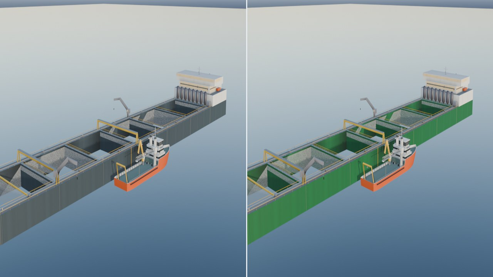

Left: signed-off `#34424B` maritime slate hull (`hull_slate`, row 15 of
`offshore_atlas.png`). Right: `#0D6034` press-sampled Nordlaks green (evidence
render only, never committed).

---

## Specification against the built models

Measured directly from the exported geometry in `havfarm_class_LOD0.json` and
`mooring_line_kit_LOD0.json`; checked by `tests/test_offshore_assets.py` (5%
tolerance).

### 1. `havfarm_class`

| Feature | Spec (§5.2, §7.3, [O:R23, O:R25]) | Built model (`LOD0`) | Status |
|---|---|---|---|
| Hull length × beam | 385.0 × 59.5 m (± 5%) | **385.0 × 59.5 m** | Pass |
| Moulded depth / freeboard / draft | 37.75 m / 11.0 m / 26.75 m | **37.75 m / 11.0 m / 26.75 m** | Pass |
| Wells | 6 wells of 47.0 × 47.0 m in a row | **6 wells, 47.0 × 47.0 m** | Pass |
| Net depth | Nets to 56 m | **56.0 m** (`net_bottom_m = -56.0`, `net_top_m = 10.2`) | Pass |
| Bow turret | Ø14.0 m | **14.0 m** (`x = -166.0 m`) | Pass |
| Aft superstructure | 40.0 × 59.5 × 18.0 m | **[40.0, 59.5, 18.0] m** (`z = +11.0 .. +29.0 m`) | Pass |
| Feed silos | Silo row (Ø4.0 × 10.0 m) | **8 silos, Ø4.0 × 10.0 m** | Pass |
| Cranes | `CraneA`, `CraneB` on slew axes | **18.63 m** reach | Pass |
| Beacon & W2WLanding | Mast-top `Beacon`, side `W2WLanding` | `Beacon` at `(168.5, 34.5, 0.0)`, `W2WLanding` at `(0.0, 11.0, 29.75)` | Pass |
| Swatches | Hull `#34424B`, Deckhouse `#E9ECEA`, Rails `#E6BE2E`, Silos `#777887`, NavLights `#FFC23A` | `#34424B`, `#EAEDEB`, `#E6BE2E`, `#777888`, `#FFC33A` (all ΔE ≤ 1.0) | Pass |
| Triangles (LOD0 / LOD1 / LOD2) | ≤ 60,000 / 12,000 / 1,500 | **18,952 / 3,692 / 1,350** | Pass |

### 2. `mooring_line_kit` and mooring spreads

| Feature | Spec (§5.2, §7.3, [O:R6, O:R23]) | Built model (`LOD0` / `LOD1`) | Status |
|---|---|---|---|
| Radial span | 1,100 m reference line | **1,100.04 m** (`x = 0 .. 1,100 m`) | Pass |
| Fairlead / seabed depth | Fairlead −30 m, seabed −150 m | **−30.0 m / −150.0 m** | Pass |
| OF1 mooring spread | 8 lines in 4 pairs, fairleads −30 m, anchors at 1,100 m | **8 lines, 4 pairs, −30.0 m, 1,100.0 m** | Pass |
| Havfarm mooring spread | 11 lines in 3 groups from bow turret, anchors at 650 m | **11 lines, 3 groups (`[4, 3, 4]`), 650.0 m** | Pass |
| Swatches | Chain & anchor `#3A3F44`, fibre `#C8C2B0` | `#3A3F44`, `#C8C2B0` (ΔE ≤ 1.0) | Pass |
| Triangles per line (LOD0 / LOD1) | ≤ 400 / 60 | **348 / 46** | Pass |

---

## Frames

**Hero oblique (`f2_29/havfarm_hero.jpg`)** — the 385 × 59.5 m ship-shaped unit in
low winter sun with the 75 m orange DP service vessel moored alongside its
walk-to-work landing:

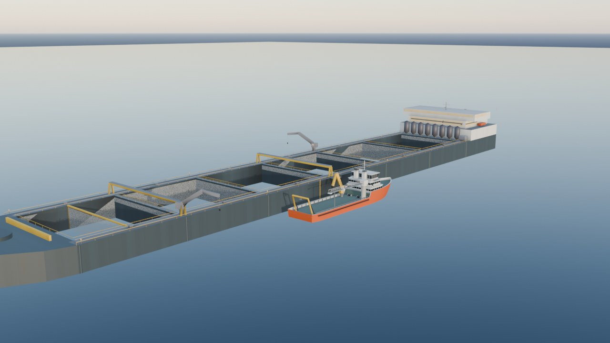

**The Havfarm framing (`f2_29/havfarm_framing.jpg`, 700 m at −16°)** and
**stern three-quarter (`f2_29/havfarm_three_quarter.jpg`)**:

| | |
|---|---|
| 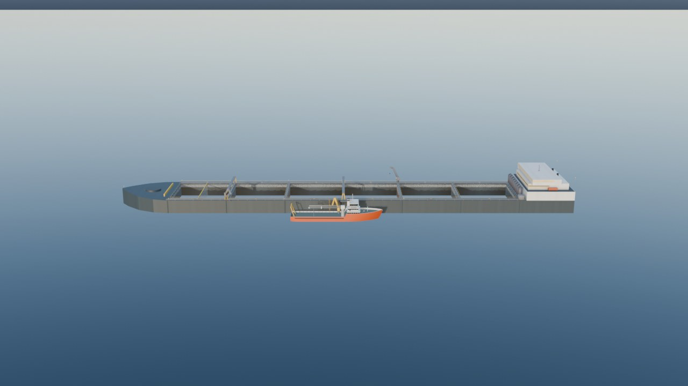 | 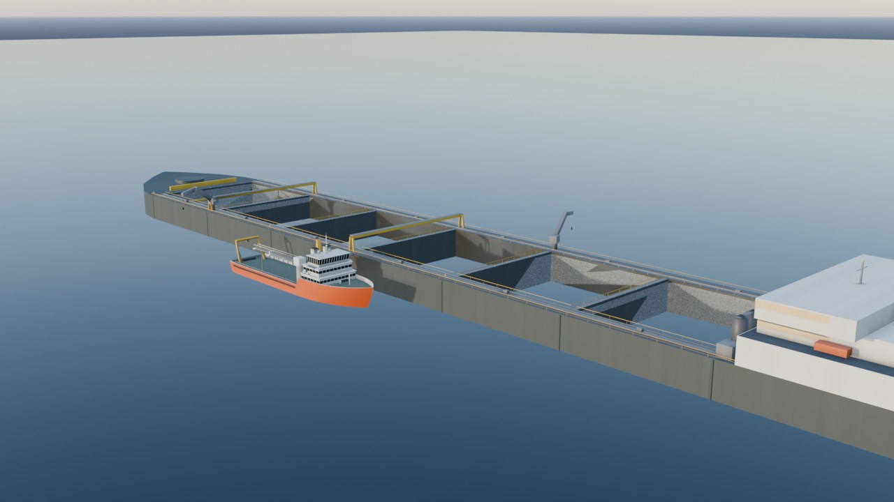 |

**Close-ups** — aft superstructure (`40 × 59.5 × 18 m`) with the row of 8 silos
(`f2_29/havfarm_superstructure.jpg`), the six `47 × 47 m` wells with the yellow
travelling service gantries and crowding bulkhead (`f2_29/havfarm_wells.jpg`),
the raked bow with the `Ø14 m` turret (`f2_29/havfarm_bow_turret.jpg`), and the
top-down plan view (`f2_29/havfarm_top_down.jpg`):

| | |
|---|---|
| 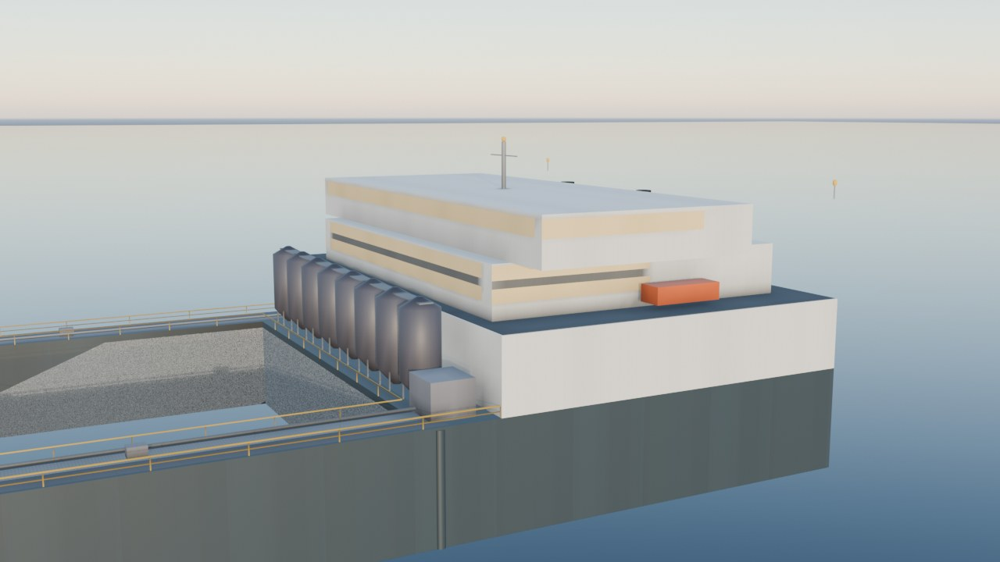 | 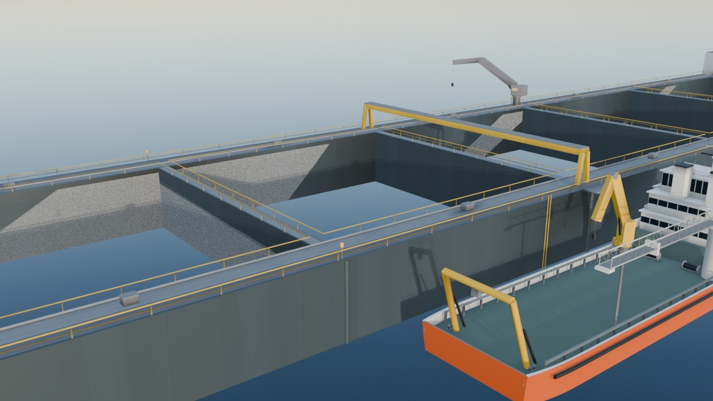 |
| 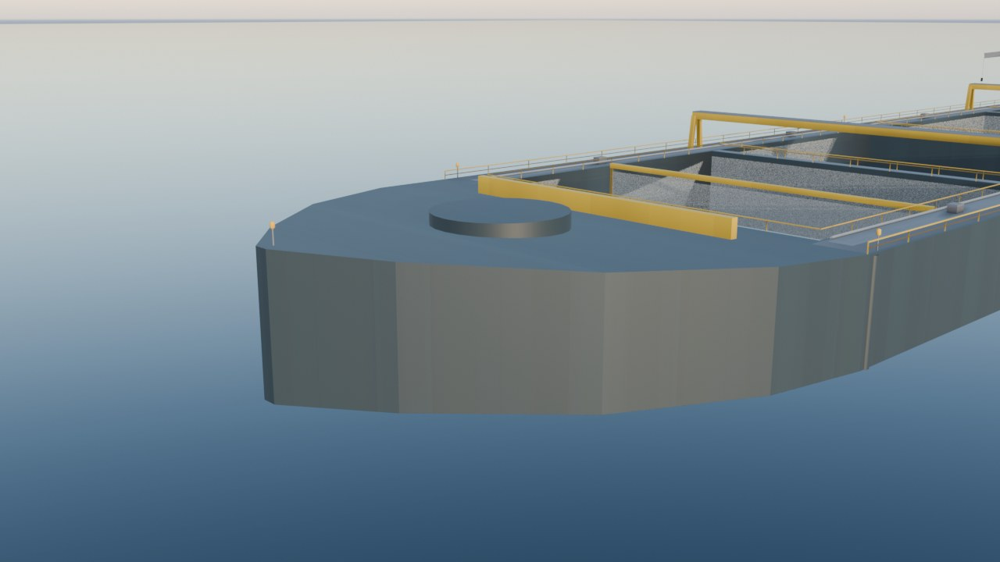 | 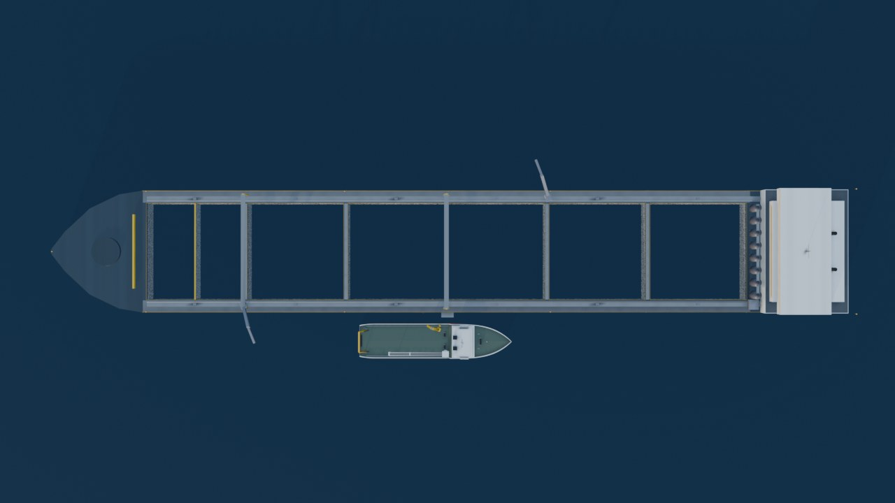 |

**Submerged hull & nets in the yard view (`f2_29/havfarm_yard.jpg`)**, **LOD1
(3,692 tris, `f2_29/havfarm_lod1.jpg`)** and **LOD2 (1,350 tris, `f2_29/havfarm_lod2.jpg`)**:

| | |
|---|---|
| 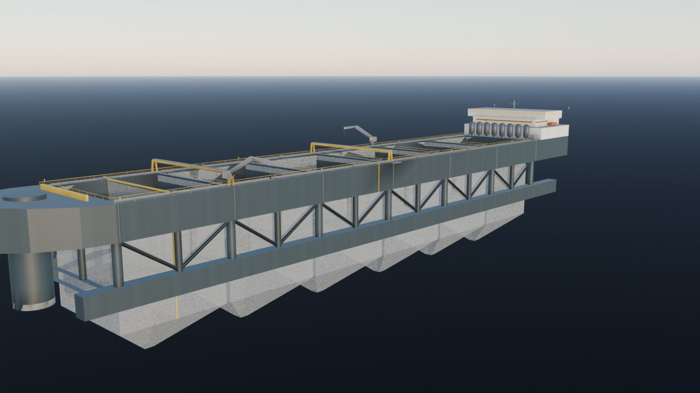 | 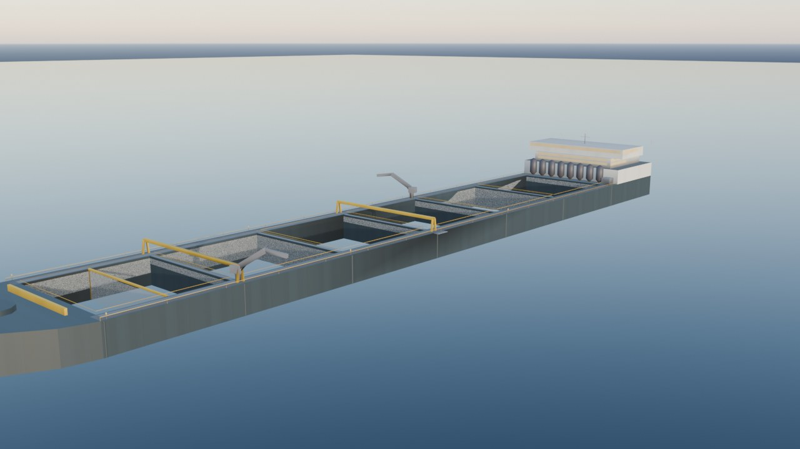 |
| 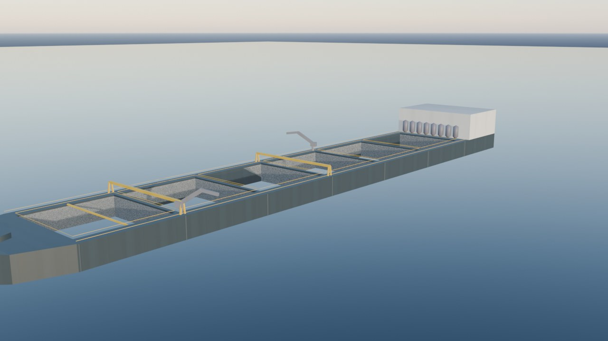 | |

**Mooring-line kit & 11-line bow-turret spread (`f2_29/mooring_spread.jpg`)** and
**drag-embedment anchor close-up (`f2_29/mooring_anchor_close.jpg`)**:

| | |
|---|---|
| 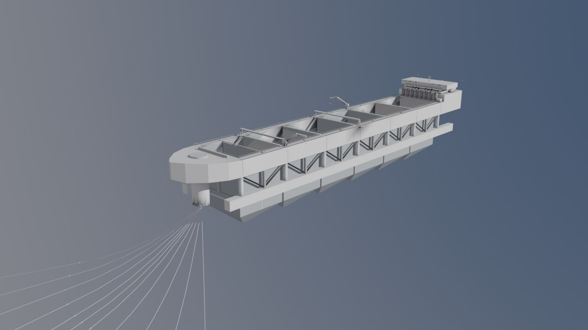 | 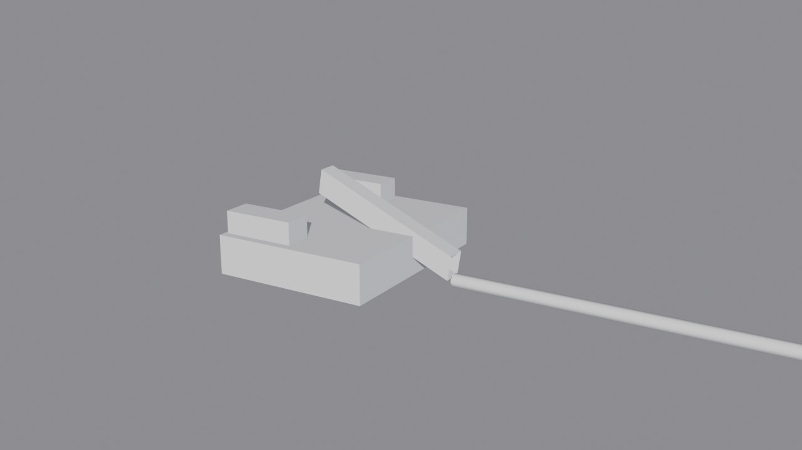 |

---

## Acceptance summary

| # | Criterion | Evidence |
|---|---|---|
| 1 | Hull 385 × 59.5 m ± 5%, with 6 wells of 47 × 47 m, nets to 56 m, bow turret Ø14 m, aft superstructure 40 × 59.5 × 18 m | `havfarm_class_LOD0.json`: `length_m = 385.0`, `beam_m = 59.5`, `moulded_depth_m = 37.75`, `freeboard_m = 11.0`, `wells = 6`, `well_length_m = 47.0`, `well_width_m = 47.0`, `net_depth_m = 56.0`, `turret_d_m = 14.0`, `superstructure_m = [40.0, 59.5, 18.0]` |
| 2 | Triangle budgets met | `havfarm_class`: 18,952 / 3,692 / 1,350 (≤ 60,000 / 12,000 / 1,500); `mooring_line_kit`: 348 / 46 (≤ 400 / 60) |
| 3 | Mooring line counts are 8 (OF1) and 11 (Havfarm) at 1,100 m and 650 m radius | `mooring_line_kit_LOD0.json` `spreads` and `dimensions`; `OffshoreUnitModel.get_mooring_spread()`; `construction_phase_sets["offshore"]["Mooring"]` |
| 4 | Hull-colour check against press photos recorded before sign-off | Sampled table and side-by-side `f2_29/havfarm_slate_vs_press_green.jpg` above; recorded in `docs/RUN_LOG.md` §7 |

---

## Reproduce

```bash
/Applications/Blender.app/Contents/MacOS/Blender -b --factory-startup \
    --python blender/build_offshore.py -- --asset havfarm_class --textures
/Applications/Blender.app/Contents/MacOS/Blender -b --factory-startup \
    --python blender/build_offshore.py -- --asset mooring_line_kit
python3.12 .claude/skills/ecc/blender-asset-pipeline/blender_asset_pipeline.py --verify-only
python3.12 -m pytest tests/test_offshore_assets.py tests/test_construction_kit_assets.py -q
```
