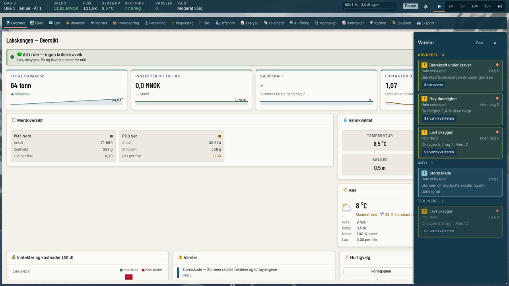
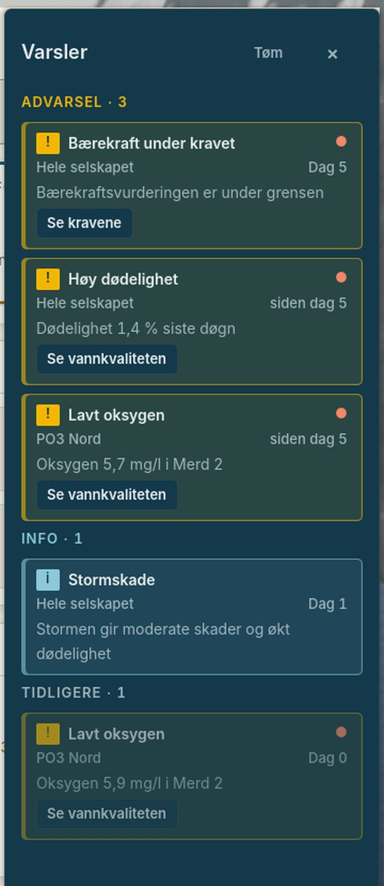
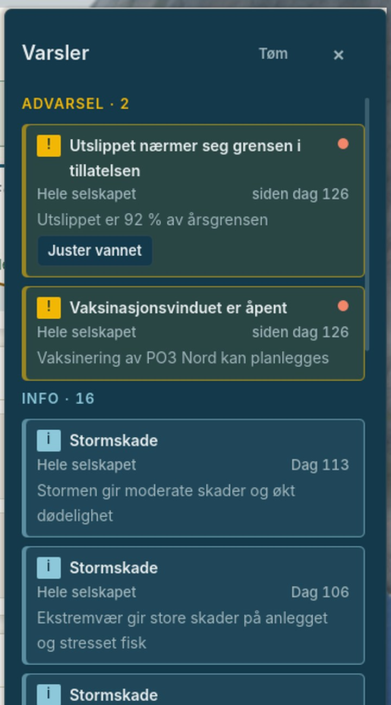

# Evidence: inbox polish

The two follow-ups the cycle-2 playtest left open (RUN_LOG §8, SHIP_PLAN §10): a
live inbox entry showed the day it was *first* reported, and the 30× button's
first click was said to be swallowed while the drawer is open. The first is
fixed. The second is not a game bug: it is the playtest harness, and the numbers
are in §2. Frames are 1920 x 1080 captures of the real game scene (windowed,
the audio driver off, an isolated user dir) as a 1280 px downscale and 2x crops
of the drawer, in `inbox_polish/`.

## 1. «siden dag N»

### The cause

`NotificationCenter` printed `entry.day`, the day the bus *delivered* the event.
The bus delivers a condition once and then keeps that one entry alive: a report
of the same key within `GameEventBus.DedupeWindowDays` (3) of the last one is a
repeat, counted and dropped, and it keeps the key alive. A bloom, a lice count
over the limit or an open vaccination window that the game reports every day is
therefore one entry for as long as it holds, and its day is where the run
*began*: on day 540 the vaccination window read «Dag 274» and nothing said it
was still going on.

### The rule now

| The entry | Reads | Why |
|---|---|---|
| a warning or critical that is live (its key reported within `LIVE_DAYS` = 2 of today) and was reported again after its own day | «siden dag N» (N = the day it began) | the condition goes on: the bus's `LastSeenDays()` is later than the entry's day |
| a warning or critical reported once, still live | «Dag N» | one report says nothing about a run |
| info, and everything under «Tidligere» | «Dag N» | the log; a run that ended keeps the day it began |

`NotificationCenter._day_text` is that table. The bus makes N true: a condition
that clears for more than the dedupe window and returns is a *new* entry
(`delivered`), so one entry never spans a gap.

### Two more things found on the way

- **A revived run.** `_is_live` asked only whether the *key* was alive. After a
  gap the bus delivers a new entry for the returning condition, and the key's
  reports then also made the *older* entry (same key) live: it would have sat
  under «Advarsel» reading «siden dag 274» beside the new one. `_is_live` now
  counts only the newest entry of a key (`_is_newest_of_key`), so the older run
  goes to «Tidligere» with the day it began.
- **A title that broke.** The first version put «siden dag 126» in the header
  beside the title. «Vaksinasjonsvinduet er åpent», the entry the follow-up was
  found on, then broke mid-word after "Vaksinasjonsvindue" (its longest word is
  141 px and the line had 140). It was seen on the frame, not in a check. The
  day now sits on the line under the title, right-aligned beside the subject
  («Hele selskapet», «PO3 Nord»), and the title has the header's whole width (238
  px in the same frame). A hand-made entry with no subject keeps its short «Dag
  N» in the header.

### Frames

The three cases at day 6 (`01_three_cases.jpg`, then the drawer 2x in
`01b_drawer_crop.jpg`): «Bærekraft under kravet» was reported once and reads
«Dag 5»; «Høy dødelighet» and «Lavt oksygen» were reported again and read «siden
dag 5»; the info entry reads «Dag 1»; under «Tidligere» the older oxygen run,
which the game stopped reporting for 5 days before the condition came back (a new
entry, so the older one is history), keeps «Dag 0».

The case the follow-up was found on (`02_long_titles_crop.jpg`): day 129, the
vaccination window and the discharge warning reported every day since day 126
read «siden dag 126» (three digits, long titles; the discharge title wraps at a
space), and the 16 info entries the 120 days left keep their own days.

How: a throwaway SceneTree script (not committed) starts `po3_red_sone` (seed
91), skips the tutorial, instantiates `GameScene`, reports through
`SimBridge.publish_condition_event` and moves days with `advance_days` exactly as
the checks below do, opens the drawer and waits 13 s for the toasts to leave
before it saves the viewport: `godot-mono --audio-driver Dummy --resolution
1600x900 --path godot -s <script> -- <out>`, with the playtest's temporary
`override.cfg` (an isolated user dir).

### Checks

Five new checks in `UiFlowTests._test_inbox_lists_what_happened` (the frozen UI
count 2334 → 2339, `MIN_CHECKS` equal to the measured count):

1. a condition reported again after its first day reads «siden dag 3» (the bus's
   outcome for the repeat is `suppressed`);
2. a warning reported once keeps «Dag 3»;
3. a condition back after a 5-day gap is a new entry (`delivered`) and the older
   run is not live;
4. the older run keeps its own day («Dag 4») under «Tidligere»;
5. «siden dag 126» beside «Vaksinasjonsvinduet er åpent» leaves the title room for
   its longest word (141 of 238 px).

Four scripted mutants of `NotificationCenter.gd`, each run against the inbox test
alone on the final tree (a throwaway runner, 17 checks per run), each caught, the
file restored byte-identical after:

| Mutant | Caught by |
|---|---|
| M1 the label is always the first day («Dag N» even while the condition goes on) | check 1 (it reads «Dag 3»), and check 5 (its text is not «siden dag 126») |
| M2 a one-off reads «siden dag» too (the "reported after its own day" test dropped) | check 2 (it reads «siden dag 3») |
| M3 an older entry of a key is live again (`_is_newest_of_key` dropped) | check 3 (older live true) and check 4 (the older run reads «siden dag 4») |
| M4 the day back beside the title (the first layout) | check 5 (141 of 140 px) |

## 2. The 30× button

### What was claimed

The playtest's `click_missed` on «30×» was read as «the first click is swallowed
while the inbox drawer is open».

### What the numbers say

`inbox_polish/inbox_speed_stress.json` starts Familiegården to «Start sesongen»,
then presses «30×» and «1×» in turn, 32 presses: 16 with the drawer open and 16
with it closed (the V key toggles it). It was run 20 times with real input at
window pixels, `bash tools/playtest.sh <acts> <out> --w=1280 --h=720` (20 runs,
640 presses):

| | presses | `click_missed` |
|---|---|---|
| drawer open | 320 | 7 |
| drawer closed | 320 | 7 |

Four of the 20 runs had any miss (runs 1, 2, 4 and 15); the other 16 had none,
the last 8 in a row among them. The drawer is also nowhere near the buttons: it is
anchored right with `offset_top` 120 and the speed buttons sit in the top bar at
y = 16 px (1280 x 720).

### What a miss is

Temporary logging of every `gui_input` event at the two buttons (reverted:
`HUD.gd` is unchanged), run 15: the three misses each had `InputEventMouseMotion`
events at local positions far outside the window (about (−1035, 1691)) between
the harness's injected press and its release; none of the 29 presses that landed
had one. In Godot a motion that takes the pointer off a pressed button makes the
release emit `button_up` without `pressed` (the same as dragging off a button
before letting go), and the harness counts a press whose `pressed` did not fire as
`click_missed`. A real click has no such events. They come from outside the game
and outside the harness's own input; the likeliest source is the real pointer of
the Mac the run shares with the person using it (not proven). The one miss in the
full first-season playtest was a tab press, not a speed button.

### Decision

No game change: the drawer is not at fault and a real player's click is not
affected. The harness is what to change, and it is not this item's to touch
(`PlaytestHarness.gd` is on the never-touch list): annotate a `click_missed` with
the stray motion seen between press and release (and, if wanted, retry the press
once), without moving the real pointer. Recorded in SHIP_PLAN §10 as an open row.

## Gates

All on the final tree (`ui/inbox-polish`; `origin/main` `89bfc92` had not moved):

| Gate | Result |
|---|---|
| `bash tools/run_ui_flow_tests.sh` | `UI_FLOW_RESULT checks=2339 failures=0` (2334 + the 5 above; `MIN_CHECKS` 2339) |
| `python3 -m pytest tests/ -q` | 1026 passed, 1 skipped |
| `bash tools/validate_scenes.sh` | SCENE VALIDATION: PASSED |
| headless GDScript parse scan (`godot --headless --editor --quit-after 3`) | clean: 0 parse or script errors |

No `src/` change, so dotnet and the golden traces were not run (SHIP_PLAN §3 item
3). The new key `UI_EVENT_SINCE_DAY` (en «since day %d», no «siden dag %d») is in
`godot/translations/translations.csv`; the translation tests accept it. The five
checks pin the follow-ups found in the cycle-2 playtest (SHIP_PLAN §3 item 4).
